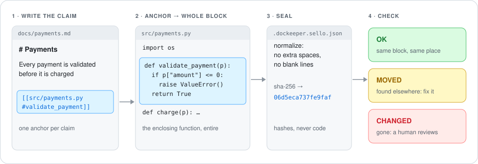
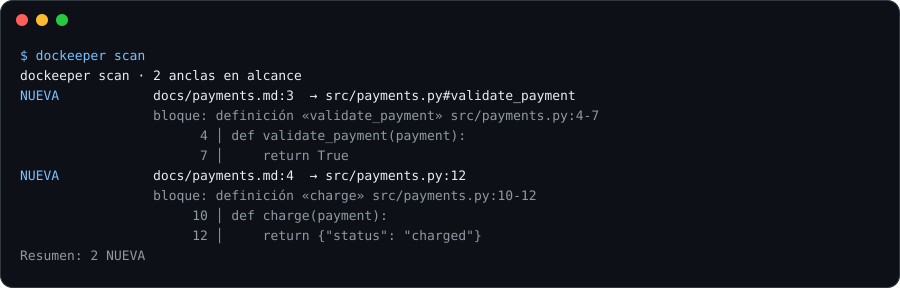
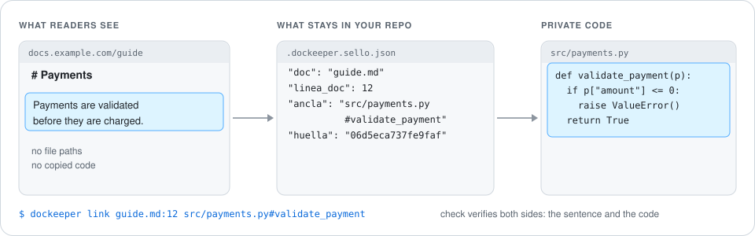

<div align="center">

# DocKeeper

**Documentation that doesn't rot.**

DocKeeper anchors every claim in your docs to the code behind it, and tells you the moment that code
changes. It is an [Agent Skill](https://agentskills.io) for your coding agent plus a zero-dependency
CLI for you and your CI.

[](https://github.com/Nokky21/DocKeeper/actions/workflows/ci.yml)


[](LICENSE)

[Website](https://nokky21.github.io/DocKeeper/) · [Install](#install) · [How it works](#how-it-works) ·
[Commands](#commands) · [CI](#continuous-integration) · [FAQ](#faq)

</div>

---

## Why

Writing documentation is cheap now: an agent can produce a README in seconds. Keeping it **true** is
the expensive part. A few months later the text describes code that no longer exists, and nobody
knows which pages are lying.

Tools that check docs against code exist, but they are priced for companies. DocKeeper is the free,
local and complete version:

- **No account, no server, no network.** Everything runs on your machine or in your CI.
- **No AI in the engine.** The check is content comparison and fingerprints. Your agent writes the
  docs; DocKeeper verifies them deterministically.
- **Zero dependencies.** Python standard library only.
- **Nothing held back.** The full engine is MIT-licensed. There is no "pro" check you are missing.

## How it works

<p align="center"></p>

1. **Anchor every claim.** Next to "every payment is validated before it is charged" you write an
   anchor to the code that proves it: `[[src/payments.py#validate_payment]]`. Anchors inside code
   blocks or inline code are ignored, so docs can teach the syntax safely.
   <!-- dockeeper: dockeeper/markdown.py#analizar -->
2. **The anchor becomes a block.** If the anchored line sits inside a function, class or method,
   the block is that whole definition (the innermost one). Otherwise it is a small window around the
   line, trimmed to lines with content. <!-- dockeeper: dockeeper/bloques.py#bloque_en -->
3. **Seal it.** The block is normalized (extra spaces and blank lines removed) and hashed.
   Reformatting doesn't break anything; changing logic does. The seal file stores positions and
   hashes, never code. <!-- dockeeper: dockeeper/huellas.py#normalizar_linea dockeeper/huellas.py#huella dockeeper/sello.py#Entrada -->
4. **Check it.** The block is recomputed where it was. Same fingerprint, same place: `OK`. Same
   fingerprint somewhere else in the file: `MOVED`, and `fix` relocates it for you. Fingerprint gone:
   `CHANGED`, and a person has to look. <!-- dockeeper: dockeeper/motor.py#verificar_codigo -->

<p align="center"></p>

<sub>Real output after editing the code from the diagram. CLI messages are in Spanish for now; the
verdict codes and the `--json` output are stable and documented [below](#verdicts-and-exit-codes).</sub>

## Install

The repository root **is** the skill folder. Clone it into a folder named exactly `dockeeper`: the
Agent Skills standard requires the folder name to match the skill name. You need `python3` and
`git`; nothing else.

| You work with | Install (macOS / Linux) |
|---|---|
| **Claude Code** (terminal, desktop app, VS Code / JetBrains) | `git clone https://github.com/Nokky21/DocKeeper.git ~/.claude/skills/dockeeper` |
| **Codex**, **Gemini CLI**, **Cursor**, **GitHub Copilot / VS Code** | `git clone https://github.com/Nokky21/DocKeeper.git ~/.agents/skills/dockeeper` |
| Any of the above, **one project only** | clone into `.claude/skills/dockeeper` or `.agents/skills/dockeeper` inside that repository |
| **No agent** (by hand or in CI) | clone anywhere and run `python3 <folder>/bin/dockeeper` |

Where each tool looks for skills, from its own docs:
[Claude Code](https://code.claude.com/docs/en/skills) (`~/.claude/skills`, `.claude/skills`) ·
[Codex](https://developers.openai.com/codex/skills/) (`~/.agents/skills`, `.agents/skills`) ·
[Gemini CLI](https://geminicli.com/docs/cli/skills/) (`~/.gemini/skills` or `~/.agents/skills`) ·
[Cursor](https://cursor.com/docs/context/skills) (`~/.cursor/skills`, `~/.agents/skills`, also `~/.claude/skills`) ·
[GitHub Copilot / VS Code](https://code.visualstudio.com/docs/copilot/customization/agent-skills) (`~/.copilot/skills`, `~/.claude/skills`, `~/.agents/skills`).
Dozens of other agents support the same format: see the [Agent Skills client list](https://agentskills.io).

**Windows (PowerShell).** Same folders under your user profile. Use `python` if `python3` is not on
your `PATH`:

```powershell
git clone https://github.com/Nokky21/DocKeeper.git "$env:USERPROFILE\.claude\skills\dockeeper"
python "$env:USERPROFILE\.claude\skills\dockeeper\bin\dockeeper" --version
```

**Update** with `git -C ~/.claude/skills/dockeeper pull` (or the folder you used).

<details>
<summary><b>claude.ai, the Claude API and the Agent SDK</b></summary>

- **claude.ai (web or desktop chat).** Download `dockeeper-skill.zip` from the
  [latest release](https://github.com/Nokky21/DocKeeper/releases/latest) and upload it in the Skills
  section of your settings (code execution must be enabled). Be aware of the limit: a chat sandbox
  does not have your repository or its git history, and the seal file would not persist. It is fine
  for drafting documentation, not for keeping it verified. Use a coding agent or CI for that.
- **Claude Agent SDK.** It reads the same `~/.claude/skills` and `.claude/skills` folders as
  Claude Code. See the [Agent Skills overview](https://platform.claude.com/docs/en/agents-and-tools/agent-skills/overview).
- **Claude API.** Custom skills are uploaded through the Skills API and run with the code execution
  tool; the same repository and sandbox limits as claude.ai apply. See the
  [skills guide](https://platform.claude.com/docs/en/build-with-claude/skills-guide).

</details>

## Quick start

### With your agent

Open your project with any agent that has the skill installed and ask in plain words:

- *"Document this repository with dockeeper."*
- *"Check whether our docs are still true and fix what isn't."*
- *"Document only `src/payments` with dockeeper."*
- *"Write the decisions page from the git history. Don't invent reasons."*

In Claude Code you can also type `/dockeeper`. The skill makes the agent follow the same loop every
time: **audit → write → seal → check → fix**. When it seals, it reads the block each anchor landed on
and corrects anchors that point at the wrong code, before telling you it is done:

<p align="center"></p>

### By hand

From the root of the project you are documenting (with the skill cloned to `~/.claude/skills`):

```bash
DK="python3 $HOME/.claude/skills/dockeeper/bin/dockeeper"
$DK audit    # which pages are missing, which docs have no anchors, which code is undocumented
$DK scan     # seal new anchors and show the block each one landed on
$DK check    # still true? exit 0 = yes, 1 = something changed, 2 = usage error
$DK fix      # relocate MOVED anchors (only touches the seal file)
```

Tip: symlink `bin/dockeeper` into a folder on your `PATH` to type just `dockeeper`.

## Anchors

| Form | Syntax | Use it for |
|---|---|---|
| By symbol (**preferred**) | `[[src/pay.ts#validatePayment]]` | functions, classes, methods, constants |
| Symbol inside a container | `[[src/pay.ts#Payments.validate]]` | methods with the same name in different classes |
| By line | `[[src/pay.ts:147]]` | things that are not definitions (config, a single line) |
| Hidden | `<!-- dockeeper: src/pay.ts:147 src/pay.ts#validatePayment -->` | keep the rendered text clean |
| Linked, outside the text | `dockeeper link guide.md:12 src/pay.ts#validatePayment` | published docs whose code is private |

Paths are relative to the repository root. Prefer symbols: a line number written in a document ages
when code moves. The seal file always knows the real position, but readers see the old number, and
`fix` never rewrites your documents. <!-- dockeeper: dockeeper/motor.py#arreglar -->

Definitions are recognized for Python, JavaScript/TypeScript, Go, Rust, Java, Kotlin, Scala, C#,
C/C++, Swift, PHP, Dart, Ruby, Elixir, Lua, Julia and shell. Any other text file still works with
line anchors (window blocks).

## Commands

| Command | What it does | Writes |
|---|---|---|
| `audit` | Inventory: missing base pages, docs without anchors, coverage per folder, biggest undocumented definitions | nothing |
| `scan` | Seals new anchors and shows the block each one landed on; prunes anchors removed from docs. `--resellar` re-seals everything after a review | seal file |
| `check` | Verifies anchors, links and published-doc rules | nothing |
| `fix` | Relocates `MOVED`, removes orphans. `--aceptar` accepts reviewed `CHANGED` blocks as the new truth | seal file |
| `link DOC:LINE ANCHOR` | Binds a line of a document to code without touching the document. `--quitar` removes it | seal file |
| `why` | Decisions from git history (`Decision:`, `Motivo:`/`Why:`, `Alternativas:`, `ADR`) and decision entries with no written reason | nothing |

Every command accepts `--json` (stable, machine-readable) and `--raiz PATH` (repository root;
defaults to the nearest folder with `.dockeeper.json` or `.git`). `audit`, `scan`, `check`, `fix` and
`why` accept `--solo` and `--sin` ([partial scope](#partial-scope)).

## Verdicts and exit codes

| Code | Meaning | Exit | What to do |
|---|---|---|---|
| `OK` | Same block, same place | 0 | nothing |
| `MOVED` | Same block, somewhere else | 0 | `fix` relocates it |
| `CHANGED` | The block's content changed, or its symbol is gone | **1** | read the code, correct the text, then `fix --aceptar` |
| `DESAPARECIDO` | The anchored file no longer exists | **1** | rewrite or remove the claim, then `scan` |
| `SIN_SELLAR` | Anchor written but never sealed | **1** | `scan` |
| `HUERFANA` | Sealed anchor no longer in the document | 0 | `fix` (or `scan`) removes it |
| `ANCLA_MAL_ESCRITA` | Malformed anchor or a path outside the repository | **1** | fix the anchor |
| `ANCLA_INTERNA` | Anchor inside a `publico` document | **1** | use `link` instead |
| `RUTA_INTERNA` | A `publico` document mentions an internal path | **1** | remove the path |
| `CODIGO_COPIADO` | A published document copies code from the repository | **1** | describe it or write your own example |
| `VINCULO_SUELTO` | The sentence a link pointed to was rewritten | **1** | review it, then `link` again or `link --quitar` |
| `NADA_COMPROBADO` | Nothing to check in this scope | **1** | there is no "empty green" |

`scan` can also report `NO_EXISTE`, `SIN_SIMBOLO`, `FUERA_DE_RANGO` or `SIN_CONTENIDO` while sealing
(file, symbol or line not found), exit code 1. Exit code **2** always means a usage or
configuration error. <!-- dockeeper: dockeeper/motor.py#FALLOS dockeeper/motor.py#comprobar dockeeper/cli.py#main -->

## Published documentation

Documentation that leaves the repository is the hard case: it can't carry internal paths or copied
code, and it still has to be checkable. Declare it in `.dockeeper.json`:

```json
{
  "publico": ["docs/public/"],
  "publicado": ["README.md"]
}
```

- **`publico`**: published, and the code is **private**. No anchors, no internal paths, no copied
  code. Bind each claim with `dockeeper link`. The link is stored in the seal file, so readers never
  see a path, while `check` verifies both the code and that the sentence is still there.
- **`publicado`**: published, and the code is **public** (like this README). Anchors are allowed
  (hidden ones are best); copying code is not.

<p align="center"></p>

Copied code means a code block in the document with `bloque_minimo` (default 3) or more consecutive
lines identical, spacing aside, to a file in the repository. The report names the source file.
<!-- dockeeper: dockeeper/publicado.py#IndiceCopias dockeeper/publicado.py#rutas_en_texto -->

## Partial scope

- `--solo PATH` (repeatable). If the path points only at documents, it narrows the **documents**; if
  it points at code, it narrows the **code**. `--solo src/payments` checks that part against every
  document that talks about it; `--solo docs/api.md` checks that document without losing the code it
  points to.
- `--sin PATTERN` (repeatable, globs or folder prefixes) excludes documents and code. The `sin` key
  in `.dockeeper.json` excludes permanently.
- No `--solo` means no restriction; no `--sin` means nothing excluded. A `--solo` that matches
  nothing is an error. <!-- dockeeper: dockeeper/alcance.py#Alcance -->

## The "why"

`why` reads the git history looking for decision markers and checks your decision documents for
entries with no written reason. What is not in the history is never invented: the agent writes
"not documented". Mark decisions in commit messages like this:

```text
feat(seal): keep the seal outside the documents

Decision: the seal lives in its own file
Why: published pages must not show internal paths
Alternatives: HTML comments (they still leak in the page source)
```

<!-- dockeeper: dockeeper/porque.py#historial dockeeper/porque.py#entradas_sin_motivo -->

## Continuous integration

**GitHub Actions.** The repository is also an action:

```yaml
name: docs
on: [push, pull_request]
jobs:
  dockeeper:
    runs-on: ubuntu-latest
    steps:
      - uses: actions/checkout@v6
      - uses: Nokky21/DocKeeper@v0.1.0
        # with:
        #   args: --sin vendor/
```

**Any other CI.** Only Python and git are needed:

```bash
git clone --depth 1 https://github.com/Nokky21/DocKeeper.git /tmp/dockeeper
python3 /tmp/dockeeper/bin/dockeeper check
```

**Git hook.** To catch it before pushing, save this as `.git/hooks/pre-push` and make it executable:

```sh
#!/bin/sh
exec python3 "$HOME/.claude/skills/dockeeper/bin/dockeeper" check
```

## Configuration

`.dockeeper.json` at the repository root. Every key is optional; unknown keys are an error, so a
typo can't silently disable a rule. <!-- dockeeper: dockeeper/config.py#cargar -->

| Key | Default | Meaning |
|---|---|---|
| `documentos` | `["*.md", "*.markdown", "*.mdx"]` | which files are documents (everything else is code) |
| `sin` | `[]` | always excluded |
| `publico` | `[]` | published docs whose code is private |
| `publicado` | `[]` | published docs whose code is public |
| `decisiones` | `["*decision*", "*adr*"]` | decision documents for `why` (case-insensitive) |
| `bloque_minimo` | `3` | consecutive lines that count as copied code |
| `ventana` | `3` | window radius when a line is not inside any definition |

## Limits

DocKeeper is honest about what it can't do:

- It compares content, not meaning: a block rewritten with the same behavior is `CHANGED`.
- It does not detect non-contiguous copies, and lets one- or two-line copies through on purpose.
- Definitions are found with patterns, not a parser. Rare constructs (C++ out-of-class methods,
  multi-line decorators) fall back to the enclosing definition or a window; `scan` shows every block
  so you can confirm it.
- It checks that documentation is still **true**, not that it is **useful**.

## FAQ

**Does my code leave my machine?** No. DocKeeper makes no network calls, and the seal file stores
hashes and positions, never code.

**Does it need an AI model?** No. The agent writes the documentation; DocKeeper's verification is
deterministic and runs without any model.

**I renamed a function. What happens?** Its symbol anchors report `CHANGED` ("symbol not found").
Update the anchor in the document, then run `scan`.

**What should I commit?** The documents, `.dockeeper.json` and `.dockeeper.sello.json`. The seal is
what CI checks against.

**Is the CLI in English?** Messages are in Spanish today. Verdict codes and `--json` keys are stable,
so scripts and agents are not affected.

## Development

```bash
python3 -m unittest
```

The suite covers every acceptance criterion in [SPEC.md](SPEC.md) (Spanish) and includes a
self-check: this README is sealed, and CI fails if it stops being true. CI runs the tests on Linux,
macOS and Windows with Python 3.10 to 3.14.

```text
bin/dockeeper        CLI launcher (no install needed)
dockeeper/           engine: anchors, blocks, fingerprints, seal, scope, published docs, why, audit
templates/           page templates the skill writes from
SKILL.md             instructions for agents
action.yml           GitHub Action
docs/                website (GitHub Pages)
```

## License

[MIT](LICENSE).
