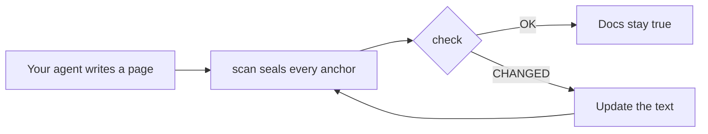

<div align="center">

# DocKeeper

**Documentation that doesn't rot.**

Your coding agent writes the docs, diagrams included. DocKeeper ties every claim and every diagram to
the code behind it and tells you the moment that code changes.

[](https://github.com/Nokky21/DocKeeper/actions/workflows/ci.yml)


[](LICENSE)

[Website](https://nokky21.github.io/DocKeeper/) · [Live demo](https://nokky21.github.io/DocKeeper/#demo) · [Install](#install) · [Reference](docs/reference.md)

<details>
<summary>🌐 English</summary>

<sub>**English** · [Español](docs/i18n/README.es.md) · [Português](docs/i18n/README.pt-BR.md) · [Français](docs/i18n/README.fr.md) · [Deutsch](docs/i18n/README.de.md) · [Italiano](docs/i18n/README.it.md) · [Nederlands](docs/i18n/README.nl.md) · [Polski](docs/i18n/README.pl.md) · [Čeština](docs/i18n/README.cs.md) · [Svenska](docs/i18n/README.sv.md) · [Русский](docs/i18n/README.ru.md) · [Українська](docs/i18n/README.uk.md) · [Türkçe](docs/i18n/README.tr.md) · [العربية](docs/i18n/README.ar.md) · [עברית](docs/i18n/README.he.md) · [हिन्दी](docs/i18n/README.hi.md) · [简体中文](docs/i18n/README.zh-CN.md) · [繁體中文](docs/i18n/README.zh-TW.md) · [日本語](docs/i18n/README.ja.md) · [한국어](docs/i18n/README.ko.md) · [Tiếng Việt](docs/i18n/README.vi.md) · [Bahasa Indonesia](docs/i18n/README.id.md) · [ไทย](docs/i18n/README.th.md)</sub>

</details>

<picture>
  <source media="(prefers-color-scheme: dark)" srcset="site/public/assets/readme-hero-dark.png">
  
</picture>

</div>

---

## Why

A README written today is wrong a few months later, and nobody knows which pages are lying.
DocKeeper fixes the "nobody knows" part, for free and on your machine:

- **Every claim is checked.** "Payments are validated before they are charged" is tied to the
  function that does it. When that function changes, DocKeeper tells you.
- **No AI in the check.** Your agent writes; the check compares fingerprints, so it gives the same
  answer every time.
- **Local and free.** No account, no server, no network, no dependencies. MIT license.

## What it writes

Ask once and your agent documents the whole repository, page by page, from the templates in the
skill:

<table>
<tr><td><b>README</b></td><td>What it is, how it works, how to run it.</td></tr>
<tr><td><b>Architecture</b></td><td>Components, flows, data and boundaries, with diagrams.</td></tr>
<tr><td><b>Decisions</b></td><td>What was decided and why, taken only from the git history.</td></tr>
<tr><td><b>Procedures</b></td><td>Runbooks with exact commands.</td></tr>
<tr><td><b>API</b></td><td>Every operation with its inputs, errors and effects.</td></tr>
<tr><td><b>Onboarding</b></td><td>A reading path for the first day.</td></tr>
</table>

In a monorepo it also writes a README for every package. Every claim points at its code. See
[DocKeeper's own architecture](docs/architecture.md), written by the skill.

## How it works

<p align="center"></p>

1. **Anchor.** Next to each claim, the agent writes where it lives in the code:
   `[[src/payments.py#validate_payment]]`, or the same inside an HTML comment to keep the page clean.
2. **Seal.** `dockeeper scan` fingerprints the code behind each anchor, usually the whole function.
   Reformatting doesn't matter; changing the logic does.
   <!-- dockeeper: dockeeper/bloques.py#bloque_en dockeeper/huellas.py#huella -->
3. **Check.** `dockeeper check` gives each claim a verdict: `OK`; `MOVED` (the code moved, and
   `dockeeper fix` follows it without anyone reviewing); or `CHANGED` (the code changed, so a person
   reads it and updates the text). Any `CHANGED` makes it exit with 1, so CI fails.
   <!-- dockeeper: dockeeper/motor.py#verificar_codigo dockeeper/motor.py#FALLOS -->

<p align="center"></p>

## Install

You need `python3` (3.10 or newer) and `git`. Clone the repository into a folder named exactly
`dockeeper`:

```bash
# Claude Code
git clone https://github.com/Nokky21/DocKeeper.git ~/.claude/skills/dockeeper

# Codex, Gemini CLI, Cursor, GitHub Copilot
git clone https://github.com/Nokky21/DocKeeper.git ~/.agents/skills/dockeeper
```

Other folders, a single project, Windows, claude.ai and the API: see the
[install guide](docs/install.md).

## Use it

Ask your agent in plain words:

- *"Document this repository with dockeeper."* Monorepos too, one package at a time.
- *"Check whether our docs are still true and fix what isn't."*
- *"Review the docs on every commit."* It installs a git hook that never blocks a commit.
- *"Draw the architecture with flow diagrams."*
- *"Write the decisions page from the git history. Don't invent reasons."*

Or run it yourself from the root of your project:

```bash
DK="python3 $HOME/.claude/skills/dockeeper/bin/dockeeper"
$DK audit    # what's missing: pages, packages, undocumented code
$DK scan     # seal new anchors and show the code each one points to
$DK check    # still true? exit 0 = yes, 1 = something changed
$DK fix      # follow code that moved (only touches the seal file)
$DK review   # what the last commit means for the docs
```

<!-- dockeeper: dockeeper/motor.py#arreglar -->

## On every commit

`review` looks at the last commit (or a whole branch, with `--desde main`) and lists the claims it
touched, the new or changed code that no claim covers yet, and the decisions in those commits that
are not written down. As a `post-commit` hook, whoever commits, you or your agent, sees that list
every time, and the docs grow with the code:
<!-- dockeeper: dockeeper/revision.py#revisar -->

```sh
#!/bin/sh
python3 "$HOME/.claude/skills/dockeeper/bin/dockeeper" review || true
```

## Diagrams that stay true

The agent draws flows, sequences, states and data as Mermaid, which GitHub and Obsidian render the
same way. Each diagram carries its anchors inside, on `%% dockeeper:` lines nobody sees, so `check`
flags it when the code it shows changes. This one is live:



## Monorepos

`audit` finds every package (any subfolder with a `package.json`, `go.mod`, `Cargo.toml`,
`pyproject.toml`, `pom.xml` and so on) and shows which ones have no docs. The agent writes the root
pages with a map of the packages, then documents one package at a time, so even a huge repository
fits. <!-- dockeeper: dockeeper/paquetes.py#detectar -->

## In CI

```yaml
- uses: actions/checkout@v6
- uses: Nokky21/DocKeeper@v0.4.0
```

Any other CI only needs Python and git: [clone it and run `check`](docs/reference.md#continuous-integration).

## Learn more

- [Install guide](docs/install.md): every agent, a single project, Windows, claude.ai and the API.
- [Reference](docs/reference.md): anchors, commands, verdicts, partial scope, published docs, the
  "why", configuration, limits and FAQ.
- [Architecture](docs/architecture.md): how DocKeeper works inside, in six anchored diagrams.
- [SKILL.md](SKILL.md), the instructions your agent follows, and the [specification](SPEC.md)
  (both in Spanish).

## License

[MIT](LICENSE).
