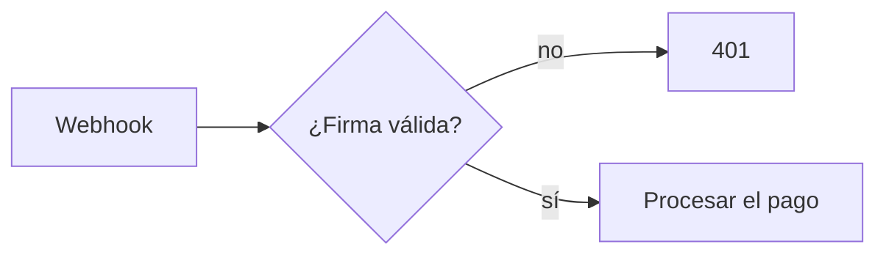

# DocKeeper — documentación que no se pudre

Escribir documentación ya no tiene valor; que **siga siendo verdad**, sí. Este skill escribe
documentación detallada y **ancla cada afirmación a su código**; la CLI `dockeeper` sella esas
anclas y avisa cuando el código del que hablan cambia. Todo es local: sin cuenta, sin red, sin IA en
el motor.

**Cómo se ejecuta la CLI** (sin instalar nada, Python 3.10+ y solo biblioteca estándar), desde la
raíz del repositorio que se documenta:

```bash
python3 <carpeta-de-este-skill>/bin/dockeeper <orden> [--json] [--solo RUTA]... [--sin PATRÓN]...
```

En Claude Code la carpeta del skill es `${CLAUDE_SKILL_DIR}`. En Windows, si no existe `python3`, usa
`python` (o `py`).

Órdenes: `audit`, `scan`, `check`, `fix`, `link`, `why`, `review`. Todas aceptan `--json` (úsalo para leer
resultados) y `--raiz` si no estás en la raíz. Salida: 0 bien · 1 hay problemas · 2 error de uso. Los
mensajes salen en inglés, o en español si el entorno está en español; los códigos de veredicto y la
estructura del `--json` (claves y códigos) son iguales en los dos idiomas: decide por ellos, no por el
texto de `detalle`. <!-- dockeeper: dockeeper/textos.py#espanol -->
<!-- dockeeper: dockeeper/cli.py#main dockeeper/motor.py#FALLOS -->

## La regla

**Cada afirmación verificable lleva su ancla.** No «esta función valida el pago», sino «esta función
valida el pago» + ancla a la definición. Si una frase no se puede anclar (opiniones, planes,
promesas), o se convierte en algo comprobable o se marca como lo que es. Lo que no se sabe no se
inventa: se escribe «No consta».

**Idioma:** escribe la documentación en el idioma del repositorio (o en el que pida la persona). Las
plantillas de `templates/` están en español: traduce sus encabezados y textos guía; no impongas el
español a un proyecto en otro idioma. Para no consta, usa la expresión equivalente («Not documented»).

## Sintaxis de anclas

| Forma | Escritura | Cuándo |
|---|---|---|
| Por símbolo (**preferida**) | `[[ruta/fichero.ext#nombre]]` | funciones, clases, métodos, constantes |
| Símbolo con contenedor | `[[ruta/fichero.ext#Clase.metodo]]` | métodos con nombres repetidos |
| Por línea | `[[ruta/fichero.ext:147]]` | algo que no es una definición (config, una línea suelta) |
| Oculta | `<!-- dockeeper: ruta:147 ruta#nombre -->` | no ensuciar el texto visible (código público) |
| Vínculo | `dockeeper link doc.md:12 ruta#nombre` | documentación publicada con código privado |

- Rutas **relativas a la raíz** del repositorio.
- El bloque de un ancla es la **definición entera** que contiene la línea (la más interior); si no
  hay definición, una ventana de ±3 líneas. Por eso un ancla por línea dentro de una función vigila
  la función completa. <!-- dockeeper: dockeeper/bloques.py#bloque_en -->
- Prefiere símbolos: el número de línea escrito en un documento envejece a la vista cuando el código
  se mueve (el sello sabe la posición real, pero el lector ve la antigua). `fix` no reescribe
  documentos.
- Lo que va dentro de bloques de código o código en línea **no** es un ancla: así se enseña la
  sintaxis sin crear anclas falsas. La única excepción son las líneas `%% dockeeper:` de un diagrama
  Mermaid (ver «Diagramas y gráficos»). <!-- dockeeper: dockeeper/markdown.py#analizar -->

## Flujo de trabajo

1. **Auditar** — `dockeeper audit --json`: páginas base que faltan, documentos sin anclas, carpetas y
   definiciones grandes sin ninguna afirmación. Lee el código de la zona antes de escribir.
   `dockeeper why --json` da las decisiones del historial.
2. **Escribir** — parte de `templates/` (README, ARQUITECTURA, DECISIONES, PROCEDIMIENTOS, API,
   INCORPORACION y PAQUETE para cada paquete de un monorepo). Detallado y concreto; un ancla por afirmación. Nada de copiar bloques de código
   del repositorio en documentos publicados: descríbelo o escribe un ejemplo propio.
3. **Sellar** — `dockeeper scan`. **Lee la previa de cada ancla**: dice en qué bloque ha quedado
   (tipo, nombre, líneas, primera y última línea). Si el bloque no es aquello de lo que habla la
   frase, corrige el ancla y vuelve a ejecutar `scan`. Un ancla mal puesta se sella tal cual; la
   previa es la única red.
4. **Comprobar** — `dockeeper check`. En CI, el código de salida decide.
5. **Arreglar**:
   - `MOVED` → `dockeeper fix` (solo toca el sello). <!-- dockeeper: dockeeper/motor.py#arreglar -->
   - `CHANGED` → lee el código nuevo, **corrige el texto** si ya no es cierto y después
     `dockeeper fix --aceptar` (acota con `--solo` para no aceptar más de lo revisado).
   - `DESAPARECIDO` → el fichero ya no existe: reescribe la afirmación o quítala; luego `scan`.
   - `SIN_SELLAR` → `scan`. `HUERFANA` → `fix` la quita.

## Documentación completa (un repositorio entero o un monorepo)

Cuando la persona pide documentar todo el repositorio, no se escribe de una sentada: se recorre por
partes con un plan, y cada parte se sella y se comprueba antes de pasar a la siguiente.

1. **Inventario** — `audit --json` y `why --json`. `audit` lista las páginas base que faltan, la
   cobertura por carpeta y los **paquetes**: cada subcarpeta con un manifiesto (`package.json`,
   `go.mod`, `Cargo.toml`, `pyproject.toml`, `pom.xml`…), con su nombre, su README si lo tiene y
   cuántas de sus definiciones tienen alguna afirmación. Las dependencias copiadas (`node_modules`,
   `vendor`…) no cuentan. <!-- dockeeper: dockeeper/paquetes.py#detectar dockeeper/auditoria.py#auditar -->
2. **Plan** — escríbelo a la persona antes de empezar: qué páginas de la raíz y qué paquetes, en qué
   orden (primero los paquetes de los que dependen los demás y los más grandes).
3. **Raíz** — README con el mapa de paquetes (sección «Paquetes» de la plantilla), ARQUITECTURA con
   los paquetes como componentes y sus dependencias (léelas de los manifiestos, no las supongas),
   DECISIONES desde `why`, PROCEDIMIENTOS con los scripts de la raíz e INCORPORACION.
4. **Cada paquete, uno cada vez** — `audit --solo <carpeta>` → README del paquete en su carpeta
   (`templates/PAQUETE.md`; API.md si expone una API) → `scan --solo <carpeta>` (revisa cada
   previa) → `check --solo <carpeta>`. Lee solo el código de ese paquete: así el trabajo cabe en
   contexto aunque el monorepo sea enorme.
5. **Cierre** — `check` sin alcance (en verde) y `audit`: ninguna página base falta, ningún paquete
   sale «sin documentar» y las mayores definiciones sin ancla son las que se dejaron a propósito.

En un repositorio sin paquetes, las partes son las carpetas de primer nivel de la cobertura.

## En cada commit

La documentación se mantiene viva commit a commit, no en una gran revisión al final.

1. **Después de cada commit** que hagas (y antes de dar por buena una rama o un PR):
   `dockeeper review --json`. Por defecto mira el último commit y lo que haya sin commitear; con
   `--desde main` (o la rama principal) mira toda la rama desde donde se bifurcó. Solo cuentan los
   ficheros que git ya conoce. <!-- dockeeper: dockeeper/revision.py#revisar dockeeper/revision.py#_base -->
2. Actúa sobre cada lista:
   - `afirmaciones` → como en el paso 5 del flujo (`MOVED` → `fix`; `CHANGED` → corrige el texto y
     `fix --aceptar`; `DESAPARECIDO`/`SIN_SELLAR` → reescribe y `scan`).
   - `sin_documentar` → definiciones nuevas o cambiadas sin ninguna afirmación. Decide cuáles
     merecen documentación: comportamiento visible, API, configuración, errores, flujos, decisiones.
     Lo trivial o interno se deja. Añade la afirmación con su ancla en la página que ya habla de ese
     fichero (`documentos`) o en la que corresponda, y sella con `scan`. No rellenes por rellenar.
   - `decisiones` → entrada en el documento de decisiones; motivo solo si consta.
3. Commitea la documentación aparte (`docs: …`) y vuelve a ejecutar `check`.

**Revisión automática** (solo si la persona la pide): instala un hook `post-commit` de git en la
carpeta que diga `git rev-parse --git-path hooks`. Si ya existe uno, añade la línea; no lo
sobrescribas. Con la ruta absoluta de este skill:

```sh
#!/bin/sh
# DocKeeper: qué documentación toca este commit y qué queda sin documentar. Nunca bloquea.
python3 "/ruta/absoluta/al/skill/bin/dockeeper" review || true
```

Hazlo ejecutable (`chmod +x`). Su salida aparece al hacer cada commit, también en la terminal de
un agente: cuando la veas, sigue el paso 2. Para quitarla, borra esa línea o el fichero. La CLI no
instala nada por su cuenta: solo escribe el sello.

## Diagramas y gráficos (estilo Obsidian, también en GitHub)

Cuando hay un flujo, una conversación entre piezas, estados o datos relacionados, dibújalo. Se
escribe en Mermaid dentro del Markdown: Obsidian y GitHub lo pintan igual, y se comprueba como el
texto.

| Qué enseñas | Mermaid |
|---|---|
| Un proceso de principio a fin, con su camino de error | `flowchart` |
| Quién llama a quién y en qué orden (petición, webhook, cola) | `sequenceDiagram` |
| El ciclo de vida de una entidad (pedido, pago, tarjeta) | `stateDiagram-v2` |
| Datos y sus relaciones | `erDiagram` o `classDiagram` |
| Los paquetes de un monorepo y de quién depende cada uno (de los manifiestos) | `flowchart` |
| Un reparto medido (por ejemplo la cobertura de `audit --json`) | `pie` |
| Las decisiones en el tiempo (de `why --json`) | `timeline` |

- **Cada nodo existe en el código** y se llama como allí. Nada de cajas inventadas.
- **Ancla el diagrama dentro del bloque** con líneas `%% dockeeper: ruta#símbolo …` junto a los
  nodos de los que hablan. `%%` es un comentario de Mermaid: no se ve. Si el código cambia, `check`
  marca esa línea (`CHANGED`) y rehaces el diagrama. Es la única ancla que vale dentro de un bloque
  de código. <!-- dockeeper: dockeeper/markdown.py#analizar dockeeper/markdown.py#_fichas -->
- **Las cifras de un gráfico salen de una orden** (`audit --json`, `why --json`), con su fecha;
  nunca estimadas.
- Un diagrama por idea, de 5 a 15 nodos; si crece, divídelo.
- Avisos con callouts: `> [!NOTE]`, `> [!TIP]`, `> [!IMPORTANT]`, `> [!WARNING]`, `> [!CAUTION]`.
- Enlaza las páginas entre sí con enlaces Markdown (`[Arquitectura](ARQUITECTURA.md)`): Obsidian los
  dibuja en su grafo y GitHub los sigue. No uses `[[wikilinks]]`, que se confunden con las anclas.
- `audit` cuenta los diagramas sin anclas de cada documento.
  <!-- dockeeper: dockeeper/auditoria.py#auditar -->

````markdown

````

## Qué escribe cada página

- **README** — qué es, para quién, cómo funciona en una vuelta (un ancla por paso), cómo arrancar,
  configuración (ancla al código que lee cada variable), estado y límites.
- **ARQUITECTURA** — componentes con responsabilidad, entradas/salidas, dependencias e invariantes;
  flujos principales paso a paso incluidos los fallos; datos; fronteras de seguridad. Todo anclado.
  Con diagramas: un `flowchart` de componentes, uno por flujo principal y `sequenceDiagram` o
  `stateDiagram-v2` donde aclaren.
- **DECISIONES** — una entrada por decisión: fecha, decisión, **motivo**, alternativas descartadas,
  consecuencias, fuente (commit/ADR/persona) y ancla al código. Motivo y alternativas **solo si
  constan** (historial, ADR o una persona); si no, «**Motivo:** No consta». `why` señala las
  entradas sin motivo escrito y qué decisiones del historial aún no están documentadas.
- **PROCEDIMIENTOS** — pasos ejecutables con comando exacto, ancla al script y comprobación de cada
  paso; qué hacer si falla y cómo volver atrás. Sin secretos reales.
- **API** — por operación: permisos, entrada (ancla a la validación), salida, errores, efectos e
  idempotencia; ejemplos escritos a mano.
- **PAQUETE** — el README de cada paquete, en su carpeta: punto de entrada, qué ofrece, de qué
  depende y quién lo usa, configuración, cómo se prueba. Lo común va en la raíz y aquí se enlaza.
- **INCORPORACION** — ruta de lectura anclada para el primer día, ideas clave, cómo se trabaja,
  trampas conocidas y a quién preguntar.

## Documentación publicada

Declárala en `.dockeeper.json` (en la raíz del repositorio documentado):

| Clase | Clave | Regla que comprueba `check` |
|---|---|---|
| Se publica y su código **no** es público | `publico` | sin anclas (`ANCLA_INTERNA`), sin rutas internas (`RUTA_INTERNA`), sin código copiado (`CODIGO_COPIADO`) |
| Se publica y su código **sí** es público | `publicado` | puede anclar a su código (mejor oculto), pero sin código copiado |

- Para documentos `publico`, vincula cada afirmación **fuera del texto**:
  `dockeeper link docs/guia.md:12 src/pagos.ts#validarPago`. El lector no ve ninguna ruta; `check`
  comprueba el código y también que la frase siga ahí (si se mueve: `MOVED`; si se reescribe:
  `VINCULO_SUELTO` → revisar y volver a vincular, o `link --quitar`).
- Código copiado = 3 o más líneas seguidas idénticas (espacios aparte) a un fichero del repositorio;
  el aviso dice de qué fichero sale. Umbral: `bloque_minimo`.
  <!-- dockeeper: dockeeper/publicado.py#IndiceCopias dockeeper/motor.py#_verificar_vinculo -->

Otras claves: `documentos` (qué ficheros son documentos, por defecto Markdown), `sin` (lo que se
descarta siempre), `decisiones` (qué documentos son de decisiones), `ventana` (radio de la ventana).

## Alcance parcial

- `--solo RUTA` (repetible). Si la ruta señala **solo documentos**, recorta los documentos; si
  señala **código**, recorta el código. `--solo src/pagos` comprueba esa parte con todos los
  documentos que hablan de ella; `--solo docs/api.md` comprueba ese documento sin perder el código
  al que apunta. Varias rutas se combinan.
- `--sin PATRÓN` (repetible) descarta documentos y código (`*`, `?` o prefijos de carpeta).
- Un `--solo` que no casa con nada es un error; un `check` sin nada que comprobar **falla**
  (`NADA_COMPROBADO`): no existe el verde vacío. <!-- dockeeper: dockeeper/alcance.py#Alcance dockeeper/motor.py#comprobar -->
- Úsalo para documentar una zona cada vez: `audit --solo zona` → escribir → `scan --solo zona` →
  `check --solo zona`.

## Limitaciones (dilas si vienen al caso)

- Compara contenido, no significados: un bloque reescrito con el mismo sentido sale `CHANGED`.
- Una copia **no contigua** (líneas reordenadas o recortadas) no se detecta; copias de una o dos
  líneas se dejan pasar a propósito.
- Las definiciones se reconocen por patrones (Python, JS/TS, Go, Rust, Java, Kotlin, C#, C/C++,
  Swift, PHP, Ruby, Elixir, Lua, shell…), no con un analizador: alguna construcción rara no se
  detecta y se usa la definición que la contiene o una ventana. La previa de `scan` lo enseña.
- No juzga si la documentación es útil, solo si sigue siendo cierta.
