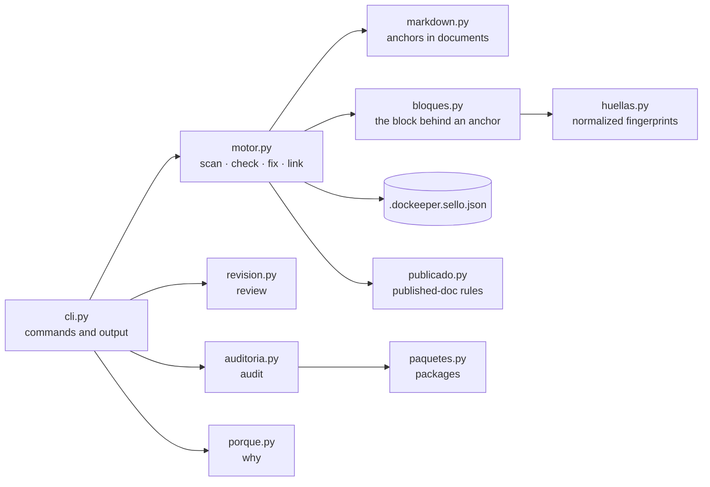
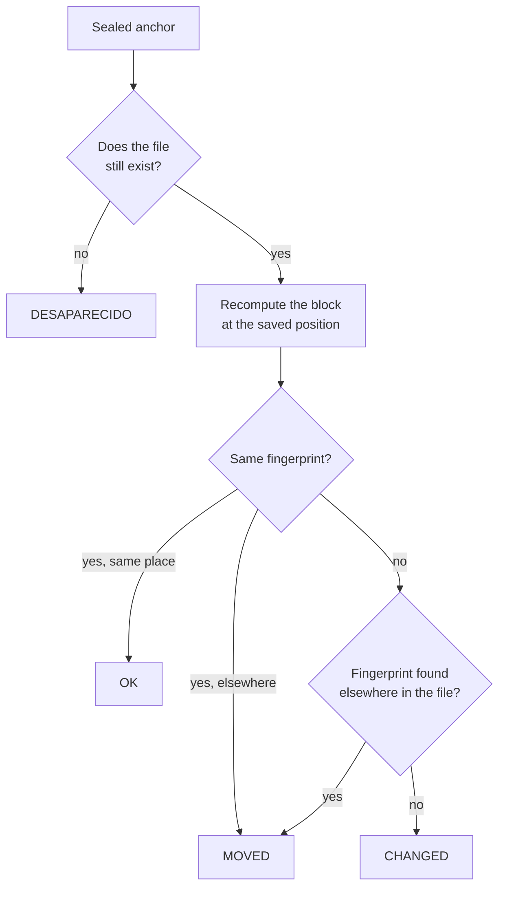
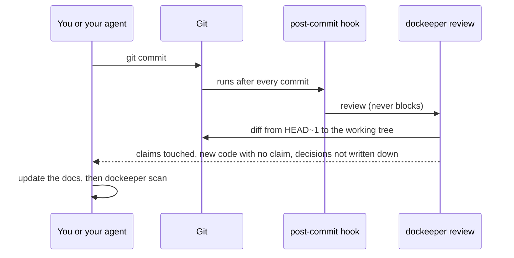
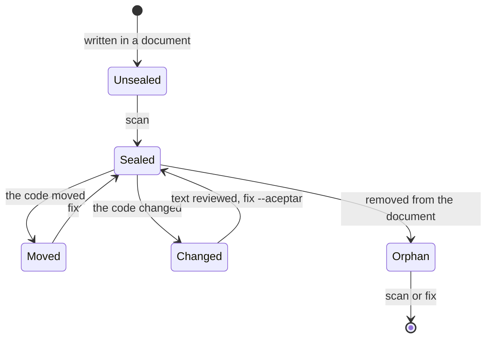
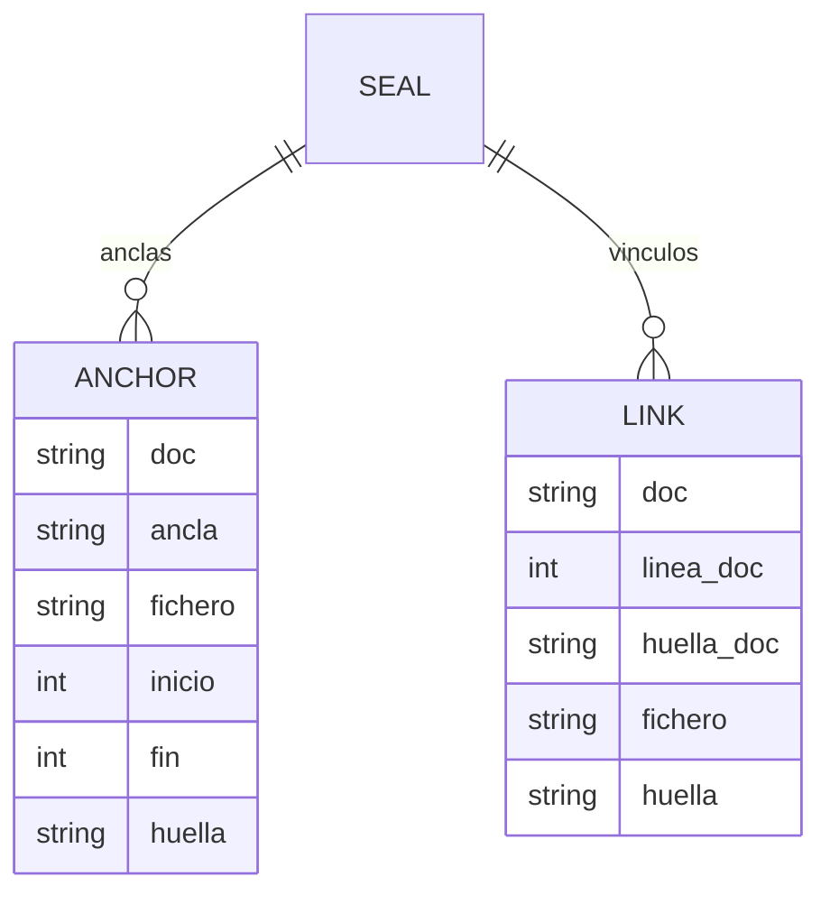
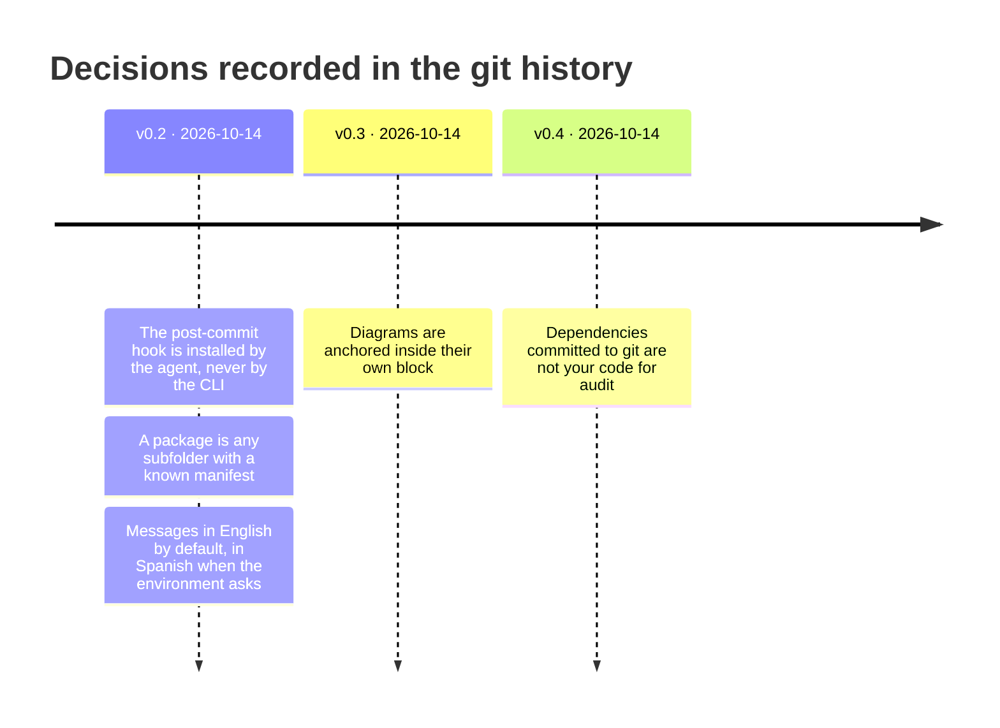

# DocKeeper architecture

[← README](../README.md) · [Reference](reference.md) · [Install](install.md)

> [!NOTE]
> This page was written with the DocKeeper skill, the same way it documents your repository. Every
> claim and every diagram is anchored to the code it describes, and CI fails the moment one of them
> stops being true. The diagrams are Mermaid, so they render the same on GitHub and in Obsidian.

DocKeeper has two halves. The **skill** (`SKILL.md` and `templates/`) tells your agent how to write
documentation and diagrams that point at the code. The **CLI** (`dockeeper/`, Python standard library
only) seals what those pointers cover and later says whether it is still true. Nothing here calls a
model or the network.

## Components

- **The CLI** parses the command and prints the result, as text or as `--json`.
- **The engine** (`motor.py`) seals anchors, checks them and relocates the ones that moved. It is the
  only part that writes, and it only writes the seal file.
  <!-- dockeeper: dockeeper/motor.py#escanear dockeeper/motor.py#arreglar dockeeper/sello.py#Sello -->
- **Blocks and fingerprints.** An anchor stands for a whole definition, found with per-language
  patterns rather than a parser, and its lines are normalized before hashing so reformatting doesn't
  count as a change. <!-- dockeeper: dockeeper/bloques.py#bloque_en dockeeper/huellas.py#normalizar_linea -->

## How a claim is checked

`MOVED` never needs a person: `fix` updates the seal. `CHANGED` always does, because only a person can
say whether the sentence is still true. Any `CHANGED` makes `check` exit with 1.
<!-- dockeeper: dockeeper/motor.py#FALLOS -->

## The commit loop

A new class is reported as the class, not as each of its methods, and a definition already covered
by any claim is not reported again. <!-- dockeeper: dockeeper/revision.py#_tocadas dockeeper/revision.py#_tramos -->

## Life of an anchor

## The seal file

It stores positions and fingerprints, never code, as sorted JSON so its diffs are readable. A link
also keeps the fingerprint of the sentence it belongs to, which is how published pages are checked
without showing any path. <!-- dockeeper: dockeeper/sello.py#Entrada dockeeper/motor.py#vincular -->

## Decisions

From `dockeeper why`, which only reads what the git history says:

> [!TIP]
> The reasons are in the commit messages (`Decision:` and `Why:` lines). Run `dockeeper why` to see
> them, and the [specification](../SPEC.md) (Spanish) for every decision taken so far.
