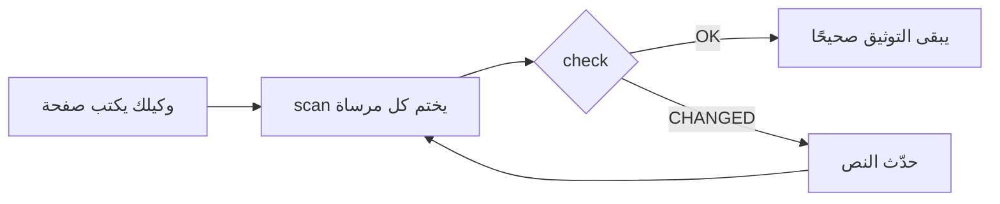

<div align="center">

# DocKeeper

**توثيق لا يتعفّن.**

يكتب وكيل البرمجة لديك التوثيق، بما فيه المخططات. يربط DocKeeper كل ادعاء وكل مخطط بالشيفرة التي تقف وراءهما، ويخبرك فور تغيّر تلك الشيفرة.

[](https://github.com/Nokky21/DocKeeper/actions/workflows/ci.yml)


[](../../LICENSE)

[الموقع](https://nokky21.github.io/DocKeeper/) · [عرض حي](https://nokky21.github.io/DocKeeper/#demo) · [التثبيت](#install) · [المرجع](../reference.md)

<details>
<summary>🌐 العربية</summary>

<sub>[English](../../README.md) · [Español](README.es.md) · [Português](README.pt-BR.md) · [Français](README.fr.md) · [Deutsch](README.de.md) · [Italiano](README.it.md) · [Nederlands](README.nl.md) · [Polski](README.pl.md) · [Čeština](README.cs.md) · [Svenska](README.sv.md) · [Русский](README.ru.md) · [Українська](README.uk.md) · [Türkçe](README.tr.md) · **العربية** · [עברית](README.he.md) · [हिन्दी](README.hi.md) · [简体中文](README.zh-CN.md) · [繁體中文](README.zh-TW.md) · [日本語](README.ja.md) · [한국어](README.ko.md) · [Tiếng Việt](README.vi.md) · [Bahasa Indonesia](README.id.md) · [ไทย](README.th.md)</sub>

</details>

<picture>
  <source media="(prefers-color-scheme: dark)" srcset="../../site/public/assets/readme-hero-dark.png">
  
</picture>

</div>

---

## لماذا

ملف README المكتوب اليوم يصبح خاطئًا بعد بضعة أشهر، ولا أحد يعرف أي الصفحات تكذب. يحلّ DocKeeper مشكلة «لا أحد يعرف» مجانًا وعلى جهازك:

- **كل ادعاء يُتحقَّق منه.** عبارة «تُتحقَّق المدفوعات قبل تحصيلها» مربوطة بالدالة التي تقوم بذلك. وعندما تتغيّر تلك الدالة، يخبرك DocKeeper.
- **لا ذكاء اصطناعي في التحقق.** وكيلك يكتب، والتحقق يقارن البصمات، لذا يعطي الجواب نفسه في كل مرة.
- **محلي ومجاني.** بلا حساب، بلا خادم، بلا شبكة، بلا تبعيات. ترخيص MIT.

## ماذا يكتب

اطلب مرة واحدة، فيوثّق وكيلك المستودع كاملًا صفحةً بعد صفحة انطلاقًا من قوالب المهارة:

<table dir="rtl">
<tr><td><b>README</b></td><td>ما هو، وكيف يعمل، وكيف تشغّله.</td></tr>
<tr><td><b>البنية</b></td><td>المكوّنات والتدفقات والبيانات والحدود، مع مخططات.</td></tr>
<tr><td><b>القرارات</b></td><td>ما الذي تقرّر ولماذا، من سجل git وحده.</td></tr>
<tr><td><b>الإجراءات</b></td><td>أدلة تشغيل بالأوامر الدقيقة.</td></tr>
<tr><td><b>الواجهة البرمجية</b></td><td>كل عملية بمدخلاتها وأخطائها وآثارها.</td></tr>
<tr><td><b>الإعداد للقادمين الجدد</b></td><td>مسار قراءة لليوم الأول.</td></tr>
</table>

وفي المستودع الأحادي يكتب أيضًا ملف README لكل حزمة. كل ادعاء يشير إلى شيفرته. اطّلع على [بنية DocKeeper نفسه](../architecture.md)، المكتوبة بالمهارة.

## كيف يعمل

<p align="center"></p>

1. **اربط.** بجانب كل ادعاء، يكتب الوكيل مكانه في الشيفرة: `[[src/payments.py#validate_payment]]`، أو الشيء نفسه داخل تعليق HTML لتبقى الصفحة نظيفة.
2. **اختم.** يحسب `dockeeper scan` بصمة الشيفرة خلف كل مرساة، وهي عادةً الدالة كاملة. إعادة التنسيق لا تهم؛ أما تغيير المنطق فيهم.
   <!-- dockeeper: dockeeper/bloques.py#bloque_en dockeeper/huellas.py#huella -->
3. **تحقّق.** يعطي `dockeeper check` حكمًا لكل ادعاء: `OK`؛ أو `MOVED` (انتقلت الشيفرة، ويتبعها `dockeeper fix` دون حاجة إلى مراجعة)؛ أو `CHANGED` (تغيّرت الشيفرة، فيقرأها شخص ويحدّث النص). أي `CHANGED` يجعل الأمر يخرج بالرمز 1، فيفشل CI.
   <!-- dockeeper: dockeeper/motor.py#verificar_codigo dockeeper/motor.py#FALLOS -->

<p align="center"></p>

<a id="install"></a>

## التثبيت

تحتاج إلى `python3` (الإصدار 3.10 أو أحدث) و`git`. انسخ المستودع إلى مجلد اسمه `dockeeper` بالضبط:

```bash
# Claude Code
git clone https://github.com/Nokky21/DocKeeper.git ~/.claude/skills/dockeeper

# Codex, Gemini CLI, Cursor, GitHub Copilot
git clone https://github.com/Nokky21/DocKeeper.git ~/.agents/skills/dockeeper
```

مجلدات أخرى، مشروع واحد، Windows، claude.ai والواجهة البرمجية: راجع [دليل التثبيت](../install.md).

## الاستخدام

اطلب من وكيلك بكلماتك:

- *«وثّق هذا المستودع باستخدام dockeeper.»* والمستودعات الأحادية أيضًا، حزمةً بعد حزمة.
- *«تحقّق مما إذا كان توثيقنا ما زال صحيحًا وأصلح ما لم يعد كذلك.»*
- *«راجع التوثيق مع كل commit.»* يثبّت خطاف git لا يمنع أي commit أبدًا.
- *«اكتب صفحة القرارات من سجل git. لا تخترع أسبابًا.»*
- *«ارسم البنية بمخططات تدفق.»*

أو شغّله بنفسك من جذر مشروعك:

```bash
DK="python3 $HOME/.claude/skills/dockeeper/bin/dockeeper"
$DK audit    # ما الناقص: صفحات، حزم، شيفرة غير موثّقة
$DK scan     # يختم المراسي الجديدة ويعرض الشيفرة التي تشير إليها كل واحدة
$DK check    # ما زال صحيحًا؟ الخروج 0 = نعم، 1 = تغيّر شيء ما
$DK fix      # يتبع الشيفرة التي انتقلت (لا يلمس إلا ملف الختم)
$DK review   # ماذا يعني آخر commit للتوثيق
```

<!-- dockeeper: dockeeper/motor.py#arreglar -->

## مع كل commit

ينظر `review` في آخر commit (أو في فرع كامل باستخدام `--desde main`) ويسرد الادعاءات التي مسّها، والشيفرة الجديدة أو المعدّلة التي لا يغطيها أي ادعاء بعد، والقرارات الواردة في تلك الـ commits وغير المكتوبة. وبوصفه خطاف `post-commit`، يرى من يُجري الـ commit، أنت أو وكيلك، هذه القائمة في كل مرة، فينمو التوثيق مع الشيفرة:
<!-- dockeeper: dockeeper/revision.py#revisar -->

```sh
#!/bin/sh
python3 "$HOME/.claude/skills/dockeeper/bin/dockeeper" review || true
```

## مخططات تبقى صحيحة

يرسم الوكيل التدفقات والتسلسلات والحالات والبيانات بلغة Mermaid، التي يعرضها GitHub وObsidian بالطريقة نفسها. يحمل كل مخطط مراسيه في داخله، في أسطر `%% dockeeper:` لا يراها أحد، فينبّه `check` إليه حين تتغيّر الشيفرة التي يعرضها. هذا المخطط حقيقي:



## المستودعات الأحادية

يعثر `audit` على كل حزمة (أي مجلد فرعي فيه `package.json` أو `go.mod` أو `Cargo.toml` أو `pyproject.toml` أو `pom.xml` وما شابه) ويبيّن أيّها بلا توثيق. يكتب الوكيل صفحات الجذر مع خريطة للحزم، ثم يوثّق حزمةً بعد حزمة، فيتسع الأمر حتى لمستودع ضخم. <!-- dockeeper: dockeeper/paquetes.py#detectar -->

## في CI

```yaml
- uses: actions/checkout@v6
- uses: Nokky21/DocKeeper@v0.4.0
```

أي نظام CI آخر لا يحتاج إلا إلى Python و git: [انسخه وشغّل `check`](../reference.md#continuous-integration).

## للمزيد

- [دليل التثبيت](../install.md): كل الوكلاء، مشروع واحد، Windows، claude.ai والواجهة البرمجية.
- [المرجع](../reference.md): المراسي، الأوامر، الأحكام، النطاق الجزئي، التوثيق المنشور، «لماذا»، الإعداد، الحدود والأسئلة الشائعة.
- [البنية](../architecture.md): كيف يعمل DocKeeper من الداخل، في ستة مخططات مربوطة بالشيفرة.
- [SKILL.md](../../SKILL.md)، التعليمات التي يتبعها وكيلك، و[المواصفة](../../SPEC.md) (كلاهما بالإسبانية).

## الترخيص

[MIT](../../LICENSE).

---

<sub>ترجمة لـ [ملف README الإنجليزي](../../README.md)، وهو المرجع عند الاختلاف. دليل التثبيت والمرجع والبنية باللغة الإنجليزية.</sub>
