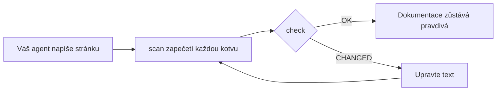

<div align="center">

# DocKeeper

**Dokumentace, která nehnije.**

Váš programovací agent píše dokumentaci, včetně diagramů. DocKeeper spojí každé tvrzení a každý diagram s kódem, který za nimi stojí, a dá vám vědět, jakmile se ten kód změní.

[](https://github.com/Nokky21/DocKeeper/actions/workflows/ci.yml)


[](../../LICENSE)

[Web](https://nokky21.github.io/DocKeeper/) · [Živé demo](https://nokky21.github.io/DocKeeper/#demo) · [Instalace](#install) · [Reference](../reference.md)

<details>
<summary>🌐 Čeština</summary>

<sub>[English](../../README.md) · [Español](README.es.md) · [Português](README.pt-BR.md) · [Français](README.fr.md) · [Deutsch](README.de.md) · [Italiano](README.it.md) · [Nederlands](README.nl.md) · [Polski](README.pl.md) · **Čeština** · [Svenska](README.sv.md) · [Русский](README.ru.md) · [Українська](README.uk.md) · [Türkçe](README.tr.md) · [العربية](README.ar.md) · [עברית](README.he.md) · [हिन्दी](README.hi.md) · [简体中文](README.zh-CN.md) · [繁體中文](README.zh-TW.md) · [日本語](README.ja.md) · [한국어](README.ko.md) · [Tiếng Việt](README.vi.md) · [Bahasa Indonesia](README.id.md) · [ไทย](README.th.md)</sub>

</details>

<picture>
  <source media="(prefers-color-scheme: dark)" srcset="../../site/public/assets/readme-hero-dark.png">
  
</picture>

</div>

---

## Proč

README napsané dnes je za pár měsíců špatně a nikdo neví, které stránky lžou. DocKeeper řeší tu část „nikdo neví“ — zdarma a na vašem počítači:

- **Každé tvrzení se ověřuje.** „Platby se ověřují před stržením“ je svázané s funkcí, která to dělá. Když se ta funkce změní, DocKeeper vám to řekne.
- **Žádná AI v kontrole.** Váš agent píše; kontrola porovnává otisky, takže vždy dá stejnou odpověď.
- **Lokálně a zdarma.** Žádný účet, žádný server, žádná síť, žádné závislosti. Licence MIT.

## Co píše

Stačí požádat jednou a váš agent zdokumentuje celý repozitář, stránku po stránce, podle šablon ze skillu:

<table>
<tr><td><b>README</b></td><td>Co to je, jak to funguje a jak to spustit.</td></tr>
<tr><td><b>Architektura</b></td><td>Komponenty, toky, data a hranice, s diagramy.</td></tr>
<tr><td><b>Rozhodnutí</b></td><td>Co se rozhodlo a proč, jen z historie gitu.</td></tr>
<tr><td><b>Postupy</b></td><td>Runbooky s přesnými příkazy.</td></tr>
<tr><td><b>API</b></td><td>Každá operace se vstupy, chybami a účinky.</td></tr>
<tr><td><b>Zaškolení</b></td><td>Trasa čtení na první den.</td></tr>
</table>

V monorepu navíc napíše README pro každý balíček. Každé tvrzení ukazuje na svůj kód. Podívejte se na [architekturu samotného DocKeeperu](../architecture.md), napsanou pomocí skillu.

## Jak to funguje

<p align="center"></p>

1. **Ukotvit.** Vedle každého tvrzení agent napíše, kde v kódu žije: `[[src/payments.py#validate_payment]]`, nebo totéž v HTML komentáři, aby stránka zůstala čistá.
2. **Zapečetit.** `dockeeper scan` spočítá otisk kódu za každou kotvou, obvykle celé funkce. Přeformátování nevadí; změna logiky ano.
   <!-- dockeeper: dockeeper/bloques.py#bloque_en dockeeper/huellas.py#huella -->
3. **Zkontrolovat.** `dockeeper check` vydá ke každému tvrzení verdikt: `OK`; `MOVED` (kód se přesunul a `dockeeper fix` ho následuje, aniž by to musel kdokoli kontrolovat); nebo `CHANGED` (kód se změnil, takže ho člověk přečte a upraví text). Jakékoli `CHANGED` skončí návratovým kódem 1, takže CI selže.
   <!-- dockeeper: dockeeper/motor.py#verificar_codigo dockeeper/motor.py#FALLOS -->

<p align="center"></p>

<a id="install"></a>

## Instalace

Potřebujete `python3` (3.10 nebo novější) a `git`. Naklonujte repozitář do složky, která se jmenuje přesně `dockeeper`:

```bash
# Claude Code
git clone https://github.com/Nokky21/DocKeeper.git ~/.claude/skills/dockeeper

# Codex, Gemini CLI, Cursor, GitHub Copilot
git clone https://github.com/Nokky21/DocKeeper.git ~/.agents/skills/dockeeper
```

Jiné složky, jediný projekt, Windows, claude.ai a API: viz [instalační příručku](../install.md).

## Použití

Požádejte svého agenta vlastními slovy:

- *„Zdokumentuj tento repozitář pomocí dockeeper.“* I monorepa, jeden balíček po druhém.
- *„Zkontroluj, jestli je naše dokumentace pořád pravdivá, a oprav, co není.“*
- *„Kontroluj dokumentaci při každém commitu.“* Nainstaluje git hook, který nikdy neblokuje commit.
- *„Napiš stránku rozhodnutí z historie gitu. Nevymýšlej si důvody.“*
- *„Nakresli architekturu pomocí vývojových diagramů.“*

Nebo to spusťte sami z kořene projektu:

```bash
DK="python3 $HOME/.claude/skills/dockeeper/bin/dockeeper"
$DK audit    # co chybí: stránky, balíčky, nezdokumentovaný kód
$DK scan     # zapečetí nové kotvy a ukáže kód, na který každá míří
$DK check    # pořád pravda? výstup 0 = ano, 1 = něco se změnilo
$DK fix      # následuje přesunutý kód (mění jen soubor pečeti)
$DK review   # co poslední commit znamená pro dokumentaci
```

<!-- dockeeper: dockeeper/motor.py#arreglar -->

## Při každém commitu

`review` projde poslední commit (nebo celou větev, s `--desde main`) a vypíše tvrzení, kterých se dotkl, nový nebo změněný kód, který zatím žádné tvrzení nepokrývá, a rozhodnutí z těch commitů, která nejsou nikde zapsaná. Jako hook `post-commit` vidí ten seznam pokaždé ten, kdo commituje — vy nebo váš agent — a dokumentace roste spolu s kódem:
<!-- dockeeper: dockeeper/revision.py#revisar -->

```sh
#!/bin/sh
python3 "$HOME/.claude/skills/dockeeper/bin/dockeeper" review || true
```

## Diagramy, které zůstávají pravdivé

Agent kreslí toky, sekvence, stavy a data v Mermaidu, který GitHub i Obsidian zobrazí stejně. Každý diagram nese své kotvy uvnitř, na řádcích `%% dockeeper:`, které nikdo nevidí, takže ho `check` označí, když se změní kód, který ukazuje. Tenhle je skutečný:



## Monorepa

`audit` najde každý balíček (jakoukoli podsložku s `package.json`, `go.mod`, `Cargo.toml`, `pyproject.toml`, `pom.xml` a podobně) a ukáže, které nemají dokumentaci. Agent napíše stránky v kořeni s mapou balíčků a pak dokumentuje jeden balíček po druhém, takže se vejde i obrovský repozitář. <!-- dockeeper: dockeeper/paquetes.py#detectar -->

## V CI

```yaml
- uses: actions/checkout@v6
- uses: Nokky21/DocKeeper@v0.3.0
```

Jakékoli jiné CI potřebuje jen Python a git: [naklonujte ho a spusťte `check`](../reference.md#continuous-integration).

## Další informace

- [Instalační příručka](../install.md): každý agent, jediný projekt, Windows, claude.ai a API.
- [Reference](../reference.md): kotvy, příkazy, verdikty, částečný rozsah, publikovaná dokumentace, „proč“, konfigurace, omezení a FAQ.
- [Architektura](../architecture.md): jak DocKeeper funguje uvnitř, v šesti ukotvených diagramech.
- [SKILL.md](../../SKILL.md), pokyny, kterými se váš agent řídí, a [specifikace](../../SPEC.md) (obojí ve španělštině).

## Licence

[MIT](../../LICENSE).

---

<sub>Překlad [anglického README](../../README.md), které platí v případě rozdílů. Instalační příručka, reference a architektura jsou v angličtině.</sub>
