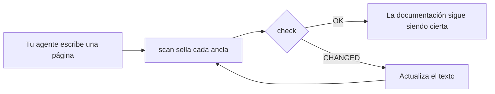

<div align="center">

# DocKeeper

**Documentación que no se pudre.**

Tu agente de código escribe la documentación, diagramas incluidos. DocKeeper ata cada afirmación y cada diagrama al código que los respalda y te avisa en cuanto ese código cambia.

[](https://github.com/Nokky21/DocKeeper/actions/workflows/ci.yml)


[](../../LICENSE)

[Web](https://nokky21.github.io/DocKeeper/) · [Demo en vivo](https://nokky21.github.io/DocKeeper/#demo) · [Instalar](#install) · [Referencia](../reference.md)

<details>
<summary>🌐 Español</summary>

<sub>[English](../../README.md) · **Español** · [Português](README.pt-BR.md) · [Français](README.fr.md) · [Deutsch](README.de.md) · [Italiano](README.it.md) · [Nederlands](README.nl.md) · [Polski](README.pl.md) · [Čeština](README.cs.md) · [Svenska](README.sv.md) · [Русский](README.ru.md) · [Українська](README.uk.md) · [Türkçe](README.tr.md) · [العربية](README.ar.md) · [עברית](README.he.md) · [हिन्दी](README.hi.md) · [简体中文](README.zh-CN.md) · [繁體中文](README.zh-TW.md) · [日本語](README.ja.md) · [한국어](README.ko.md) · [Tiếng Việt](README.vi.md) · [Bahasa Indonesia](README.id.md) · [ไทย](README.th.md)</sub>

</details>

<picture>
  <source media="(prefers-color-scheme: dark)" srcset="../../site/public/assets/readme-hero-dark.png">
  
</picture>

</div>

---

## Por qué

Un README escrito hoy está mal unos meses después, y nadie sabe qué páginas mienten. DocKeeper resuelve la parte de «nadie sabe», gratis y en tu máquina:

- **Cada afirmación se comprueba.** «Los pagos se validan antes de cobrarse» queda atada a la función que lo hace. Cuando esa función cambia, DocKeeper te lo dice.
- **Sin IA en la comprobación.** Tu agente escribe; la comprobación compara huellas, así que siempre da la misma respuesta.
- **Local y gratis.** Sin cuenta, sin servidor, sin red, sin dependencias. Licencia MIT.

## Qué escribe

Pídelo una vez y tu agente documenta el repositorio entero, página a página, a partir de las plantillas del skill:

<table>
<tr><td><b>README</b></td><td>Qué es, cómo funciona y cómo arrancarlo.</td></tr>
<tr><td><b>Arquitectura</b></td><td>Componentes, flujos, datos y fronteras, con diagramas.</td></tr>
<tr><td><b>Decisiones</b></td><td>Qué se decidió y por qué, sacado solo del historial de git.</td></tr>
<tr><td><b>Procedimientos</b></td><td>Runbooks con los comandos exactos.</td></tr>
<tr><td><b>API</b></td><td>Cada operación con sus entradas, errores y efectos.</td></tr>
<tr><td><b>Incorporación</b></td><td>Una ruta de lectura para el primer día.</td></tr>
</table>

En un monorepo escribe además un README por paquete. Cada afirmación apunta a su código. Mira [la arquitectura de DocKeeper](../architecture.md), escrita con el propio skill.

## Cómo funciona

<p align="center"></p>

1. **Anclar.** Junto a cada afirmación, el agente escribe dónde vive en el código: `[[src/payments.py#validate_payment]]`, o lo mismo dentro de un comentario HTML para que la página quede limpia.
2. **Sellar.** `dockeeper scan` saca la huella del código de cada ancla, normalmente la función entera. Reformatear no importa; cambiar la lógica, sí.
   <!-- dockeeper: dockeeper/bloques.py#bloque_en dockeeper/huellas.py#huella -->
3. **Comprobar.** `dockeeper check` da un veredicto a cada afirmación: `OK`; `MOVED` (el código se movió y `dockeeper fix` lo sigue sin que nadie tenga que revisar nada); o `CHANGED` (el código cambió: una persona lo lee y actualiza el texto). Cualquier `CHANGED` hace que salga con 1, así que el CI falla.
   <!-- dockeeper: dockeeper/motor.py#verificar_codigo dockeeper/motor.py#FALLOS -->

<p align="center"></p>

<a id="install"></a>

## Instalar

Necesitas `python3` (3.10 o posterior) y `git`. Clona el repositorio en una carpeta que se llame exactamente `dockeeper`:

```bash
# Claude Code
git clone https://github.com/Nokky21/DocKeeper.git ~/.claude/skills/dockeeper

# Codex, Gemini CLI, Cursor, GitHub Copilot
git clone https://github.com/Nokky21/DocKeeper.git ~/.agents/skills/dockeeper
```

Otras carpetas, un solo proyecto, Windows, claude.ai y la API: mira la [guía de instalación](../install.md).

## Uso

Pídeselo a tu agente con tus palabras:

- *«Documenta este repositorio con dockeeper.»* También monorepos, un paquete cada vez.
- *«Comprueba si nuestra documentación sigue siendo cierta y arregla lo que no lo sea.»*
- *«Revisa la documentación en cada commit.»* Instala un hook de git que nunca bloquea un commit.
- *«Escribe la página de decisiones a partir del historial de git. No te inventes motivos.»*
- *«Dibuja la arquitectura con diagramas de flujo.»*

O ejecútalo tú desde la raíz de tu proyecto:

```bash
DK="python3 $HOME/.claude/skills/dockeeper/bin/dockeeper"
$DK audit    # qué falta: páginas, paquetes, código sin documentar
$DK scan     # sella las anclas nuevas y enseña el código al que apunta cada una
$DK check    # ¿sigue siendo cierto? salida 0 = sí, 1 = algo cambió
$DK fix      # sigue al código que se movió (solo toca el fichero de sello)
$DK review   # qué supone el último commit para la documentación
```

<!-- dockeeper: dockeeper/motor.py#arreglar -->

## En cada commit

`review` mira el último commit (o una rama entera, con `--desde main`) y lista las afirmaciones que tocó, el código nuevo o cambiado que todavía no cubre ninguna afirmación y las decisiones de esos commits que no están escritas. Como hook `post-commit`, quien haga el commit, tú o tu agente, ve esa lista cada vez, y la documentación crece con el código:
<!-- dockeeper: dockeeper/revision.py#revisar -->

```sh
#!/bin/sh
python3 "$HOME/.claude/skills/dockeeper/bin/dockeeper" review || true
```

## Diagramas que siguen siendo ciertos

El agente dibuja flujos, secuencias, estados y datos en Mermaid, que GitHub y Obsidian pintan igual. Cada diagrama lleva dentro sus anclas, en líneas `%% dockeeper:` que nadie ve, así que `check` lo señala cuando cambia el código que enseña. Este está vivo:



## Monorepos

`audit` encuentra cada paquete (cualquier subcarpeta con un `package.json`, `go.mod`, `Cargo.toml`, `pyproject.toml`, `pom.xml`, etc.) y enseña cuáles no tienen documentación. El agente escribe las páginas de la raíz con un mapa de los paquetes y después documenta un paquete cada vez, así que cabe hasta un repositorio enorme. <!-- dockeeper: dockeeper/paquetes.py#detectar -->

## En CI

```yaml
- uses: actions/checkout@v6
- uses: Nokky21/DocKeeper@v0.4.0
```

Cualquier otro CI solo necesita Python y git: [clónalo y ejecuta `check`](../reference.md#continuous-integration).

## Más información

- [Guía de instalación](../install.md): cada agente, un solo proyecto, Windows, claude.ai y la API.
- [Referencia](../reference.md): anclas, órdenes, veredictos, alcance parcial, documentación publicada, el «porqué», configuración, límites y preguntas frecuentes.
- [Arquitectura](../architecture.md): cómo funciona DocKeeper por dentro, en seis diagramas anclados.
- [SKILL.md](../../SKILL.md), las instrucciones que sigue tu agente, y la [especificación](../../SPEC.md) (las dos en español).

## Licencia

[MIT](../../LICENSE).

---

<sub>Traducción del [README en inglés](../../README.md), que manda si hay diferencias. La guía de instalación, la referencia y la arquitectura están en inglés.</sub>
