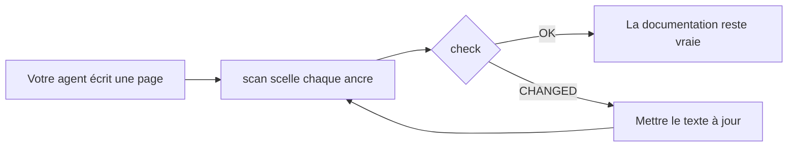

<div align="center">

# DocKeeper

**Une documentation qui ne pourrit pas.**

Votre agent de code écrit la documentation, schémas compris. DocKeeper relie chaque affirmation et chaque schéma au code qui les justifie et vous prévient dès que ce code change.

[](https://github.com/Nokky21/DocKeeper/actions/workflows/ci.yml)


[](../../LICENSE)

[Site](https://nokky21.github.io/DocKeeper/) · [Démo en direct](https://nokky21.github.io/DocKeeper/#demo) · [Installer](#install) · [Référence](../reference.md)

<sub>[English](../../README.md) · [Español](README.es.md) · [Português](README.pt-BR.md) · **Français** · [Deutsch](README.de.md) · [Italiano](README.it.md) · [Nederlands](README.nl.md) · [Polski](README.pl.md) · [Čeština](README.cs.md) · [Svenska](README.sv.md) · [Русский](README.ru.md) · [Українська](README.uk.md) · [Türkçe](README.tr.md) · [العربية](README.ar.md) · [עברית](README.he.md) · [हिन्दी](README.hi.md) · [简体中文](README.zh-CN.md) · [繁體中文](README.zh-TW.md) · [日本語](README.ja.md) · [한국어](README.ko.md) · [Tiếng Việt](README.vi.md) · [Bahasa Indonesia](README.id.md) · [ไทย](README.th.md)</sub>

</div>

---

## Pourquoi

Un README écrit aujourd’hui est faux quelques mois plus tard, et personne ne sait quelles pages mentent. DocKeeper règle la partie « personne ne sait », gratuitement et sur votre machine :

- **Chaque affirmation est vérifiée.** « Les paiements sont validés avant d’être encaissés » est relié à la fonction qui le fait. Quand cette fonction change, DocKeeper vous le dit.
- **Pas d’IA dans la vérification.** Votre agent écrit ; la vérification compare des empreintes, donc elle donne toujours la même réponse.
- **Local et gratuit.** Pas de compte, pas de serveur, pas de réseau, aucune dépendance. Licence MIT.

## Ce qu’il écrit

Demandez-le une fois et votre agent documente tout le dépôt, page par page, à partir des modèles de la skill :

- **README** : ce que c’est, comment ça marche, comment le lancer.
- **Architecture** : composants, flux, données et frontières, avec des schémas.
- **Décisions** : ce qui a été décidé et pourquoi, tiré uniquement de l’historique git.
- **Procédures** : des runbooks avec les commandes exactes.
- **API** : chaque opération avec ses entrées, ses erreurs et ses effets.
- **Intégration** : un parcours de lecture pour le premier jour.

Dans un monorepo, il écrit aussi un README par paquet. Chaque affirmation pointe vers son code. Voyez [l’architecture de DocKeeper lui-même](../architecture.md), écrite avec la skill.

## Comment ça marche

<p align="center"></p>

1. **Ancrer.** À côté de chaque affirmation, l’agent écrit où elle se trouve dans le code : `[[src/payments.py#validate_payment]]`, ou la même chose dans un commentaire HTML pour garder la page propre.
2. **Sceller.** `dockeeper scan` calcule l’empreinte du code derrière chaque ancre, en général la fonction entière. Reformater ne change rien ; modifier la logique, si.
   <!-- dockeeper: dockeeper/bloques.py#bloque_en dockeeper/huellas.py#huella -->
3. **Vérifier.** `dockeeper check` rend un verdict pour chaque affirmation : `OK` ; `MOVED` (le code a été déplacé, et `dockeeper fix` le suit sans relecture) ; ou `CHANGED` (le code a changé : quelqu’un le relit et met le texte à jour). Le moindre `CHANGED` le fait sortir avec le code 1, donc la CI échoue.
   <!-- dockeeper: dockeeper/motor.py#verificar_codigo dockeeper/motor.py#FALLOS -->

<p align="center"></p>

<a id="install"></a>

## Installation

Il vous faut `python3` (3.10 ou plus récent) et `git`. Clonez le dépôt dans un dossier nommé exactement `dockeeper` :

```bash
# Claude Code
git clone https://github.com/Nokky21/DocKeeper.git ~/.claude/skills/dockeeper

# Codex, Gemini CLI, Cursor, GitHub Copilot
git clone https://github.com/Nokky21/DocKeeper.git ~/.agents/skills/dockeeper
```

Autres dossiers, un seul projet, Windows, claude.ai et l’API : voir le [guide d’installation](../install.md).

## Utilisation

Demandez-le à votre agent avec vos mots :

- *« Documente ce dépôt avec dockeeper. »* Les monorepos aussi, un paquet à la fois.
- *« Vérifie si notre documentation est toujours vraie et corrige ce qui ne l’est plus. »*
- *« Relis la documentation à chaque commit. »* Il installe un hook git qui ne bloque jamais un commit.
- *« Écris la page des décisions à partir de l’historique git. N’invente pas de raisons. »*
- *« Dessine l’architecture avec des diagrammes de flux. »*

Ou lancez-le vous-même depuis la racine de votre projet :

```bash
DK="python3 $HOME/.claude/skills/dockeeper/bin/dockeeper"
$DK audit    # ce qui manque : pages, paquets, code non documenté
$DK scan     # scelle les nouvelles ancres et montre le code visé par chacune
$DK check    # toujours vrai ? sortie 0 = oui, 1 = quelque chose a changé
$DK fix      # suit le code déplacé (ne touche que le fichier de sceau)
$DK review   # ce que le dernier commit implique pour la documentation
```

<!-- dockeeper: dockeeper/motor.py#arreglar -->

## À chaque commit

`review` examine le dernier commit (ou toute une branche, avec `--desde main`) et liste les affirmations touchées, le code nouveau ou modifié qu’aucune affirmation ne couvre encore, et les décisions de ces commits qui ne sont pas écrites. En hook `post-commit`, la personne qui commite, vous ou votre agent, voit cette liste à chaque fois, et la documentation grandit avec le code :
<!-- dockeeper: dockeeper/revision.py#revisar -->

```sh
#!/bin/sh
python3 "$HOME/.claude/skills/dockeeper/bin/dockeeper" review || true
```

## Des schémas qui restent vrais

L’agent dessine les flux, les séquences, les états et les données en Mermaid, que GitHub et Obsidian affichent de la même façon. Chaque schéma porte ses ancres à l’intérieur, sur des lignes `%% dockeeper:` invisibles, si bien que `check` le signale quand le code qu’il montre change. Celui-ci est bien réel :



## Monorepos

`audit` trouve chaque paquet (tout sous-dossier avec un `package.json`, `go.mod`, `Cargo.toml`, `pyproject.toml`, `pom.xml`, etc.) et indique ceux qui n’ont pas de documentation. L’agent écrit les pages de la racine avec une carte des paquets, puis documente un paquet à la fois : même un dépôt énorme tient. <!-- dockeeper: dockeeper/paquetes.py#detectar -->

## En CI

```yaml
- uses: actions/checkout@v6
- uses: Nokky21/DocKeeper@v0.3.0
```

Toute autre CI n’a besoin que de Python et git : [clonez-le et lancez `check`](../reference.md#continuous-integration).

## En savoir plus

- [Guide d’installation](../install.md) : chaque agent, un seul projet, Windows, claude.ai et l’API.
- [Référence](../reference.md) : ancres, commandes, verdicts, périmètre partiel, documentation publiée, le « pourquoi », configuration, limites et FAQ.
- [Architecture](../architecture.md) : le fonctionnement interne de DocKeeper en six schémas ancrés.
- [SKILL.md](../../SKILL.md), les instructions que suit votre agent, et la [spécification](../../SPEC.md) (toutes deux en espagnol).

## Licence

[MIT](../../LICENSE).

---

<sub>Traduction du [README en anglais](../../README.md), qui fait foi en cas de différence. Le guide d’installation, la référence et l’architecture sont en anglais.</sub>
