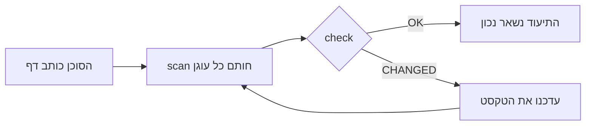

<div align="center">

# DocKeeper

**תיעוד שלא נרקב.**

סוכן הקוד שלך כותב את התיעוד, כולל דיאגרמות. DocKeeper קושר כל טענה וכל דיאגרמה לקוד שמאחוריהן ומודיע לך ברגע שהקוד הזה משתנה.

[](https://github.com/Nokky21/DocKeeper/actions/workflows/ci.yml)


[](../../LICENSE)

[אתר](https://nokky21.github.io/DocKeeper/) · [הדגמה חיה](https://nokky21.github.io/DocKeeper/#demo) · [התקנה](#install) · [עיון](../reference.md)

<sub>[English](../../README.md) · [Español](README.es.md) · [Português](README.pt-BR.md) · [Français](README.fr.md) · [Deutsch](README.de.md) · [Italiano](README.it.md) · [Nederlands](README.nl.md) · [Polski](README.pl.md) · [Čeština](README.cs.md) · [Svenska](README.sv.md) · [Русский](README.ru.md) · [Українська](README.uk.md) · [Türkçe](README.tr.md) · [العربية](README.ar.md) · **עברית** · [हिन्दी](README.hi.md) · [简体中文](README.zh-CN.md) · [繁體中文](README.zh-TW.md) · [日本語](README.ja.md) · [한국어](README.ko.md) · [Tiếng Việt](README.vi.md) · [Bahasa Indonesia](README.id.md) · [ไทย](README.th.md)</sub>

</div>

---

## למה

README שנכתב היום שגוי כעבור כמה חודשים, ואף אחד לא יודע אילו דפים משקרים. DocKeeper פותר את החלק של „אף אחד לא יודע”, בחינם ועל המחשב שלך:

- **כל טענה נבדקת.** „תשלומים מאומתים לפני החיוב” קשור לפונקציה שעושה זאת. כשהפונקציה משתנה, DocKeeper אומר לך.
- **בלי בינה מלאכותית בבדיקה.** הסוכן שלך כותב; הבדיקה משווה טביעות אצבע, ולכן נותנת תמיד אותה תשובה.
- **מקומי וחינמי.** בלי חשבון, בלי שרת, בלי רשת, בלי תלויות. רישיון MIT.

## מה הוא כותב

בקשו פעם אחת, והסוכן יתעד את כל המאגר, דף אחר דף, לפי התבניות של ה-skill:

- **README**: מה זה, איך זה עובד ואיך מריצים.
- **ארכיטקטורה**: רכיבים, זרימות, נתונים וגבולות, עם דיאגרמות.
- **החלטות**: מה הוחלט ולמה, רק מתוך היסטוריית ה-git.
- **נהלים**: ספרי הפעלה עם הפקודות המדויקות.
- **API**: כל פעולה עם הקלטים, השגיאות וההשפעות שלה.
- **קליטה**: מסלול קריאה ליום הראשון.

במונוריפו הוא כותב גם README לכל חבילה. כל טענה מצביעה על הקוד שלה. ראו את [הארכיטקטורה של DocKeeper עצמו](../architecture.md), שנכתבה עם ה-skill.

## איך זה עובד

<p align="center"></p>

1. **עיגון.** ליד כל טענה הסוכן כותב היכן היא נמצאת בקוד: `[[src/payments.py#validate_payment]]`, או אותו דבר בתוך הערת HTML כדי שהדף יישאר נקי.
2. **חתימה.** `dockeeper scan` מחשב טביעת אצבע לקוד שמאחורי כל עוגן, בדרך כלל הפונקציה כולה. שינוי עיצוב לא משנה; שינוי בלוגיקה כן.
   <!-- dockeeper: dockeeper/bloques.py#bloque_en dockeeper/huellas.py#huella -->
3. **בדיקה.** `dockeeper check` נותן לכל טענה פסק דין: `OK`; `MOVED` (הקוד זז, ו-`dockeeper fix` עוקב אחריו בלי שמישהו יצטרך לבדוק); או `CHANGED` (הקוד השתנה, אז אדם קורא אותו ומעדכן את הטקסט). כל `CHANGED` גורם ליציאה עם קוד 1, ולכן ה-CI נכשל.
   <!-- dockeeper: dockeeper/motor.py#verificar_codigo dockeeper/motor.py#FALLOS -->

<p align="center"></p>

<a id="install"></a>

## התקנה

צריך `python3` (גרסה 3.10 ומעלה) ו-`git`. שבטו את המאגר לתיקייה ששמה בדיוק `dockeeper`:

```bash
# Claude Code
git clone https://github.com/Nokky21/DocKeeper.git ~/.claude/skills/dockeeper

# Codex, Gemini CLI, Cursor, GitHub Copilot
git clone https://github.com/Nokky21/DocKeeper.git ~/.agents/skills/dockeeper
```

תיקיות אחרות, פרויקט יחיד, Windows, claude.ai וה-API: ראו את [מדריך ההתקנה](../install.md).

## שימוש

בקשו מהסוכן שלכם במילים שלכם:

- *„תעד את המאגר הזה עם dockeeper.”* גם מונוריפו, חבילה אחת בכל פעם.
- *„בדוק אם התיעוד שלנו עדיין נכון ותקן את מה שלא.”*
- *„בדוק את התיעוד בכל commit.”* הוא מתקין git hook שאף פעם לא חוסם commit.
- *„כתוב את דף ההחלטות מתוך היסטוריית ה-git. אל תמציא סיבות.”*
- *„שרטט את הארכיטקטורה בתרשימי זרימה.”*

או הריצו בעצמכם מתיקיית השורש של הפרויקט:

```bash
DK="python3 $HOME/.claude/skills/dockeeper/bin/dockeeper"
$DK audit    # מה חסר: דפים, חבילות, קוד לא מתועד
$DK scan     # חותם עוגנים חדשים ומראה לאיזה קוד כל אחד מצביע
$DK check    # עדיין נכון? יציאה 0 = כן, 1 = משהו השתנה
$DK fix      # עוקב אחרי קוד שזז (נוגע רק בקובץ החותם)
$DK review   # מה ה-commit האחרון אומר לגבי התיעוד
```

<!-- dockeeper: dockeeper/motor.py#arreglar -->

## בכל commit

`review` בוחן את ה-commit האחרון (או ענף שלם, עם `--desde main`) ומפרט את הטענות שהוא נגע בהן, קוד חדש או משתנה שאף טענה עוד לא מכסה, והחלטות מה-commits האלה שלא נכתבו. כ-hook של `post-commit`, מי שמבצע את ה-commit, אתם או הסוכן שלכם, רואה את הרשימה בכל פעם, והתיעוד גדל יחד עם הקוד:
<!-- dockeeper: dockeeper/revision.py#revisar -->

```sh
#!/bin/sh
python3 "$HOME/.claude/skills/dockeeper/bin/dockeeper" review || true
```

## דיאגרמות שנשארות נכונות

הסוכן משרטט זרימות, רצפים, מצבים ונתונים ב-Mermaid, ש-GitHub ו-Obsidian מציגים באותה צורה. כל דיאגרמה נושאת את העוגנים שלה בתוכה, בשורות `%% dockeeper:` שאיש לא רואה, כך ש-`check` מסמן אותה כשהקוד שהיא מציגה משתנה. הדיאגרמה הזו אמיתית:



## מונוריפו

`audit` מוצא כל חבילה (כל תת-תיקייה עם `package.json`, `go.mod`, `Cargo.toml`, `pyproject.toml`, `pom.xml` וכדומה) ומראה לאילו אין תיעוד. הסוכן כותב את דפי השורש עם מפה של החבילות, ואז מתעד חבילה אחת בכל פעם, כך שגם מאגר ענק נכנס. <!-- dockeeper: dockeeper/paquetes.py#detectar -->

## ב-CI

```yaml
- uses: actions/checkout@v6
- uses: Nokky21/DocKeeper@v0.2.0
```

כל CI אחר צריך רק Python ו-git: [שבטו והריצו `check`](../reference.md#continuous-integration).

## עוד

- [מדריך ההתקנה](../install.md): כל הסוכנים, פרויקט יחיד, Windows, claude.ai וה-API.
- [עיון](../reference.md): עוגנים, פקודות, פסקי דין, היקף חלקי, תיעוד שמתפרסם, ה„למה”, תצורה, מגבלות ושאלות נפוצות.
- [ארכיטקטורה](../architecture.md): איך DocKeeper עובד מבפנים, בשש דיאגרמות מעוגנות.
- [SKILL.md](../../SKILL.md), ההוראות שהסוכן שלכם פועל לפיהן, וה[מפרט](../../SPEC.md) (שניהם בספרדית).

## רישיון

[MIT](../../LICENSE).

---

<sub>תרגום של [ה-README באנגלית](../../README.md), שהוא הקובע במקרה של הבדלים. מדריך ההתקנה, העיון והארכיטקטורה כתובים באנגלית.</sub>
