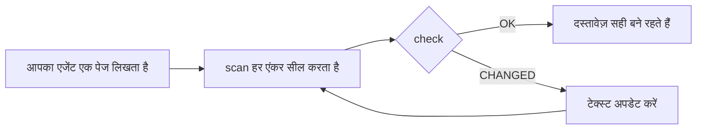

<div align="center">

# DocKeeper

**ऐसा दस्तावेज़ जो पुराना नहीं पड़ता।**

आपका कोडिंग एजेंट डायग्राम समेत दस्तावेज़ लिखता है। DocKeeper हर दावे और हर डायग्राम को उनके पीछे के कोड से जोड़ता है और जैसे ही वह कोड बदलता है, आपको बता देता है।

[](https://github.com/Nokky21/DocKeeper/actions/workflows/ci.yml)


[](../../LICENSE)

[वेबसाइट](https://nokky21.github.io/DocKeeper/) · [लाइव डेमो](https://nokky21.github.io/DocKeeper/#demo) · [इंस्टॉल](#install) · [संदर्भ](../reference.md)

<sub>[English](../../README.md) · [Español](README.es.md) · [Português](README.pt-BR.md) · [Français](README.fr.md) · [Deutsch](README.de.md) · [Italiano](README.it.md) · [Nederlands](README.nl.md) · [Polski](README.pl.md) · [Čeština](README.cs.md) · [Svenska](README.sv.md) · [Русский](README.ru.md) · [Українська](README.uk.md) · [Türkçe](README.tr.md) · [العربية](README.ar.md) · [עברית](README.he.md) · **हिन्दी** · [简体中文](README.zh-CN.md) · [繁體中文](README.zh-TW.md) · [日本語](README.ja.md) · [한국어](README.ko.md) · [Tiếng Việt](README.vi.md) · [Bahasa Indonesia](README.id.md) · [ไทย](README.th.md)</sub>

</div>

---

## क्यों

आज लिखा गया README कुछ महीनों बाद गलत हो जाता है, और किसी को नहीं पता कि कौन-से पेज झूठ बोल रहे हैं। DocKeeper इस “किसी को नहीं पता” वाले हिस्से को मुफ़्त में और आपकी अपनी मशीन पर हल करता है:

- **हर दावे की जाँच होती है।** “भुगतान लेने से पहले उनकी पुष्टि होती है” उस फ़ंक्शन से जुड़ा होता है जो यह करता है। जब वह फ़ंक्शन बदलता है, DocKeeper आपको बताता है।
- **जाँच में कोई AI नहीं।** आपका एजेंट लिखता है; जाँच फ़िंगरप्रिंट की तुलना करती है, इसलिए हर बार एक ही जवाब देती है।
- **लोकल और मुफ़्त।** न खाता, न सर्वर, न नेटवर्क, न कोई डिपेंडेंसी। MIT लाइसेंस।

## यह क्या लिखता है

एक बार कहिए, और आपका एजेंट स्किल के टेम्पलेट से पूरी रिपॉज़िटरी का दस्तावेज़ पेज-दर-पेज लिख देगा:

- **README**: यह क्या है, कैसे काम करता है, कैसे चलाएँ।
- **आर्किटेक्चर**: कंपोनेंट, फ़्लो, डेटा और सीमाएँ, डायग्राम के साथ।
- **फ़ैसले**: क्या तय हुआ और क्यों, सिर्फ़ git इतिहास से।
- **प्रक्रियाएँ**: सटीक कमांड के साथ रनबुक।
- **API**: हर ऑपरेशन, उसके इनपुट, त्रुटियों और असर के साथ।
- **ऑनबोर्डिंग**: पहले दिन के लिए पढ़ने का रास्ता।

मोनोरेपो में यह हर पैकेज के लिए अलग README भी लिखता है। हर दावा अपने कोड की ओर इशारा करता है। स्किल से लिखा गया [DocKeeper का अपना आर्किटेक्चर](../architecture.md) देखें।

## यह कैसे काम करता है

<p align="center"></p>

1. **जोड़ें।** हर दावे के साथ एजेंट लिखता है कि वह कोड में कहाँ है: `[[src/payments.py#validate_payment]]`, या यही बात किसी HTML टिप्पणी के अंदर, ताकि पेज साफ़ रहे।
2. **सील करें।** `dockeeper scan` हर एंकर के पीछे के कोड का फ़िंगरप्रिंट बनाता है, आम तौर पर पूरे फ़ंक्शन का। फ़ॉर्मैटिंग बदलने से फ़र्क नहीं पड़ता; लॉजिक बदलने से पड़ता है।
   <!-- dockeeper: dockeeper/bloques.py#bloque_en dockeeper/huellas.py#huella -->
3. **जाँचें।** `dockeeper check` हर दावे पर फ़ैसला देता है: `OK`; `MOVED` (कोड अपनी जगह से हट गया, और `dockeeper fix` बिना किसी समीक्षा के उसके पीछे चलता है); या `CHANGED` (कोड बदल गया, इसलिए कोई व्यक्ति उसे पढ़कर टेक्स्ट अपडेट करता है)। कोई भी `CHANGED` होने पर यह 1 कोड के साथ बाहर निकलता है, इसलिए CI फ़ेल होता है।
   <!-- dockeeper: dockeeper/motor.py#verificar_codigo dockeeper/motor.py#FALLOS -->

<p align="center"></p>

<a id="install"></a>

## इंस्टॉल

आपको `python3` (3.10 या नया) और `git` चाहिए। रिपॉज़िटरी को ठीक `dockeeper` नाम के फ़ोल्डर में क्लोन करें:

```bash
# Claude Code
git clone https://github.com/Nokky21/DocKeeper.git ~/.claude/skills/dockeeper

# Codex, Gemini CLI, Cursor, GitHub Copilot
git clone https://github.com/Nokky21/DocKeeper.git ~/.agents/skills/dockeeper
```

दूसरे फ़ोल्डर, सिर्फ़ एक प्रोजेक्ट, Windows, claude.ai और API के लिए [इंस्टॉल गाइड](../install.md) देखें।

## इस्तेमाल

अपने एजेंट से अपने शब्दों में कहें:

- *“इस रिपॉज़िटरी का दस्तावेज़ dockeeper से बनाओ।”* मोनोरेपो भी, एक बार में एक पैकेज।
- *“जाँचो कि हमारे दस्तावेज़ अब भी सही हैं या नहीं, और जो सही नहीं है उसे ठीक करो।”*
- *“हर commit पर दस्तावेज़ की समीक्षा करो।”* यह एक git hook इंस्टॉल करता है जो कभी कोई commit नहीं रोकता।
- *“git इतिहास से फ़ैसलों का पेज लिखो। कारण मनगढ़ंत मत बनाओ।”*
- *“आर्किटेक्चर को फ़्लो डायग्राम से समझाओ।”*

या अपने प्रोजेक्ट के रूट से इसे खुद चलाएँ:

```bash
DK="python3 $HOME/.claude/skills/dockeeper/bin/dockeeper"
$DK audit    # क्या कमी है: पेज, पैकेज, बिना दस्तावेज़ का कोड
$DK scan     # नए एंकर सील करता है और दिखाता है कि हर एंकर किस कोड की ओर इशारा करता है
$DK check    # अब भी सही है? exit 0 = हाँ, 1 = कुछ बदला है
$DK fix      # हटे हुए कोड के पीछे चलता है (सिर्फ़ सील फ़ाइल को छूता है)
$DK review   # पिछले commit का दस्तावेज़ के लिए क्या मतलब है
```

<!-- dockeeper: dockeeper/motor.py#arreglar -->

## हर commit पर

`review` पिछले commit (या `--desde main` के साथ पूरी ब्रांच) को देखता है और बताता है कि उसने किन दावों को छुआ, कौन-सा नया या बदला हुआ कोड अभी किसी दावे में शामिल नहीं है, और उन commits के कौन-से फ़ैसले लिखे नहीं गए हैं। `post-commit` hook के रूप में, commit करने वाला, आप या आपका एजेंट, हर बार यह सूची देखता है, और दस्तावेज़ कोड के साथ बढ़ते रहते हैं:
<!-- dockeeper: dockeeper/revision.py#revisar -->

```sh
#!/bin/sh
python3 "$HOME/.claude/skills/dockeeper/bin/dockeeper" review || true
```

## डायग्राम जो सही बने रहते हैं

एजेंट फ़्लो, सीक्वेंस, स्टेट और डेटा Mermaid में बनाता है, जिसे GitHub और Obsidian एक ही तरह दिखाते हैं। हर डायग्राम अपने एंकर अपने अंदर रखता है, `%% dockeeper:` वाली उन पंक्तियों में जो किसी को दिखती नहीं, इसलिए जब उसमें दिखाया गया कोड बदलता है तो `check` उसे चिह्नित कर देता है। यह डायग्राम असली है:



## मोनोरेपो

`audit` हर पैकेज ढूँढता है (कोई भी सबफ़ोल्डर जिसमें `package.json`, `go.mod`, `Cargo.toml`, `pyproject.toml`, `pom.xml` आदि हो) और दिखाता है कि किनके दस्तावेज़ नहीं हैं। एजेंट रूट के पेज पैकेजों के नक्शे के साथ लिखता है, फिर एक बार में एक पैकेज का दस्तावेज़ बनाता है, इसलिए बहुत बड़ी रिपॉज़िटरी भी समा जाती है। <!-- dockeeper: dockeeper/paquetes.py#detectar -->

## CI में

```yaml
- uses: actions/checkout@v6
- uses: Nokky21/DocKeeper@v0.3.0
```

किसी भी दूसरे CI को सिर्फ़ Python और git चाहिए: [इसे क्लोन करें और `check` चलाएँ](../reference.md#continuous-integration)।

## और जानें

- [इंस्टॉल गाइड](../install.md): हर एजेंट, एक प्रोजेक्ट, Windows, claude.ai और API।
- [संदर्भ](../reference.md): एंकर, कमांड, फ़ैसले, आंशिक दायरा, प्रकाशित दस्तावेज़, “क्यों”, कॉन्फ़िगरेशन, सीमाएँ और FAQ।
- [आर्किटेक्चर](../architecture.md): DocKeeper अंदर से कैसे काम करता है, छह एंकर किए गए डायग्राम में।
- [SKILL.md](../../SKILL.md), यानी वे निर्देश जिनका आपका एजेंट पालन करता है, और [विनिर्देश](../../SPEC.md) (दोनों स्पैनिश में)।

## लाइसेंस

[MIT](../../LICENSE).

---

<sub>[अंग्रेज़ी README](../../README.md) का अनुवाद; अंतर होने पर वही मान्य है। इंस्टॉल गाइड, संदर्भ और आर्किटेक्चर अंग्रेज़ी में हैं।</sub>
