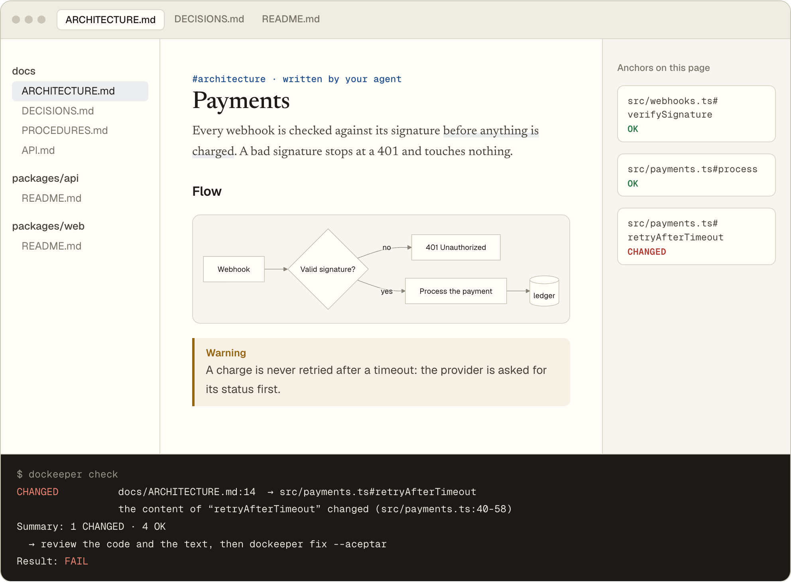
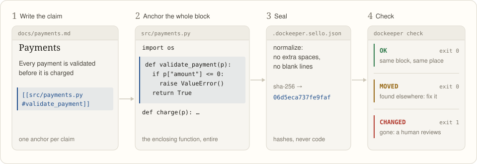
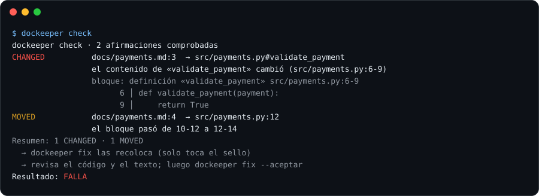
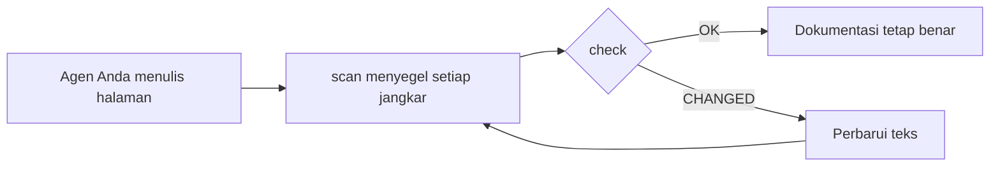

<div align="center">

# DocKeeper

**Dokumentasi yang tidak membusuk.**

Agen coding Anda yang menulis dokumentasinya, termasuk diagram. DocKeeper mengikat setiap klaim dan setiap diagram ke kode di baliknya dan memberi tahu Anda begitu kode itu berubah.

[](https://github.com/Nokky21/DocKeeper/actions/workflows/ci.yml)


[](../../LICENSE)

[Situs web](https://nokky21.github.io/DocKeeper/) · [Demo langsung](https://nokky21.github.io/DocKeeper/#demo) · [Instal](#install) · [Referensi](../reference.md)

<details>
<summary>🌐 Bahasa Indonesia</summary>

<sub>[English](../../README.md) · [Español](README.es.md) · [Português](README.pt-BR.md) · [Français](README.fr.md) · [Deutsch](README.de.md) · [Italiano](README.it.md) · [Nederlands](README.nl.md) · [Polski](README.pl.md) · [Čeština](README.cs.md) · [Svenska](README.sv.md) · [Русский](README.ru.md) · [Українська](README.uk.md) · [Türkçe](README.tr.md) · [العربية](README.ar.md) · [עברית](README.he.md) · [हिन्दी](README.hi.md) · [简体中文](README.zh-CN.md) · [繁體中文](README.zh-TW.md) · [日本語](README.ja.md) · [한국어](README.ko.md) · [Tiếng Việt](README.vi.md) · **Bahasa Indonesia** · [ไทย](README.th.md)</sub>

</details>

<picture>
  <source media="(prefers-color-scheme: dark)" srcset="../../site/public/assets/readme-hero-dark.png">
  
</picture>

</div>

---

## Mengapa

README yang ditulis hari ini sudah salah beberapa bulan kemudian, dan tidak ada yang tahu halaman mana yang berbohong. DocKeeper membereskan bagian “tidak ada yang tahu” itu, gratis dan di mesin Anda sendiri:

- **Setiap klaim diperiksa.** “Pembayaran divalidasi sebelum ditagih” diikat ke fungsi yang melakukannya. Saat fungsi itu berubah, DocKeeper memberi tahu Anda.
- **Tanpa AI dalam pemeriksaan.** Agen Anda yang menulis; pemeriksaan membandingkan sidik jari, jadi jawabannya selalu sama.
- **Lokal dan gratis.** Tanpa akun, tanpa server, tanpa jaringan, tanpa dependensi. Lisensi MIT.

## Apa yang ditulisnya

Minta sekali, dan agen Anda mendokumentasikan seluruh repositori halaman demi halaman berdasarkan templat di skill:

<table>
<tr><td><b>README</b></td><td>Apa itu, cara kerjanya, cara menjalankannya.</td></tr>
<tr><td><b>Arsitektur</b></td><td>Komponen, alur, data, dan batasan, lengkap dengan diagram.</td></tr>
<tr><td><b>Keputusan</b></td><td>Apa yang diputuskan dan mengapa, hanya dari riwayat git.</td></tr>
<tr><td><b>Prosedur</b></td><td>Runbook dengan perintah yang tepat.</td></tr>
<tr><td><b>API</b></td><td>Setiap operasi beserta input, galat, dan efeknya.</td></tr>
<tr><td><b>Orientasi</b></td><td>Jalur bacaan untuk hari pertama.</td></tr>
</table>

Di monorepo, ia juga menulis README untuk setiap paket. Setiap klaim menunjuk ke kodenya. Lihat [arsitektur DocKeeper sendiri](../architecture.md), yang ditulis dengan skill ini.

## Cara kerjanya

<p align="center"></p>

1. **Tambatkan.** Di samping setiap klaim, agen menulis letaknya di kode: `[[src/payments.py#validate_payment]]`, atau hal yang sama di dalam komentar HTML agar halaman tetap bersih.
2. **Segel.** `dockeeper scan` mengambil sidik jari kode di balik setiap jangkar, biasanya seluruh fungsi. Mengubah format tidak berpengaruh; mengubah logika berpengaruh.
   <!-- dockeeper: dockeeper/bloques.py#bloque_en dockeeper/huellas.py#huella -->
3. **Periksa.** `dockeeper check` memberi putusan untuk setiap klaim: `OK`; `MOVED` (kodenya pindah, dan `dockeeper fix` mengikutinya tanpa perlu ditinjau); atau `CHANGED` (kodenya berubah, jadi seseorang membacanya dan memperbarui teks). Satu `CHANGED` saja membuatnya keluar dengan kode 1, sehingga CI gagal.
   <!-- dockeeper: dockeeper/motor.py#verificar_codigo dockeeper/motor.py#FALLOS -->

<p align="center"></p>

<a id="install"></a>

## Instalasi

Anda memerlukan `python3` (3.10 atau lebih baru) dan `git`. Klon repositori ke folder yang namanya persis `dockeeper`:

```bash
# Claude Code
git clone https://github.com/Nokky21/DocKeeper.git ~/.claude/skills/dockeeper

# Codex, Gemini CLI, Cursor, GitHub Copilot
git clone https://github.com/Nokky21/DocKeeper.git ~/.agents/skills/dockeeper
```

Folder lain, satu proyek saja, Windows, claude.ai, dan API: lihat [panduan instalasi](../install.md).

## Penggunaan

Minta agen Anda dengan kata-kata sendiri:

- *“Dokumentasikan repositori ini dengan dockeeper.”* Monorepo juga bisa, satu paket setiap kali.
- *“Periksa apakah dokumentasi kita masih benar dan perbaiki yang tidak.”*
- *“Tinjau dokumentasi di setiap commit.”* Agen memasang git hook yang tidak pernah memblokir commit.
- *“Tulis halaman keputusan dari riwayat git. Jangan mengarang alasan.”*
- *“Gambar arsitekturnya dengan diagram alur.”*

Atau jalankan sendiri dari root proyek Anda:

```bash
DK="python3 $HOME/.claude/skills/dockeeper/bin/dockeeper"
$DK audit    # apa yang kurang: halaman, paket, kode tanpa dokumentasi
$DK scan     # menyegel jangkar baru dan menunjukkan kode yang dituju tiap jangkar
$DK check    # masih benar? keluar 0 = ya, 1 = ada yang berubah
$DK fix      # mengikuti kode yang pindah (hanya menyentuh file segel)
$DK review   # apa arti commit terakhir bagi dokumentasi
```

<!-- dockeeper: dockeeper/motor.py#arreglar -->

## Di setiap commit

`review` melihat commit terakhir (atau seluruh branch, dengan `--desde main`) dan mendaftar klaim yang tersentuh, kode baru atau berubah yang belum dicakup klaim mana pun, serta keputusan dalam commit tersebut yang belum ditulis. Sebagai hook `post-commit`, siapa pun yang melakukan commit, Anda atau agen Anda, melihat daftar itu setiap kali, dan dokumentasi tumbuh bersama kodenya:
<!-- dockeeper: dockeeper/revision.py#revisar -->

```sh
#!/bin/sh
python3 "$HOME/.claude/skills/dockeeper/bin/dockeeper" review || true
```

## Diagram yang tetap benar

Agen menggambar alur, urutan, status, dan data dengan Mermaid, yang ditampilkan sama oleh GitHub dan Obsidian. Setiap diagram membawa jangkarnya di dalam, pada baris `%% dockeeper:` yang tidak terlihat, sehingga `check` menandainya saat kode yang ditampilkannya berubah. Diagram ini nyata:



## Monorepo

`audit` menemukan setiap paket (subfolder apa pun yang berisi `package.json`, `go.mod`, `Cargo.toml`, `pyproject.toml`, `pom.xml`, dan sebagainya) dan menunjukkan mana yang belum punya dokumentasi. Agen menulis halaman root beserta peta paketnya, lalu mendokumentasikan satu paket setiap kali, sehingga repositori raksasa pun muat. <!-- dockeeper: dockeeper/paquetes.py#detectar -->

## Di CI

```yaml
- uses: actions/checkout@v6
- uses: Nokky21/DocKeeper@v0.4.0
```

CI lain hanya butuh Python dan git: [klon lalu jalankan `check`](../reference.md#continuous-integration).

## Pelajari lebih lanjut

- [Panduan instalasi](../install.md): semua agen, satu proyek saja, Windows, claude.ai, dan API.
- [Referensi](../reference.md): jangkar, perintah, putusan, cakupan sebagian, dokumentasi terbitan, “mengapa”, konfigurasi, batasan, dan FAQ.
- [Arsitektur](../architecture.md): cara kerja DocKeeper di dalam, dalam enam diagram berjangkar.
- [Keputusan](../decisions.md), [prosedur](../procedures.md), [API `--json`](../api.md), dan [orientasi](../onboarding.md): untuk yang mengerjakan DocKeeper itu sendiri.
- [SKILL.md](../../SKILL.md), instruksi yang diikuti agen Anda, dan [spesifikasi](../../SPEC.md) (keduanya dalam bahasa Spanyol).

## Lisensi

[MIT](../../LICENSE).

---

<sub>Terjemahan dari [README berbahasa Inggris](../../README.md), yang menjadi acuan bila ada perbedaan. Panduan instalasi, referensi, dan arsitektur berbahasa Inggris.</sub>
