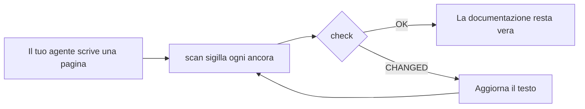

<div align="center">

# DocKeeper

**Documentazione che non marcisce.**

Il tuo agente di programmazione scrive la documentazione, diagrammi compresi. DocKeeper lega ogni affermazione e ogni diagramma al codice che li sostiene e ti avvisa appena quel codice cambia.

[](https://github.com/Nokky21/DocKeeper/actions/workflows/ci.yml)


[](../../LICENSE)

[Sito](https://nokky21.github.io/DocKeeper/) · [Demo dal vivo](https://nokky21.github.io/DocKeeper/#demo) · [Installa](#install) · [Riferimento](../reference.md)

<sub>[English](../../README.md) · [Español](README.es.md) · [Português](README.pt-BR.md) · [Français](README.fr.md) · [Deutsch](README.de.md) · **Italiano** · [Nederlands](README.nl.md) · [Polski](README.pl.md) · [Čeština](README.cs.md) · [Svenska](README.sv.md) · [Русский](README.ru.md) · [Українська](README.uk.md) · [Türkçe](README.tr.md) · [العربية](README.ar.md) · [עברית](README.he.md) · [हिन्दी](README.hi.md) · [简体中文](README.zh-CN.md) · [繁體中文](README.zh-TW.md) · [日本語](README.ja.md) · [한국어](README.ko.md) · [Tiếng Việt](README.vi.md) · [Bahasa Indonesia](README.id.md) · [ไทย](README.th.md)</sub>

</div>

---

## Perché

Un README scritto oggi è sbagliato qualche mese dopo, e nessuno sa quali pagine mentono. DocKeeper risolve la parte del «nessuno sa», gratis e sulla tua macchina:

- **Ogni affermazione viene verificata.** «I pagamenti vengono convalidati prima dell’addebito» è legata alla funzione che lo fa. Quando quella funzione cambia, DocKeeper te lo dice.
- **Niente IA nel controllo.** Il tuo agente scrive; il controllo confronta impronte, quindi dà sempre la stessa risposta.
- **Locale e gratuito.** Nessun account, nessun server, nessuna rete, nessuna dipendenza. Licenza MIT.

## Cosa scrive

Chiedilo una volta e il tuo agente documenta l’intero repository, pagina per pagina, a partire dai modelli della skill:

- **README**: cos’è, come funziona, come avviarlo.
- **Architettura**: componenti, flussi, dati e confini, con diagrammi.
- **Decisioni**: cosa è stato deciso e perché, preso solo dalla cronologia di git.
- **Procedure**: runbook con i comandi esatti.
- **API**: ogni operazione con input, errori ed effetti.
- **Onboarding**: un percorso di lettura per il primo giorno.

In un monorepo scrive anche un README per ogni pacchetto. Ogni affermazione punta al suo codice. Guarda [l’architettura di DocKeeper stesso](../architecture.md), scritta con la skill.

## Come funziona

<p align="center"></p>

1. **Ancora.** Accanto a ogni affermazione, l’agente scrive dove si trova nel codice: `[[src/payments.py#validate_payment]]`, oppure lo stesso dentro un commento HTML per tenere pulita la pagina.
2. **Sigilla.** `dockeeper scan` calcola l’impronta del codice dietro ogni ancora, di solito l’intera funzione. Riformattare non conta; cambiare la logica sì.
   <!-- dockeeper: dockeeper/bloques.py#bloque_en dockeeper/huellas.py#huella -->
3. **Controlla.** `dockeeper check` dà un verdetto per ogni affermazione: `OK`; `MOVED` (il codice si è spostato e `dockeeper fix` lo segue senza bisogno di revisione); oppure `CHANGED` (il codice è cambiato, quindi una persona lo legge e aggiorna il testo). Qualsiasi `CHANGED` lo fa uscire con 1, quindi la CI fallisce.
   <!-- dockeeper: dockeeper/motor.py#verificar_codigo dockeeper/motor.py#FALLOS -->

<p align="center"></p>

<a id="install"></a>

## Installazione

Ti servono `python3` (3.10 o successivo) e `git`. Clona il repository in una cartella che si chiami esattamente `dockeeper`:

```bash
# Claude Code
git clone https://github.com/Nokky21/DocKeeper.git ~/.claude/skills/dockeeper

# Codex, Gemini CLI, Cursor, GitHub Copilot
git clone https://github.com/Nokky21/DocKeeper.git ~/.agents/skills/dockeeper
```

Altre cartelle, un solo progetto, Windows, claude.ai e l’API: vedi la [guida all’installazione](../install.md).

## Uso

Chiedilo al tuo agente con parole tue:

- *«Documenta questo repository con dockeeper.»* Anche i monorepo, un pacchetto alla volta.
- *«Controlla se la nostra documentazione è ancora vera e correggi quello che non lo è.»*
- *«Rivedi la documentazione a ogni commit.»* Installa un hook di git che non blocca mai un commit.
- *«Scrivi la pagina delle decisioni a partire dalla cronologia di git. Non inventare motivazioni.»*
- *«Disegna l’architettura con diagrammi di flusso.»*

Oppure eseguilo tu dalla radice del progetto:

```bash
DK="python3 $HOME/.claude/skills/dockeeper/bin/dockeeper"
$DK audit    # cosa manca: pagine, pacchetti, codice non documentato
$DK scan     # sigilla le nuove ancore e mostra il codice a cui punta ciascuna
$DK check    # è ancora vero? uscita 0 = sì, 1 = qualcosa è cambiato
$DK fix      # segue il codice spostato (tocca solo il file del sigillo)
$DK review   # cosa significa l’ultimo commit per la documentazione
```

<!-- dockeeper: dockeeper/motor.py#arreglar -->

## A ogni commit

`review` guarda l’ultimo commit (o un intero branch, con `--desde main`) ed elenca le affermazioni toccate, il codice nuovo o modificato che nessuna affermazione copre ancora e le decisioni di quei commit che non sono scritte. Come hook `post-commit`, chi fa il commit, tu o il tuo agente, vede quell’elenco ogni volta, e la documentazione cresce insieme al codice:
<!-- dockeeper: dockeeper/revision.py#revisar -->

```sh
#!/bin/sh
python3 "$HOME/.claude/skills/dockeeper/bin/dockeeper" review || true
```

## Diagrammi che restano veri

L’agente disegna flussi, sequenze, stati e dati in Mermaid, che GitHub e Obsidian mostrano allo stesso modo. Ogni diagramma porta dentro le sue ancore, su righe `%% dockeeper:` che nessuno vede, così `check` lo segnala quando cambia il codice che mostra. Questo è reale:



## Monorepo

`audit` trova ogni pacchetto (qualsiasi sottocartella con `package.json`, `go.mod`, `Cargo.toml`, `pyproject.toml`, `pom.xml` e così via) e mostra quali non hanno documentazione. L’agente scrive le pagine della radice con una mappa dei pacchetti e poi documenta un pacchetto alla volta, così anche un repository enorme ci sta. <!-- dockeeper: dockeeper/paquetes.py#detectar -->

## In CI

```yaml
- uses: actions/checkout@v6
- uses: Nokky21/DocKeeper@v0.2.0
```

Qualsiasi altra CI ha bisogno solo di Python e git: [clonalo ed esegui `check`](../reference.md#continuous-integration).

## Per saperne di più

- [Guida all’installazione](../install.md): ogni agente, un solo progetto, Windows, claude.ai e l’API.
- [Riferimento](../reference.md): ancore, comandi, verdetti, ambito parziale, documentazione pubblicata, il «perché», configurazione, limiti e FAQ.
- [Architettura](../architecture.md): come funziona DocKeeper dentro, in sei diagrammi ancorati.
- [SKILL.md](../../SKILL.md), le istruzioni che segue il tuo agente, e la [specifica](../../SPEC.md) (entrambe in spagnolo).

## Licenza

[MIT](../../LICENSE).

---

<sub>Traduzione del [README in inglese](../../README.md), che fa fede in caso di differenze. La guida all’installazione, il riferimento e l’architettura sono in inglese.</sub>
