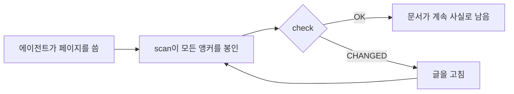

<div align="center">

# DocKeeper

**썩지 않는 문서.**

문서는 다이어그램까지 코딩 에이전트가 씁니다. DocKeeper는 모든 주장과 모든 다이어그램을 그 뒤에 있는 코드에 묶어 두고, 그 코드가 바뀌는 순간 알려 줍니다.

[](https://github.com/Nokky21/DocKeeper/actions/workflows/ci.yml)


[](../../LICENSE)

[웹사이트](https://nokky21.github.io/DocKeeper/) · [라이브 데모](https://nokky21.github.io/DocKeeper/#demo) · [설치](#install) · [레퍼런스](../reference.md)

<details>
<summary>🌐 한국어</summary>

<sub>[English](../../README.md) · [Español](README.es.md) · [Português](README.pt-BR.md) · [Français](README.fr.md) · [Deutsch](README.de.md) · [Italiano](README.it.md) · [Nederlands](README.nl.md) · [Polski](README.pl.md) · [Čeština](README.cs.md) · [Svenska](README.sv.md) · [Русский](README.ru.md) · [Українська](README.uk.md) · [Türkçe](README.tr.md) · [العربية](README.ar.md) · [עברית](README.he.md) · [हिन्दी](README.hi.md) · [简体中文](README.zh-CN.md) · [繁體中文](README.zh-TW.md) · [日本語](README.ja.md) · **한국어** · [Tiếng Việt](README.vi.md) · [Bahasa Indonesia](README.id.md) · [ไทย](README.th.md)</sub>

</details>

<picture>
  <source media="(prefers-color-scheme: dark)" srcset="../../site/public/assets/readme-hero-dark.png">
  
</picture>

</div>

---

## 왜 필요한가

오늘 쓴 README는 몇 달 뒤면 틀리게 되고, 어느 페이지가 거짓말을 하는지 아무도 모릅니다. DocKeeper는 이 ‘아무도 모른다’는 문제를 무료로, 여러분의 컴퓨터에서 해결합니다.

- **모든 주장을 검사합니다.** “결제는 청구 전에 검증된다”는 문장은 그 일을 하는 함수에 묶입니다. 그 함수가 바뀌면 DocKeeper가 알려 줍니다.
- **검사에 AI를 쓰지 않습니다.** 글은 에이전트가 쓰고, 검사는 지문을 비교하므로 항상 같은 답을 냅니다.
- **로컬이고 무료입니다.** 계정, 서버, 네트워크, 의존성이 모두 필요 없습니다. MIT 라이선스.

## 무엇을 쓰나

한 번만 부탁하면 에이전트가 스킬의 템플릿을 바탕으로 저장소 전체를 한 페이지씩 문서화합니다.

<table>
<tr><td><b>README</b></td><td>무엇인지, 어떻게 동작하는지, 어떻게 실행하는지.</td></tr>
<tr><td><b>아키텍처</b></td><td>컴포넌트, 흐름, 데이터, 경계를 다이어그램과 함께.</td></tr>
<tr><td><b>의사 결정</b></td><td>무엇을 왜 결정했는지, git 기록에서만 가져와서.</td></tr>
<tr><td><b>절차</b></td><td>정확한 명령어가 담긴 런북.</td></tr>
<tr><td><b>API</b></td><td>모든 작업의 입력, 오류, 효과.</td></tr>
<tr><td><b>온보딩</b></td><td>첫날을 위한 읽기 순서.</td></tr>
</table>

모노레포에서는 패키지마다 README도 씁니다. 모든 주장은 자기 코드를 가리킵니다. 스킬로 쓴 [DocKeeper 자체의 아키텍처](../architecture.md)를 확인해 보세요.

## 작동 방식

<p align="center"></p>

1. **앵커 달기.** 에이전트는 각 주장 옆에 그것이 코드의 어디에 있는지 적습니다: `[[src/payments.py#validate_payment]]`. 페이지를 깔끔하게 두려면 같은 내용을 HTML 주석 안에 넣으면 됩니다.
2. **봉인하기.** `dockeeper scan`은 각 앵커 뒤의 코드, 보통은 함수 전체의 지문을 만듭니다. 서식을 바꾸는 것은 상관없고, 로직을 바꾸면 감지됩니다.
   <!-- dockeeper: dockeeper/bloques.py#bloque_en dockeeper/huellas.py#huella -->
3. **검사하기.** `dockeeper check`는 주장마다 판정을 내립니다: `OK`, `MOVED`(코드가 자리만 옮겼고, `dockeeper fix`가 검토 없이 따라갑니다), 또는 `CHANGED`(코드가 바뀌었으니 사람이 읽고 글을 고칩니다). `CHANGED`가 하나라도 있으면 종료 코드가 1이 되어 CI가 실패합니다.
   <!-- dockeeper: dockeeper/motor.py#verificar_codigo dockeeper/motor.py#FALLOS -->

<p align="center"></p>

<a id="install"></a>

## 설치

`python3`(3.10 이상)와 `git`이 필요합니다. 저장소를 이름이 정확히 `dockeeper`인 폴더에 클론하세요.

```bash
# Claude Code
git clone https://github.com/Nokky21/DocKeeper.git ~/.claude/skills/dockeeper

# Codex, Gemini CLI, Cursor, GitHub Copilot
git clone https://github.com/Nokky21/DocKeeper.git ~/.agents/skills/dockeeper
```

다른 폴더, 단일 프로젝트, Windows, claude.ai, API는 [설치 가이드](../install.md)를 참고하세요.

## 사용법

에이전트에게 평소 말투로 부탁하세요.

- *“dockeeper로 이 저장소를 문서화해 줘.”* 모노레포도 패키지 하나씩 처리합니다.
- *“우리 문서가 아직 사실인지 확인하고, 아닌 부분은 고쳐 줘.”*
- *“커밋할 때마다 문서를 검토해 줘.”* 커밋을 절대 막지 않는 git 훅을 설치합니다.
- *“git 기록을 바탕으로 의사 결정 페이지를 써 줘. 이유를 지어내지는 마.”*
- *“흐름도로 아키텍처를 그려 줘.”*

아니면 프로젝트 루트에서 직접 실행하세요.

```bash
DK="python3 $HOME/.claude/skills/dockeeper/bin/dockeeper"
$DK audit    # 빠진 것: 페이지, 패키지, 문서가 없는 코드
$DK scan     # 새 앵커를 봉인하고 각 앵커가 가리키는 코드를 보여 줌
$DK check    # 아직 사실인가? 종료 코드 0 = 예, 1 = 무언가 바뀜
$DK fix      # 옮겨 간 코드를 따라감 (봉인 파일만 수정)
$DK review   # 마지막 커밋이 문서에 어떤 의미인지
```

<!-- dockeeper: dockeeper/motor.py#arreglar -->

## 커밋할 때마다

`review`는 마지막 커밋(또는 `--desde main`으로 브랜치 전체)을 살펴보고, 영향을 받은 주장, 아직 어떤 주장도 다루지 않는 새 코드나 바뀐 코드, 그리고 그 커밋들에 있지만 아직 문서로 남기지 않은 결정을 나열합니다. `post-commit` 훅으로 설정하면 커밋하는 사람이 여러분이든 에이전트든 매번 이 목록을 보게 되고, 문서가 코드와 함께 자랍니다.
<!-- dockeeper: dockeeper/revision.py#revisar -->

```sh
#!/bin/sh
python3 "$HOME/.claude/skills/dockeeper/bin/dockeeper" review || true
```

## 계속 사실로 남는 다이어그램

에이전트는 흐름, 시퀀스, 상태, 데이터를 Mermaid로 그리며, GitHub와 Obsidian은 이를 똑같이 보여 줍니다. 각 다이어그램은 아무도 보지 못하는 `%% dockeeper:` 줄에 앵커를 품고 있어서, 다이어그램이 보여 주는 코드가 바뀌면 `check`가 표시합니다. 아래 다이어그램은 실제입니다.



## 모노레포

`audit`는 모든 패키지(`package.json`, `go.mod`, `Cargo.toml`, `pyproject.toml`, `pom.xml` 등이 있는 하위 폴더)를 찾아서 문서가 없는 것을 보여 줍니다. 에이전트는 먼저 루트 페이지를 패키지 지도와 함께 쓰고, 그다음 패키지를 하나씩 문서화하므로 아무리 큰 저장소도 감당할 수 있습니다. <!-- dockeeper: dockeeper/paquetes.py#detectar -->

## CI에서

```yaml
- uses: actions/checkout@v6
- uses: Nokky21/DocKeeper@v0.4.0
```

다른 CI에서는 Python과 git만 있으면 됩니다: [클론하고 `check` 실행](../reference.md#continuous-integration).

## 더 알아보기

- [설치 가이드](../install.md): 모든 에이전트, 단일 프로젝트, Windows, claude.ai, API.
- [레퍼런스](../reference.md): 앵커, 명령어, 판정, 부분 범위, 공개 문서, ‘왜’, 설정, 한계, FAQ.
- [아키텍처](../architecture.md): DocKeeper의 내부 동작을 앵커가 달린 다이어그램 여섯 개로.
- 에이전트가 따르는 지침인 [SKILL.md](../../SKILL.md)와 [명세](../../SPEC.md) (둘 다 스페인어).

## 라이선스

[MIT](../../LICENSE).

---

<sub>[영어 README](../../README.md)의 번역입니다. 내용이 다르면 영어판을 기준으로 합니다. 설치 가이드, 레퍼런스, 아키텍처 문서는 영어로 되어 있습니다.</sub>
