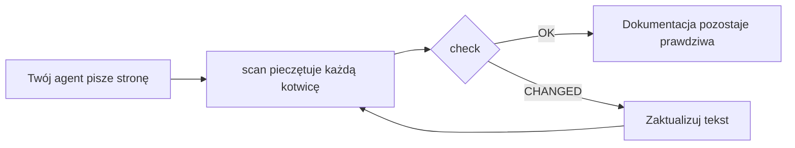

<div align="center">

# DocKeeper

**Dokumentacja, która się nie psuje.**

Twój agent programistyczny pisze dokumentację, razem z diagramami. DocKeeper wiąże każde stwierdzenie i każdy diagram z kodem, który za nimi stoi, i daje znać, gdy tylko ten kod się zmieni.

[](https://github.com/Nokky21/DocKeeper/actions/workflows/ci.yml)


[](../../LICENSE)

[Strona](https://nokky21.github.io/DocKeeper/) · [Demo na żywo](https://nokky21.github.io/DocKeeper/#demo) · [Instalacja](#install) · [Dokumentacja referencyjna](../reference.md)

<sub>[English](../../README.md) · [Español](README.es.md) · [Português](README.pt-BR.md) · [Français](README.fr.md) · [Deutsch](README.de.md) · [Italiano](README.it.md) · [Nederlands](README.nl.md) · **Polski** · [Čeština](README.cs.md) · [Svenska](README.sv.md) · [Русский](README.ru.md) · [Українська](README.uk.md) · [Türkçe](README.tr.md) · [العربية](README.ar.md) · [עברית](README.he.md) · [हिन्दी](README.hi.md) · [简体中文](README.zh-CN.md) · [繁體中文](README.zh-TW.md) · [日本語](README.ja.md) · [한국어](README.ko.md) · [Tiếng Việt](README.vi.md) · [Bahasa Indonesia](README.id.md) · [ไทย](README.th.md)</sub>

</div>

---

## Dlaczego

README napisane dziś po kilku miesiącach jest już nieaktualne, a nikt nie wie, które strony kłamią. DocKeeper rozwiązuje problem „nikt nie wie” — za darmo i na twoim komputerze:

- **Każde stwierdzenie jest sprawdzane.** „Płatności są weryfikowane przed obciążeniem” jest powiązane z funkcją, która to robi. Gdy ta funkcja się zmieni, DocKeeper ci o tym powie.
- **Bez AI w sprawdzaniu.** Twój agent pisze; sprawdzanie porównuje odciski, więc zawsze daje tę samą odpowiedź.
- **Lokalnie i za darmo.** Bez konta, bez serwera, bez sieci, bez zależności. Licencja MIT.

## Co pisze

Poproś raz, a twój agent udokumentuje całe repozytorium, strona po stronie, według szablonów ze skilla:

- **README**: czym to jest, jak działa i jak to uruchomić.
- **Architektura**: komponenty, przepływy, dane i granice, z diagramami.
- **Decyzje**: co postanowiono i dlaczego, tylko na podstawie historii gita.
- **Procedury**: runbooki z dokładnymi poleceniami.
- **API**: każda operacja z danymi wejściowymi, błędami i skutkami.
- **Wdrożenie**: ścieżka czytania na pierwszy dzień.

W monorepo pisze też README dla każdego pakietu. Każde stwierdzenie wskazuje na swój kod. Zobacz [architekturę samego DocKeepera](../architecture.md), napisaną za pomocą skilla.

## Jak to działa

<p align="center"></p>

1. **Zakotwicz.** Obok każdego stwierdzenia agent zapisuje, gdzie ono żyje w kodzie: `[[src/payments.py#validate_payment]]`, albo to samo w komentarzu HTML, żeby strona była czysta.
2. **Zapieczętuj.** `dockeeper scan` liczy odcisk kodu stojącego za każdą kotwicą, zwykle całej funkcji. Przeformatowanie nie ma znaczenia; zmiana logiki — ma.
   <!-- dockeeper: dockeeper/bloques.py#bloque_en dockeeper/huellas.py#huella -->
3. **Sprawdź.** `dockeeper check` wydaje werdykt dla każdego stwierdzenia: `OK`; `MOVED` (kod się przesunął, a `dockeeper fix` podąża za nim bez niczyjej weryfikacji); albo `CHANGED` (kod się zmienił, więc człowiek go czyta i aktualizuje tekst). Każde `CHANGED` kończy się kodem wyjścia 1, więc CI nie przechodzi.
   <!-- dockeeper: dockeeper/motor.py#verificar_codigo dockeeper/motor.py#FALLOS -->

<p align="center"></p>

<a id="install"></a>

## Instalacja

Potrzebujesz `python3` (3.10 lub nowszego) i `git`. Sklonuj repozytorium do folderu o nazwie dokładnie `dockeeper`:

```bash
# Claude Code
git clone https://github.com/Nokky21/DocKeeper.git ~/.claude/skills/dockeeper

# Codex, Gemini CLI, Cursor, GitHub Copilot
git clone https://github.com/Nokky21/DocKeeper.git ~/.agents/skills/dockeeper
```

Inne foldery, pojedynczy projekt, Windows, claude.ai i API: zobacz [przewodnik instalacji](../install.md).

## Użycie

Poproś swojego agenta własnymi słowami:

- *„Udokumentuj to repozytorium za pomocą dockeeper.”* Również monorepo, po jednym pakiecie.
- *„Sprawdź, czy nasza dokumentacja jest wciąż prawdziwa, i popraw to, co nie jest.”*
- *„Sprawdzaj dokumentację przy każdym commicie.”* Instaluje hook gita, który nigdy nie blokuje commita.
- *„Napisz stronę decyzji na podstawie historii gita. Nie wymyślaj powodów.”*
- *„Narysuj architekturę na diagramach przepływu.”*

Albo uruchom go sam w katalogu głównym projektu:

```bash
DK="python3 $HOME/.claude/skills/dockeeper/bin/dockeeper"
$DK audit    # czego brakuje: strony, pakiety, nieudokumentowany kod
$DK scan     # pieczętuje nowe kotwice i pokazuje kod, na który wskazuje każda z nich
$DK check    # wciąż prawda? wyjście 0 = tak, 1 = coś się zmieniło
$DK fix      # podąża za przeniesionym kodem (zmienia tylko plik pieczęci)
$DK review   # co ostatni commit oznacza dla dokumentacji
```

<!-- dockeeper: dockeeper/motor.py#arreglar -->

## Przy każdym commicie

`review` przegląda ostatni commit (albo całą gałąź, z `--desde main`) i wypisuje stwierdzenia, których dotknął, nowy lub zmieniony kod, którego nie obejmuje jeszcze żadne stwierdzenie, oraz decyzje z tych commitów, które nie zostały zapisane. Jako hook `post-commit` ten, kto robi commit — ty albo twój agent — widzi tę listę za każdym razem, a dokumentacja rośnie razem z kodem:
<!-- dockeeper: dockeeper/revision.py#revisar -->

```sh
#!/bin/sh
python3 "$HOME/.claude/skills/dockeeper/bin/dockeeper" review || true
```

## Diagramy, które pozostają prawdziwe

Agent rysuje przepływy, sekwencje, stany i dane w Mermaid, który GitHub i Obsidian wyświetlają tak samo. Każdy diagram ma swoje kotwice w środku, w niewidocznych liniach `%% dockeeper:`, więc `check` go zgłasza, gdy zmieni się pokazany kod. Ten jest prawdziwy:



## Monorepo

`audit` znajduje każdy pakiet (dowolny podfolder z `package.json`, `go.mod`, `Cargo.toml`, `pyproject.toml`, `pom.xml` itd.) i pokazuje, które nie mają dokumentacji. Agent pisze strony w katalogu głównym z mapą pakietów, a potem dokumentuje po jednym pakiecie, więc mieści się nawet ogromne repozytorium. <!-- dockeeper: dockeeper/paquetes.py#detectar -->

## W CI

```yaml
- uses: actions/checkout@v6
- uses: Nokky21/DocKeeper@v0.3.0
```

Każde inne CI potrzebuje tylko Pythona i gita: [sklonuj i uruchom `check`](../reference.md#continuous-integration).

## Więcej

- [Przewodnik instalacji](../install.md): każdy agent, pojedynczy projekt, Windows, claude.ai i API.
- [Dokumentacja referencyjna](../reference.md): kotwice, polecenia, werdykty, częściowy zakres, publikowana dokumentacja, „dlaczego”, konfiguracja, ograniczenia i FAQ.
- [Architektura](../architecture.md): jak DocKeeper działa w środku, w sześciu zakotwiczonych diagramach.
- [SKILL.md](../../SKILL.md), czyli instrukcje, których przestrzega twój agent, oraz [specyfikacja](../../SPEC.md) (obie po hiszpańsku).

## Licencja

[MIT](../../LICENSE).

---

<sub>Tłumaczenie [angielskiego README](../../README.md), które jest wiążące w razie różnic. Przewodnik instalacji, dokumentacja referencyjna i architektura są po angielsku.</sub>
