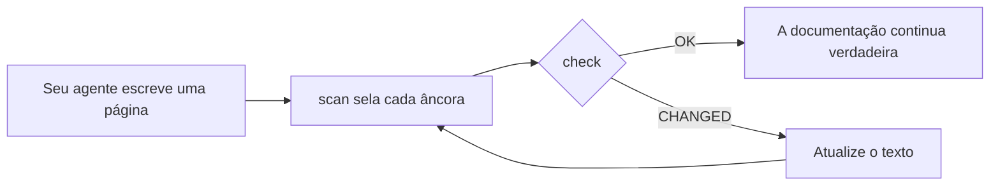

<div align="center">

# DocKeeper

**Documentação que não apodrece.**

Seu agente de código escreve a documentação, diagramas incluídos. O DocKeeper liga cada afirmação e cada diagrama ao código que os sustenta e avisa você no momento em que esse código muda.

[](https://github.com/Nokky21/DocKeeper/actions/workflows/ci.yml)


[](../../LICENSE)

[Site](https://nokky21.github.io/DocKeeper/) · [Demo ao vivo](https://nokky21.github.io/DocKeeper/#demo) · [Instalar](#install) · [Referência](../reference.md)

<sub>[English](../../README.md) · [Español](README.es.md) · **Português** · [Français](README.fr.md) · [Deutsch](README.de.md) · [Italiano](README.it.md) · [Nederlands](README.nl.md) · [Polski](README.pl.md) · [Čeština](README.cs.md) · [Svenska](README.sv.md) · [Русский](README.ru.md) · [Українська](README.uk.md) · [Türkçe](README.tr.md) · [العربية](README.ar.md) · [עברית](README.he.md) · [हिन्दी](README.hi.md) · [简体中文](README.zh-CN.md) · [繁體中文](README.zh-TW.md) · [日本語](README.ja.md) · [한국어](README.ko.md) · [Tiếng Việt](README.vi.md) · [Bahasa Indonesia](README.id.md) · [ไทย](README.th.md)</sub>

</div>

---

## Por quê

Um README escrito hoje estará errado alguns meses depois, e ninguém sabe quais páginas estão mentindo. O DocKeeper resolve a parte do “ninguém sabe”, de graça e na sua máquina:

- **Cada afirmação é verificada.** “Os pagamentos são validados antes de serem cobrados” fica ligado à função que faz isso. Quando essa função muda, o DocKeeper avisa.
- **Sem IA na verificação.** Seu agente escreve; a verificação compara impressões digitais, então dá sempre a mesma resposta.
- **Local e gratuito.** Sem conta, sem servidor, sem rede, sem dependências. Licença MIT.

## O que ele escreve

Peça uma vez e seu agente documenta o repositório inteiro, página por página, a partir dos modelos da skill:

- **README**: o que é, como funciona e como rodar.
- **Arquitetura**: componentes, fluxos, dados e fronteiras, com diagramas.
- **Decisões**: o que foi decidido e por quê, tirado só do histórico do git.
- **Procedimentos**: runbooks com os comandos exatos.
- **API**: cada operação com suas entradas, erros e efeitos.
- **Onboarding**: um roteiro de leitura para o primeiro dia.

Em um monorepo, ele também escreve um README para cada pacote. Cada afirmação aponta para o seu código. Veja [a arquitetura do próprio DocKeeper](../architecture.md), escrita pela skill.

## Como funciona

<p align="center"></p>

1. **Ancorar.** Ao lado de cada afirmação, o agente escreve onde ela vive no código: `[[src/payments.py#validate_payment]]`, ou o mesmo dentro de um comentário HTML para manter a página limpa.
2. **Selar.** `dockeeper scan` tira a impressão digital do código por trás de cada âncora, normalmente a função inteira. Reformatar não importa; mudar a lógica, sim.
   <!-- dockeeper: dockeeper/bloques.py#bloque_en dockeeper/huellas.py#huella -->
3. **Verificar.** `dockeeper check` dá um veredito a cada afirmação: `OK`; `MOVED` (o código mudou de lugar, e `dockeeper fix` o acompanha sem que ninguém precise revisar); ou `CHANGED` (o código mudou, então uma pessoa o lê e atualiza o texto). Qualquer `CHANGED` faz o comando sair com 1, então o CI falha.
   <!-- dockeeper: dockeeper/motor.py#verificar_codigo dockeeper/motor.py#FALLOS -->

<p align="center"></p>

<a id="install"></a>

## Instalar

Você precisa de `python3` (3.10 ou mais recente) e `git`. Clone o repositório em uma pasta chamada exatamente `dockeeper`:

```bash
# Claude Code
git clone https://github.com/Nokky21/DocKeeper.git ~/.claude/skills/dockeeper

# Codex, Gemini CLI, Cursor, GitHub Copilot
git clone https://github.com/Nokky21/DocKeeper.git ~/.agents/skills/dockeeper
```

Outras pastas, um único projeto, Windows, claude.ai e a API: veja o [guia de instalação](../install.md).

## Como usar

Peça ao seu agente com suas palavras:

- *“Documente este repositório com o dockeeper.”* Monorepos também, um pacote por vez.
- *“Verifique se a nossa documentação ainda é verdadeira e corrija o que não for.”*
- *“Revise a documentação a cada commit.”* Ele instala um hook do git que nunca bloqueia um commit.
- *“Escreva a página de decisões a partir do histórico do git. Não invente motivos.”*
- *“Desenhe a arquitetura com diagramas de fluxo.”*

Ou execute você mesmo na raiz do seu projeto:

```bash
DK="python3 $HOME/.claude/skills/dockeeper/bin/dockeeper"
$DK audit    # o que falta: páginas, pacotes, código sem documentação
$DK scan     # sela as âncoras novas e mostra o código para onde cada uma aponta
$DK check    # ainda é verdade? saída 0 = sim, 1 = algo mudou
$DK fix      # acompanha o código que mudou de lugar (só altera o arquivo de selo)
$DK review   # o que o último commit significa para a documentação
```

<!-- dockeeper: dockeeper/motor.py#arreglar -->

## A cada commit

`review` olha o último commit (ou uma branch inteira, com `--desde main`) e lista as afirmações que ele afetou, o código novo ou alterado que nenhuma afirmação cobre ainda e as decisões desses commits que não estão escritas. Como hook `post-commit`, quem faz o commit, você ou seu agente, vê essa lista toda vez, e a documentação cresce junto com o código:
<!-- dockeeper: dockeeper/revision.py#revisar -->

```sh
#!/bin/sh
python3 "$HOME/.claude/skills/dockeeper/bin/dockeeper" review || true
```

## Diagramas que continuam verdadeiros

O agente desenha fluxos, sequências, estados e dados em Mermaid, que o GitHub e o Obsidian renderizam do mesmo jeito. Cada diagrama carrega suas âncoras por dentro, em linhas `%% dockeeper:` que ninguém vê, então o `check` o aponta quando o código que ele mostra muda. Este aqui é real:



## Monorepos

`audit` encontra cada pacote (qualquer subpasta com `package.json`, `go.mod`, `Cargo.toml`, `pyproject.toml`, `pom.xml` etc.) e mostra quais não têm documentação. O agente escreve as páginas da raiz com um mapa dos pacotes e depois documenta um pacote por vez, então até um repositório enorme cabe. <!-- dockeeper: dockeeper/paquetes.py#detectar -->

## No CI

```yaml
- uses: actions/checkout@v6
- uses: Nokky21/DocKeeper@v0.3.0
```

Qualquer outro CI só precisa de Python e git: [clone e rode o `check`](../reference.md#continuous-integration).

## Saiba mais

- [Guia de instalação](../install.md): cada agente, um único projeto, Windows, claude.ai e a API.
- [Referência](../reference.md): âncoras, comandos, veredictos, escopo parcial, documentação publicada, o “porquê”, configuração, limites e perguntas frequentes.
- [Arquitetura](../architecture.md): como o DocKeeper funciona por dentro, em seis diagramas ancorados.
- [SKILL.md](../../SKILL.md), as instruções que seu agente segue, e a [especificação](../../SPEC.md) (ambas em espanhol).

## Licença

[MIT](../../LICENSE).

---

<sub>Tradução do [README em inglês](../../README.md), que é a referência em caso de diferença. O guia de instalação, a referência e a arquitetura estão em inglês.</sub>
