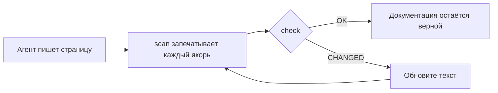

<div align="center">

# DocKeeper

**Документация, которая не устаревает.**

Ваш агент для программирования пишет документацию, включая диаграммы. DocKeeper привязывает каждое утверждение и каждую диаграмму к коду, который за ними стоит, и сообщает вам, как только этот код меняется.

[](https://github.com/Nokky21/DocKeeper/actions/workflows/ci.yml)


[](../../LICENSE)

[Сайт](https://nokky21.github.io/DocKeeper/) · [Живое демо](https://nokky21.github.io/DocKeeper/#demo) · [Установка](#install) · [Справочник](../reference.md)

<details>
<summary>🌐 Русский</summary>

<sub>[English](../../README.md) · [Español](README.es.md) · [Português](README.pt-BR.md) · [Français](README.fr.md) · [Deutsch](README.de.md) · [Italiano](README.it.md) · [Nederlands](README.nl.md) · [Polski](README.pl.md) · [Čeština](README.cs.md) · [Svenska](README.sv.md) · **Русский** · [Українська](README.uk.md) · [Türkçe](README.tr.md) · [العربية](README.ar.md) · [עברית](README.he.md) · [हिन्दी](README.hi.md) · [简体中文](README.zh-CN.md) · [繁體中文](README.zh-TW.md) · [日本語](README.ja.md) · [한국어](README.ko.md) · [Tiếng Việt](README.vi.md) · [Bahasa Indonesia](README.id.md) · [ไทย](README.th.md)</sub>

</details>

<picture>
  <source media="(prefers-color-scheme: dark)" srcset="../../site/public/assets/readme-hero-dark.png">
  
</picture>

</div>

---

## Зачем

README, написанный сегодня, через несколько месяцев уже неверен, и никто не знает, какие страницы врут. DocKeeper решает проблему «никто не знает» — бесплатно и на вашей машине:

- **Каждое утверждение проверяется.** «Платежи проверяются до списания» привязано к функции, которая это делает. Когда эта функция меняется, DocKeeper сообщает об этом.
- **Никакого ИИ в проверке.** Пишет ваш агент; проверка сравнивает отпечатки, поэтому всегда даёт один и тот же ответ.
- **Локально и бесплатно.** Без аккаунта, без сервера, без сети, без зависимостей. Лицензия MIT.

## Что он пишет

Попросите один раз — и агент задокументирует весь репозиторий, страница за страницей, по шаблонам из скилла:

<table>
<tr><td><b>README</b></td><td>Что это, как работает и как запустить.</td></tr>
<tr><td><b>Архитектура</b></td><td>Компоненты, потоки, данные и границы, с диаграммами.</td></tr>
<tr><td><b>Решения</b></td><td>Что решили и почему — только из истории git.</td></tr>
<tr><td><b>Процедуры</b></td><td>Ранбуки с точными командами.</td></tr>
<tr><td><b>API</b></td><td>Каждая операция с входными данными, ошибками и эффектами.</td></tr>
<tr><td><b>Онбординг</b></td><td>Маршрут чтения на первый день.</td></tr>
</table>

В монорепозитории он также пишет README для каждого пакета. Каждое утверждение указывает на свой код. Посмотрите [архитектуру самого DocKeeper](../architecture.md), написанную с помощью скилла.

## Как это работает

<p align="center"></p>

1. **Привязать.** Рядом с каждым утверждением агент пишет, где оно находится в коде: `[[src/payments.py#validate_payment]]`, или то же самое внутри HTML-комментария, чтобы страница оставалась чистой.
2. **Запечатать.** `dockeeper scan` вычисляет отпечаток кода за каждым якорем — обычно всей функции. Переформатирование не важно; изменение логики — важно.
   <!-- dockeeper: dockeeper/bloques.py#bloque_en dockeeper/huellas.py#huella -->
3. **Проверить.** `dockeeper check` выносит вердикт каждому утверждению: `OK`; `MOVED` (код переместился, и `dockeeper fix` следует за ним без чьей-либо проверки); или `CHANGED` (код изменился, поэтому человек читает его и обновляет текст). Любой `CHANGED` даёт код выхода 1, и CI падает.
   <!-- dockeeper: dockeeper/motor.py#verificar_codigo dockeeper/motor.py#FALLOS -->

<p align="center"></p>

<a id="install"></a>

## Установка

Нужны `python3` (3.10 или новее) и `git`. Клонируйте репозиторий в папку с названием ровно `dockeeper`:

```bash
# Claude Code
git clone https://github.com/Nokky21/DocKeeper.git ~/.claude/skills/dockeeper

# Codex, Gemini CLI, Cursor, GitHub Copilot
git clone https://github.com/Nokky21/DocKeeper.git ~/.agents/skills/dockeeper
```

Другие папки, один проект, Windows, claude.ai и API: см. [руководство по установке](../install.md).

## Использование

Попросите своего агента своими словами:

- *«Задокументируй этот репозиторий с помощью dockeeper.»* Монорепозитории тоже, по одному пакету за раз.
- *«Проверь, верна ли ещё наша документация, и исправь то, что неверно.»*
- *«Проверяй документацию при каждом коммите.»* Он установит git-хук, который никогда не блокирует коммит.
- *«Напиши страницу решений по истории git. Не придумывай причин.»*
- *«Нарисуй архитектуру в виде блок-схем.»*

Или запустите его сами из корня проекта:

```bash
DK="python3 $HOME/.claude/skills/dockeeper/bin/dockeeper"
$DK audit    # чего не хватает: страницы, пакеты, недокументированный код
$DK scan     # запечатать новые якоря и показать код, на который указывает каждый
$DK check    # всё ещё верно? выход 0 = да, 1 = что-то изменилось
$DK fix      # следовать за перемещённым кодом (меняет только файл печати)
$DK review   # что последний коммит значит для документации
```

<!-- dockeeper: dockeeper/motor.py#arreglar -->

## При каждом коммите

`review` смотрит на последний коммит (или на целую ветку, с `--desde main`) и перечисляет затронутые утверждения, новый или изменённый код, который ещё не покрыт ни одним утверждением, и решения из этих коммитов, которые нигде не записаны. Как хук `post-commit` этот список каждый раз видит тот, кто делает коммит, — вы или ваш агент, — и документация растёт вместе с кодом:
<!-- dockeeper: dockeeper/revision.py#revisar -->

```sh
#!/bin/sh
python3 "$HOME/.claude/skills/dockeeper/bin/dockeeper" review || true
```

## Диаграммы, которые остаются верными

Агент рисует потоки, последовательности, состояния и данные в Mermaid, который GitHub и Obsidian отображают одинаково. Каждая диаграмма несёт свои якоря внутри, в невидимых строках `%% dockeeper:`, поэтому `check` отмечает её, когда меняется показанный на ней код. Эта — настоящая:



## Монорепозитории

`audit` находит каждый пакет (любую подпапку с `package.json`, `go.mod`, `Cargo.toml`, `pyproject.toml`, `pom.xml` и т. д.) и показывает, у каких нет документации. Агент пишет страницы корня с картой пакетов, а затем документирует по одному пакету за раз, так что помещается даже огромный репозиторий. <!-- dockeeper: dockeeper/paquetes.py#detectar -->

## В CI

```yaml
- uses: actions/checkout@v6
- uses: Nokky21/DocKeeper@v0.3.0
```

Любому другому CI нужны только Python и git: [клонируйте и запустите `check`](../reference.md#continuous-integration).

## Подробнее

- [Руководство по установке](../install.md): все агенты, один проект, Windows, claude.ai и API.
- [Справочник](../reference.md): якоря, команды, вердикты, частичная область, публикуемая документация, «почему», настройка, ограничения и FAQ.
- [Архитектура](../architecture.md): как DocKeeper устроен внутри, в шести привязанных диаграммах.
- [SKILL.md](../../SKILL.md) — инструкции, которым следует ваш агент, — и [спецификация](../../SPEC.md) (обе на испанском).

## Лицензия

[MIT](../../LICENSE).

---

<sub>Перевод [README на английском](../../README.md); при расхождениях главным считается он. Руководство по установке, справочник и архитектура — на английском.</sub>
