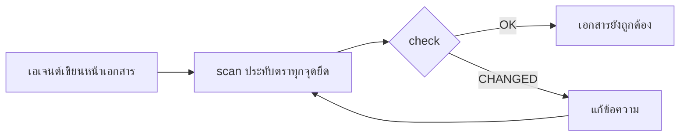

<div align="center">

# DocKeeper

**เอกสารที่ไม่มีวันเน่า**

เอเจนต์เขียนโค้ดของคุณเป็นคนเขียนเอกสาร รวมถึงไดอะแกรมด้วย DocKeeper ผูกทุกข้อความและทุกไดอะแกรมไว้กับโค้ดที่อยู่เบื้องหลัง และบอกคุณทันทีที่โค้ดนั้นเปลี่ยน

[](https://github.com/Nokky21/DocKeeper/actions/workflows/ci.yml)


[](../../LICENSE)

[เว็บไซต์](https://nokky21.github.io/DocKeeper/) · [เดโมสด](https://nokky21.github.io/DocKeeper/#demo) · [ติดตั้ง](#install) · [คู่มืออ้างอิง](../reference.md)

<details>
<summary>🌐 ไทย</summary>

<sub>[English](../../README.md) · [Español](README.es.md) · [Português](README.pt-BR.md) · [Français](README.fr.md) · [Deutsch](README.de.md) · [Italiano](README.it.md) · [Nederlands](README.nl.md) · [Polski](README.pl.md) · [Čeština](README.cs.md) · [Svenska](README.sv.md) · [Русский](README.ru.md) · [Українська](README.uk.md) · [Türkçe](README.tr.md) · [العربية](README.ar.md) · [עברית](README.he.md) · [हिन्दी](README.hi.md) · [简体中文](README.zh-CN.md) · [繁體中文](README.zh-TW.md) · [日本語](README.ja.md) · [한국어](README.ko.md) · [Tiếng Việt](README.vi.md) · [Bahasa Indonesia](README.id.md) · **ไทย**</sub>

</details>

<picture>
  <source media="(prefers-color-scheme: dark)" srcset="../../site/public/assets/readme-hero-dark.png">
  
</picture>

</div>

---

## ทำไม

README ที่เขียนวันนี้ อีกไม่กี่เดือนก็ผิดแล้ว และไม่มีใครรู้ว่าหน้าไหนกำลังโกหก DocKeeper แก้ปัญหา “ไม่มีใครรู้” นี้ ฟรี และบนเครื่องของคุณเอง:

- **ทุกข้อความถูกตรวจสอบ** “การชำระเงินจะถูกตรวจสอบก่อนเรียกเก็บ” จะผูกไว้กับฟังก์ชันที่ทำงานนั้น เมื่อฟังก์ชันนั้นเปลี่ยน DocKeeper จะบอกคุณ
- **ไม่มี AI ในการตรวจสอบ** เอเจนต์ของคุณเป็นคนเขียน ส่วนการตรวจสอบเปรียบเทียบลายนิ้วมือ จึงให้คำตอบเดิมทุกครั้ง
- **ทำงานในเครื่องและฟรี** ไม่ต้องมีบัญชี เซิร์ฟเวอร์ เครือข่าย หรือ dependency ใด ๆ สัญญาอนุญาต MIT

## เขียนอะไรบ้าง

ขอแค่ครั้งเดียว เอเจนต์จะเขียนเอกสารให้ทั้งรีโพทีละหน้า ตามเทมเพลตในสกิล:

<table>
<tr><td><b>README</b></td><td>คืออะไร ทำงานอย่างไร และรันอย่างไร</td></tr>
<tr><td><b>สถาปัตยกรรม</b></td><td>คอมโพเนนต์ โฟลว์ ข้อมูล และขอบเขต พร้อมไดอะแกรม</td></tr>
<tr><td><b>การตัดสินใจ</b></td><td>ตัดสินใจอะไรและทำไม โดยอิงจากประวัติ git เท่านั้น</td></tr>
<tr><td><b>ขั้นตอนการทำงาน</b></td><td>รันบุ๊กพร้อมคำสั่งที่แน่นอน</td></tr>
<tr><td><b>API</b></td><td>ทุกการทำงาน พร้อมอินพุต ข้อผิดพลาด และผลกระทบ</td></tr>
<tr><td><b>การเริ่มงาน</b></td><td>ลำดับการอ่านสำหรับวันแรก</td></tr>
</table>

ใน monorepo จะเขียน README ให้ทุกแพ็กเกจด้วย ทุกข้อความชี้ไปยังโค้ดของมัน ดู[สถาปัตยกรรมของ DocKeeper เอง](../architecture.md) ที่เขียนด้วยสกิลนี้

## ทำงานอย่างไร

<p align="center"></p>

1. **ยึด** ข้าง ๆ แต่ละข้อความ เอเจนต์จะเขียนว่ามันอยู่ตรงไหนในโค้ด: `[[src/payments.py#validate_payment]]` หรือเขียนแบบเดียวกันไว้ในคอมเมนต์ HTML เพื่อให้หน้าดูสะอาด
2. **ประทับตรา** `dockeeper scan` คำนวณลายนิ้วมือของโค้ดเบื้องหลังแต่ละจุดยึด ซึ่งมักจะเป็นทั้งฟังก์ชัน การจัดรูปแบบใหม่ไม่มีผล แต่การเปลี่ยนตรรกะมีผล
   <!-- dockeeper: dockeeper/bloques.py#bloque_en dockeeper/huellas.py#huella -->
3. **ตรวจสอบ** `dockeeper check` ให้คำตัดสินกับทุกข้อความ: `OK`, `MOVED` (โค้ดย้ายที่ และ `dockeeper fix` ตามไปให้เองโดยไม่ต้องมีใครตรวจ) หรือ `CHANGED` (โค้ดเปลี่ยน จึงต้องมีคนอ่านแล้วแก้ข้อความ) ถ้ามี `CHANGED` แม้แต่รายการเดียว คำสั่งจะจบด้วยรหัส 1 และ CI จะล้มเหลว
   <!-- dockeeper: dockeeper/motor.py#verificar_codigo dockeeper/motor.py#FALLOS -->

<p align="center"></p>

<a id="install"></a>

## ติดตั้ง

ต้องมี `python3` (3.10 ขึ้นไป) และ `git` จากนั้นโคลนรีโพสิทอรีไปไว้ในโฟลเดอร์ที่ชื่อ `dockeeper` พอดี:

```bash
# Claude Code
git clone https://github.com/Nokky21/DocKeeper.git ~/.claude/skills/dockeeper

# Codex, Gemini CLI, Cursor, GitHub Copilot
git clone https://github.com/Nokky21/DocKeeper.git ~/.agents/skills/dockeeper
```

โฟลเดอร์อื่น โปรเจกต์เดียว Windows, claude.ai และ API: ดู[คู่มือการติดตั้ง](../install.md)

## วิธีใช้

บอกเอเจนต์ด้วยคำพูดของคุณเอง:

- *“ช่วยเขียนเอกสารให้รีโพนี้ด้วย dockeeper”* ใช้กับ monorepo ได้ด้วย ทีละแพ็กเกจ
- *“ตรวจดูว่าเอกสารของเรายังถูกต้องอยู่ไหม แล้วแก้ส่วนที่ไม่ถูก”*
- *“ช่วยรีวิวเอกสารทุกครั้งที่ commit”* มันจะติดตั้ง git hook ที่ไม่เคยบล็อกการ commit
- *“เขียนหน้าการตัดสินใจจากประวัติ git และอย่าแต่งเหตุผลขึ้นมาเอง”*
- *“วาดสถาปัตยกรรมเป็นโฟลว์ไดอะแกรม”*

หรือรันเองจากโฟลเดอร์รากของโปรเจกต์:

```bash
DK="python3 $HOME/.claude/skills/dockeeper/bin/dockeeper"
$DK audit    # อะไรยังขาด: หน้า แพ็กเกจ โค้ดที่ยังไม่มีเอกสาร
$DK scan     # ประทับตราจุดยึดใหม่ และแสดงโค้ดที่แต่ละจุดชี้ไป
$DK check    # ยังถูกต้องไหม? exit 0 = ใช่, 1 = มีบางอย่างเปลี่ยน
$DK fix      # ตามโค้ดที่ย้ายที่ (แตะแค่ไฟล์ตราประทับ)
$DK review   # commit ล่าสุดมีผลอย่างไรกับเอกสาร
```

<!-- dockeeper: dockeeper/motor.py#arreglar -->

## ทุกครั้งที่ commit

`review` ดู commit ล่าสุด (หรือทั้ง branch ด้วย `--desde main`) แล้วแสดงรายการข้อความที่ได้รับผลกระทบ โค้ดใหม่หรือที่เปลี่ยนซึ่งยังไม่มีข้อความใดครอบคลุม และการตัดสินใจใน commit เหล่านั้นที่ยังไม่ได้เขียนไว้ เมื่อใช้เป็น hook `post-commit` ใครก็ตามที่ commit ไม่ว่าจะเป็นคุณหรือเอเจนต์ จะเห็นรายการนี้ทุกครั้ง และเอกสารก็เติบโตไปพร้อมกับโค้ด:
<!-- dockeeper: dockeeper/revision.py#revisar -->

```sh
#!/bin/sh
python3 "$HOME/.claude/skills/dockeeper/bin/dockeeper" review || true
```

## ไดอะแกรมที่ยังถูกต้องเสมอ

เอเจนต์วาดโฟลว์ ลำดับขั้น สถานะ และข้อมูลด้วย Mermaid ซึ่ง GitHub และ Obsidian แสดงผลเหมือนกัน ทุกไดอะแกรมเก็บจุดยึดไว้ข้างใน บนบรรทัด `%% dockeeper:` ที่ไม่มีใครเห็น ดังนั้น `check` จะแจ้งเตือนเมื่อโค้ดที่ไดอะแกรมแสดงเปลี่ยนไป ไดอะแกรมนี้เป็นของจริง:



## Monorepo

`audit` ค้นหาทุกแพ็กเกจ (โฟลเดอร์ย่อยใดก็ได้ที่มี `package.json`, `go.mod`, `Cargo.toml`, `pyproject.toml`, `pom.xml` เป็นต้น) และบอกว่าแพ็กเกจไหนยังไม่มีเอกสาร เอเจนต์จะเขียนหน้าระดับรากพร้อมแผนที่ของแพ็กเกจ แล้วจึงเขียนเอกสารทีละแพ็กเกจ รีโพใหญ่แค่ไหนก็รับมือได้ <!-- dockeeper: dockeeper/paquetes.py#detectar -->

## ใน CI

```yaml
- uses: actions/checkout@v6
- uses: Nokky21/DocKeeper@v0.3.0
```

CI อื่น ๆ ต้องการแค่ Python และ git: [โคลนแล้วรัน `check`](../reference.md#continuous-integration)

## อ่านเพิ่มเติม

- [คู่มือการติดตั้ง](../install.md): ทุกเอเจนต์ โปรเจกต์เดียว Windows, claude.ai และ API
- [คู่มืออ้างอิง](../reference.md): จุดยึด คำสั่ง คำตัดสิน ขอบเขตบางส่วน เอกสารที่เผยแพร่ “เหตุผล” การตั้งค่า ข้อจำกัด และคำถามที่พบบ่อย
- [สถาปัตยกรรม](../architecture.md): DocKeeper ทำงานภายในอย่างไร ผ่านไดอะแกรมที่มีจุดยึดหกภาพ
- [SKILL.md](../../SKILL.md) คำสั่งที่เอเจนต์ของคุณปฏิบัติตาม และ[ข้อกำหนด](../../SPEC.md) (ทั้งสองเป็นภาษาสเปน)

## สัญญาอนุญาต

[MIT](../../LICENSE).

---

<sub>แปลจาก [README ภาษาอังกฤษ](../../README.md) ซึ่งถือเป็นฉบับอ้างอิงหากมีความต่างกัน คู่มือการติดตั้ง คู่มืออ้างอิง และสถาปัตยกรรมเป็นภาษาอังกฤษ</sub>
