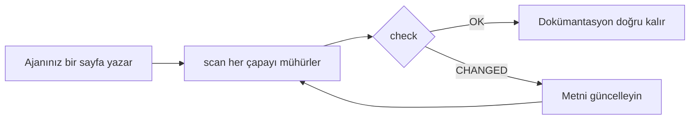

<div align="center">

# DocKeeper

**Çürümeyen dokümantasyon.**

Kodlama ajanınız dokümantasyonu diyagramlarıyla birlikte yazar. DocKeeper her iddiayı ve her diyagramı arkasındaki koda bağlar ve o kod değiştiği anda size haber verir.

[](https://github.com/Nokky21/DocKeeper/actions/workflows/ci.yml)


[](../../LICENSE)

[Web sitesi](https://nokky21.github.io/DocKeeper/) · [Canlı demo](https://nokky21.github.io/DocKeeper/#demo) · [Kurulum](#install) · [Başvuru](../reference.md)

<sub>[English](../../README.md) · [Español](README.es.md) · [Português](README.pt-BR.md) · [Français](README.fr.md) · [Deutsch](README.de.md) · [Italiano](README.it.md) · [Nederlands](README.nl.md) · [Polski](README.pl.md) · [Čeština](README.cs.md) · [Svenska](README.sv.md) · [Русский](README.ru.md) · [Українська](README.uk.md) · **Türkçe** · [العربية](README.ar.md) · [עברית](README.he.md) · [हिन्दी](README.hi.md) · [简体中文](README.zh-CN.md) · [繁體中文](README.zh-TW.md) · [日本語](README.ja.md) · [한국어](README.ko.md) · [Tiếng Việt](README.vi.md) · [Bahasa Indonesia](README.id.md) · [ไทย](README.th.md)</sub>

</div>

---

## Neden

Bugün yazılan bir README birkaç ay sonra yanlıştır ve hangi sayfaların yalan söylediğini kimse bilmez. DocKeeper bu “kimse bilmiyor” kısmını ücretsiz ve kendi makinenizde çözer:

- **Her iddia kontrol edilir.** “Ödemeler tahsil edilmeden önce doğrulanır” cümlesi bunu yapan fonksiyona bağlanır. O fonksiyon değiştiğinde DocKeeper size söyler.
- **Kontrolde yapay zekâ yok.** Ajanınız yazar; kontrol parmak izlerini karşılaştırır, bu yüzden her seferinde aynı cevabı verir.
- **Yerel ve ücretsiz.** Hesap yok, sunucu yok, ağ yok, bağımlılık yok. MIT lisansı.

## Neler yazar

Bir kez isteyin; ajanınız skill’deki şablonlardan yola çıkarak tüm depoyu sayfa sayfa belgelesin:

- **README**: ne olduğu, nasıl çalıştığı, nasıl başlatılacağı.
- **Mimari**: bileşenler, akışlar, veriler ve sınırlar, diyagramlarla.
- **Kararlar**: neyin neden kararlaştırıldığı, yalnızca git geçmişinden.
- **Prosedürler**: tam komutlarıyla runbook’lar.
- **API**: her işlem; girdileri, hataları ve etkileriyle.
- **Oryantasyon**: ilk gün için bir okuma rotası.

Bir monorepoda her paket için ayrıca bir README yazar. Her iddia kendi koduna işaret eder. Skill ile yazılmış [DocKeeper’ın kendi mimarisine](../architecture.md) göz atın.

## Nasıl çalışır

<p align="center"></p>

1. **Sabitle.** Ajan her iddianın yanına kodda nerede durduğunu yazar: `[[src/payments.py#validate_payment]]`; ya da sayfa temiz kalsın diye aynısını bir HTML yorumunun içine.
2. **Mühürle.** `dockeeper scan` her çapanın arkasındaki kodun, genellikle fonksiyonun tamamının, parmak izini alır. Yeniden biçimlendirmek fark etmez; mantığı değiştirmek eder.
   <!-- dockeeper: dockeeper/bloques.py#bloque_en dockeeper/huellas.py#huella -->
3. **Kontrol et.** `dockeeper check` her iddia için bir karar verir: `OK`; `MOVED` (kod yer değiştirdi ve `dockeeper fix` kimsenin incelemesine gerek kalmadan onu takip eder); ya da `CHANGED` (kod değişti, bu yüzden bir insan okur ve metni günceller). Herhangi bir `CHANGED` çıkış kodunu 1 yapar, yani CI başarısız olur.
   <!-- dockeeper: dockeeper/motor.py#verificar_codigo dockeeper/motor.py#FALLOS -->

<p align="center"></p>

<a id="install"></a>

## Kurulum

`python3` (3.10 veya daha yeni) ve `git` gerekir. Depoyu tam olarak `dockeeper` adlı bir klasöre klonlayın:

```bash
# Claude Code
git clone https://github.com/Nokky21/DocKeeper.git ~/.claude/skills/dockeeper

# Codex, Gemini CLI, Cursor, GitHub Copilot
git clone https://github.com/Nokky21/DocKeeper.git ~/.agents/skills/dockeeper
```

Diğer klasörler, tek bir proje, Windows, claude.ai ve API için [kurulum kılavuzuna](../install.md) bakın.

## Kullanım

Ajanınızdan kendi sözlerinizle isteyin:

- *“Bu depoyu dockeeper ile belgele.”* Monorepolar da olur, her seferinde bir paket.
- *“Dokümantasyonumuzun hâlâ doğru olup olmadığını kontrol et ve doğru olmayanı düzelt.”*
- *“Her commit’te dokümantasyonu gözden geçir.”* Hiçbir commit’i engellemeyen bir git hook’u kurar.
- *“Kararlar sayfasını git geçmişinden yaz. Gerekçe uydurma.”*
- *“Mimariyi akış diyagramlarıyla çiz.”*

Ya da projenizin kök klasöründen kendiniz çalıştırın:

```bash
DK="python3 $HOME/.claude/skills/dockeeper/bin/dockeeper"
$DK audit    # eksik olanlar: sayfalar, paketler, belgelenmemiş kod
$DK scan     # yeni çapaları mühürler ve her birinin gösterdiği kodu gösterir
$DK check    # hâlâ doğru mu? çıkış 0 = evet, 1 = bir şey değişti
$DK fix      # yer değiştiren kodu takip eder (yalnızca mühür dosyasına dokunur)
$DK review   # son commit’in dokümantasyon için anlamı
```

<!-- dockeeper: dockeeper/motor.py#arreglar -->

## Her commit’te

`review` son commit’e (ya da `--desde main` ile bütün bir dala) bakar ve dokunduğu iddiaları, henüz hiçbir iddianın kapsamadığı yeni veya değişmiş kodu ve bu commit’lerdeki yazılmamış kararları listeler. Bir `post-commit` hook’u olarak, commit’i kim yaparsa, siz ya da ajanınız, bu listeyi her seferinde görür ve dokümantasyon kodla birlikte büyür:
<!-- dockeeper: dockeeper/revision.py#revisar -->

```sh
#!/bin/sh
python3 "$HOME/.claude/skills/dockeeper/bin/dockeeper" review || true
```

## Doğru kalan diyagramlar

Ajan akışları, dizileri, durumları ve verileri, GitHub ile Obsidian’ın aynı şekilde gösterdiği Mermaid ile çizer. Her diyagram çapalarını içinde, kimsenin görmediği `%% dockeeper:` satırlarında taşır; böylece gösterdiği kod değiştiğinde `check` onu işaretler. Bu diyagram gerçek:



## Monorepolar

`audit` her paketi bulur (`package.json`, `go.mod`, `Cargo.toml`, `pyproject.toml`, `pom.xml` vb. içeren her alt klasör) ve hangilerinin dokümantasyonu olmadığını gösterir. Ajan kök sayfaları paketlerin haritasıyla yazar, sonra paketleri birer birer belgeler; böylece devasa bir depo bile sığar. <!-- dockeeper: dockeeper/paquetes.py#detectar -->

## CI’da

```yaml
- uses: actions/checkout@v6
- uses: Nokky21/DocKeeper@v0.3.0
```

Diğer tüm CI’lar yalnızca Python ve git ister: [klonlayın ve `check` çalıştırın](../reference.md#continuous-integration).

## Daha fazlası

- [Kurulum kılavuzu](../install.md): tüm ajanlar, tek proje, Windows, claude.ai ve API.
- [Başvuru](../reference.md): çapalar, komutlar, kararlar, kısmi kapsam, yayımlanan dokümantasyon, “neden”, yapılandırma, sınırlar ve SSS.
- [Mimari](../architecture.md): DocKeeper’ın içeride nasıl çalıştığı, altı sabitlenmiş diyagramda.
- [SKILL.md](../../SKILL.md), ajanınızın izlediği talimatlar, ve [şartname](../../SPEC.md) (ikisi de İspanyolca).

## Lisans

[MIT](../../LICENSE).

---

<sub>[İngilizce README](../../README.md)’nin çevirisidir; farklılık olursa o esas alınır. Kurulum kılavuzu, başvuru belgesi ve mimari İngilizcedir.</sub>
