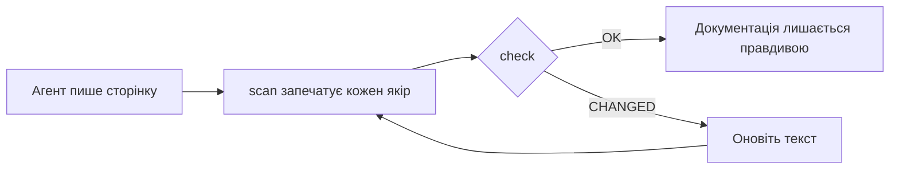

<div align="center">

# DocKeeper

**Документація, яка не застаріває.**

Ваш агент для програмування пише документацію, разом із діаграмами. DocKeeper прив’язує кожне твердження й кожну діаграму до коду, що за ними стоїть, і повідомляє вас, щойно цей код змінюється.

[](https://github.com/Nokky21/DocKeeper/actions/workflows/ci.yml)


[](../../LICENSE)

[Сайт](https://nokky21.github.io/DocKeeper/) · [Живе демо](https://nokky21.github.io/DocKeeper/#demo) · [Встановлення](#install) · [Довідник](../reference.md)

<details>
<summary>🌐 Українська</summary>

<sub>[English](../../README.md) · [Español](README.es.md) · [Português](README.pt-BR.md) · [Français](README.fr.md) · [Deutsch](README.de.md) · [Italiano](README.it.md) · [Nederlands](README.nl.md) · [Polski](README.pl.md) · [Čeština](README.cs.md) · [Svenska](README.sv.md) · [Русский](README.ru.md) · **Українська** · [Türkçe](README.tr.md) · [العربية](README.ar.md) · [עברית](README.he.md) · [हिन्दी](README.hi.md) · [简体中文](README.zh-CN.md) · [繁體中文](README.zh-TW.md) · [日本語](README.ja.md) · [한국어](README.ko.md) · [Tiếng Việt](README.vi.md) · [Bahasa Indonesia](README.id.md) · [ไทย](README.th.md)</sub>

</details>

<picture>
  <source media="(prefers-color-scheme: dark)" srcset="../../site/public/assets/readme-hero-dark.png">
  
</picture>

</div>

---

## Навіщо

README, написаний сьогодні, за кілька місяців уже хибний, і ніхто не знає, які сторінки брешуть. DocKeeper розв’язує проблему «ніхто не знає» — безкоштовно і на вашому комп’ютері:

- **Кожне твердження перевіряється.** «Платежі перевіряються перед списанням» прив’язано до функції, яка це робить. Коли ця функція змінюється, DocKeeper повідомляє про це.
- **Жодного ШІ в перевірці.** Пише ваш агент; перевірка порівнює відбитки, тому завжди дає ту саму відповідь.
- **Локально й безкоштовно.** Без облікового запису, без сервера, без мережі, без залежностей. Ліцензія MIT.

## Що він пише

Попросіть один раз — і агент задокументує весь репозиторій, сторінку за сторінкою, за шаблонами зі скіла:

<table>
<tr><td><b>README</b></td><td>Що це, як працює і як запустити.</td></tr>
<tr><td><b>Архітектура</b></td><td>Компоненти, потоки, дані й межі, з діаграмами.</td></tr>
<tr><td><b>Рішення</b></td><td>Що вирішили і чому — лише з історії git.</td></tr>
<tr><td><b>Процедури</b></td><td>Ранбуки з точними командами.</td></tr>
<tr><td><b>API</b></td><td>Кожна операція з вхідними даними, помилками й ефектами.</td></tr>
<tr><td><b>Онбординг</b></td><td>Маршрут читання на перший день.</td></tr>
</table>

У монорепозиторії він також пише README для кожного пакета. Кожне твердження вказує на свій код. Погляньте на [архітектуру самого DocKeeper](../architecture.md), написану за допомогою скіла.

## Як це працює

<p align="center"></p>

1. **Прив’язати.** Поруч із кожним твердженням агент пише, де воно живе в коді: `[[src/payments.py#validate_payment]]`, або те саме в HTML-коментарі, щоб сторінка лишалася чистою.
2. **Запечатати.** `dockeeper scan` обчислює відбиток коду за кожним якорем — зазвичай усієї функції. Переформатування не має значення; зміна логіки — має.
   <!-- dockeeper: dockeeper/bloques.py#bloque_en dockeeper/huellas.py#huella -->
3. **Перевірити.** `dockeeper check` виносить вердикт кожному твердженню: `OK`; `MOVED` (код перемістився, і `dockeeper fix` іде за ним без жодної перевірки людиною); або `CHANGED` (код змінився, тож людина читає його й оновлює текст). Будь-який `CHANGED` дає код виходу 1, і CI падає.
   <!-- dockeeper: dockeeper/motor.py#verificar_codigo dockeeper/motor.py#FALLOS -->

<p align="center"></p>

<a id="install"></a>

## Встановлення

Потрібні `python3` (3.10 або новіший) і `git`. Клонуйте репозиторій у папку з назвою саме `dockeeper`:

```bash
# Claude Code
git clone https://github.com/Nokky21/DocKeeper.git ~/.claude/skills/dockeeper

# Codex, Gemini CLI, Cursor, GitHub Copilot
git clone https://github.com/Nokky21/DocKeeper.git ~/.agents/skills/dockeeper
```

Інші папки, один проєкт, Windows, claude.ai та API: див. [посібник зі встановлення](../install.md).

## Використання

Попросіть свого агента своїми словами:

- *«Задокументуй цей репозиторій за допомогою dockeeper.»* Монорепозиторії теж, по одному пакету.
- *«Перевір, чи наша документація досі правдива, і виправ те, що ні.»*
- *«Перевіряй документацію під час кожного коміту.»* Він встановить git-хук, який ніколи не блокує коміт.
- *«Напиши сторінку рішень за історією git. Не вигадуй причин.»*
- *«Намалюй архітектуру у вигляді блок-схем.»*

Або запустіть його самі з кореня проєкту:

```bash
DK="python3 $HOME/.claude/skills/dockeeper/bin/dockeeper"
$DK audit    # чого бракує: сторінки, пакети, незадокументований код
$DK scan     # запечатати нові якорі й показати код, на який вказує кожен
$DK check    # досі правда? вихід 0 = так, 1 = щось змінилося
$DK fix      # іти за переміщеним кодом (змінює лише файл печатки)
$DK review   # що останній коміт означає для документації
```

<!-- dockeeper: dockeeper/motor.py#arreglar -->

## Під час кожного коміту

`review` переглядає останній коміт (або цілу гілку, з `--desde main`) і перелічує зачеплені твердження, новий чи змінений код, якого ще не покриває жодне твердження, і рішення з цих комітів, яких ніде не записано. Як хук `post-commit` цей список щоразу бачить той, хто робить коміт, — ви або ваш агент, — і документація росте разом із кодом:
<!-- dockeeper: dockeeper/revision.py#revisar -->

```sh
#!/bin/sh
python3 "$HOME/.claude/skills/dockeeper/bin/dockeeper" review || true
```

## Діаграми, які лишаються правдивими

Агент малює потоки, послідовності, стани й дані в Mermaid, який GitHub і Obsidian показують однаково. Кожна діаграма містить свої якорі всередині, у невидимих рядках `%% dockeeper:`, тож `check` позначає її, коли змінюється код, який вона показує. Ця — справжня:



## Монорепозиторії

`audit` знаходить кожен пакет (будь-яку підпапку з `package.json`, `go.mod`, `Cargo.toml`, `pyproject.toml`, `pom.xml` тощо) і показує, які з них не мають документації. Агент пише сторінки кореня з мапою пакетів, а потім документує по одному пакету, тож вміщується навіть величезний репозиторій. <!-- dockeeper: dockeeper/paquetes.py#detectar -->

## У CI

```yaml
- uses: actions/checkout@v6
- uses: Nokky21/DocKeeper@v0.4.0
```

Будь-якому іншому CI потрібні лише Python і git: [клонуйте й запустіть `check`](../reference.md#continuous-integration).

## Докладніше

- [Посібник зі встановлення](../install.md): усі агенти, один проєкт, Windows, claude.ai та API.
- [Довідник](../reference.md): якорі, команди, вердикти, часткова область, опублікована документація, «чому», налаштування, обмеження та FAQ.
- [Архітектура](../architecture.md): як DocKeeper влаштований усередині, у шести прив’язаних діаграмах.
- [Рішення](../decisions.md), [процедури](../procedures.md), [API `--json`](../api.md) і [онбординг](../onboarding.md): для тих, хто працює над самим DocKeeper.
- [SKILL.md](../../SKILL.md) — інструкції, яких дотримується ваш агент, — і [специфікація](../../SPEC.md) (обидві іспанською).

## Ліцензія

[MIT](../../LICENSE).

---

<sub>Переклад [README англійською](../../README.md); у разі розбіжностей чинним є він. Посібник зі встановлення, довідник і архітектура — англійською.</sub>
