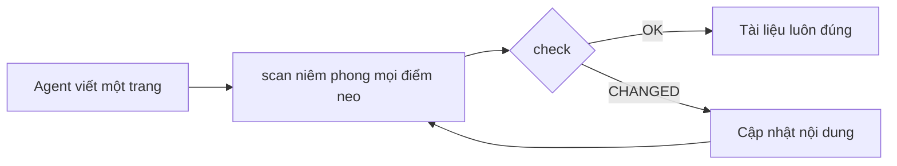

<div align="center">

# DocKeeper

**Tài liệu không bao giờ mục rữa.**

Agent lập trình của bạn viết tài liệu, kể cả sơ đồ. DocKeeper gắn mỗi khẳng định và mỗi sơ đồ với đoạn mã đứng sau chúng và báo cho bạn ngay khi đoạn mã đó thay đổi.

[](https://github.com/Nokky21/DocKeeper/actions/workflows/ci.yml)


[](../../LICENSE)

[Trang web](https://nokky21.github.io/DocKeeper/) · [Demo trực tiếp](https://nokky21.github.io/DocKeeper/#demo) · [Cài đặt](#install) · [Tham khảo](../reference.md)

<details>
<summary>🌐 Tiếng Việt</summary>

<sub>[English](../../README.md) · [Español](README.es.md) · [Português](README.pt-BR.md) · [Français](README.fr.md) · [Deutsch](README.de.md) · [Italiano](README.it.md) · [Nederlands](README.nl.md) · [Polski](README.pl.md) · [Čeština](README.cs.md) · [Svenska](README.sv.md) · [Русский](README.ru.md) · [Українська](README.uk.md) · [Türkçe](README.tr.md) · [العربية](README.ar.md) · [עברית](README.he.md) · [हिन्दी](README.hi.md) · [简体中文](README.zh-CN.md) · [繁體中文](README.zh-TW.md) · [日本語](README.ja.md) · [한국어](README.ko.md) · **Tiếng Việt** · [Bahasa Indonesia](README.id.md) · [ไทย](README.th.md)</sub>

</details>

<picture>
  <source media="(prefers-color-scheme: dark)" srcset="../../site/public/assets/readme-hero-dark.png">
  
</picture>

</div>

---

## Vì sao

Một README viết hôm nay sẽ sai sau vài tháng, và không ai biết trang nào đang nói sai. DocKeeper giải quyết phần “không ai biết” đó, miễn phí và ngay trên máy của bạn:

- **Mọi khẳng định đều được kiểm tra.** “Thanh toán được xác thực trước khi bị trừ tiền” được gắn với hàm thực hiện việc đó. Khi hàm ấy thay đổi, DocKeeper sẽ báo cho bạn.
- **Không dùng AI khi kiểm tra.** Agent của bạn viết; phần kiểm tra so sánh dấu vân tay, nên lần nào cũng cho cùng một câu trả lời.
- **Chạy cục bộ và miễn phí.** Không tài khoản, không máy chủ, không mạng, không phụ thuộc. Giấy phép MIT.

## Nó viết những gì

Chỉ cần nhờ một lần, agent sẽ viết tài liệu cho cả kho mã, từng trang một, dựa trên các mẫu trong skill:

<table>
<tr><td><b>README</b></td><td>Nó là gì, hoạt động ra sao, chạy thế nào.</td></tr>
<tr><td><b>Kiến trúc</b></td><td>Thành phần, luồng, dữ liệu và ranh giới, kèm sơ đồ.</td></tr>
<tr><td><b>Quyết định</b></td><td>Đã quyết định gì và vì sao, chỉ lấy từ lịch sử git.</td></tr>
<tr><td><b>Quy trình</b></td><td>Runbook với lệnh chính xác.</td></tr>
<tr><td><b>API</b></td><td>Mọi thao tác cùng đầu vào, lỗi và tác động.</td></tr>
<tr><td><b>Hướng dẫn nhập môn</b></td><td>Lộ trình đọc cho ngày đầu tiên.</td></tr>
</table>

Với monorepo, nó còn viết một README cho mỗi gói. Mỗi khẳng định đều trỏ tới mã của nó. Xem [kiến trúc của chính DocKeeper](../architecture.md), được viết bằng skill.

## Cách hoạt động

<p align="center"></p>

1. **Neo.** Bên cạnh mỗi khẳng định, agent ghi nó nằm ở đâu trong mã: `[[src/payments.py#validate_payment]]`, hoặc ghi y như vậy trong một chú thích HTML để trang luôn gọn gàng.
2. **Niêm phong.** `dockeeper scan` lấy dấu vân tay của đoạn mã sau mỗi điểm neo, thường là toàn bộ hàm. Định dạng lại thì không sao; đổi logic thì có.
   <!-- dockeeper: dockeeper/bloques.py#bloque_en dockeeper/huellas.py#huella -->
3. **Kiểm tra.** `dockeeper check` đưa ra phán quyết cho từng khẳng định: `OK`; `MOVED` (mã đã dời chỗ, và `dockeeper fix` tự đi theo mà không cần ai xem lại); hoặc `CHANGED` (mã đã thay đổi, nên một người đọc lại và cập nhật nội dung). Chỉ cần một `CHANGED` là lệnh thoát với mã 1, nên CI thất bại.
   <!-- dockeeper: dockeeper/motor.py#verificar_codigo dockeeper/motor.py#FALLOS -->

<p align="center"></p>

<a id="install"></a>

## Cài đặt

Bạn cần `python3` (3.10 trở lên) và `git`. Clone kho mã vào một thư mục có tên chính xác là `dockeeper`:

```bash
# Claude Code
git clone https://github.com/Nokky21/DocKeeper.git ~/.claude/skills/dockeeper

# Codex, Gemini CLI, Cursor, GitHub Copilot
git clone https://github.com/Nokky21/DocKeeper.git ~/.agents/skills/dockeeper
```

Thư mục khác, một dự án riêng, Windows, claude.ai và API: xem [hướng dẫn cài đặt](../install.md).

## Sử dụng

Nhờ agent của bạn bằng lời của chính bạn:

- *“Viết tài liệu cho kho mã này bằng dockeeper.”* Cả monorepo, mỗi lần một gói.
- *“Kiểm tra xem tài liệu của chúng ta còn đúng không và sửa những chỗ sai.”*
- *“Rà soát tài liệu sau mỗi commit.”* Nó cài một git hook không bao giờ chặn commit.
- *“Viết trang quyết định từ lịch sử git. Đừng bịa ra lý do.”*
- *“Vẽ kiến trúc bằng sơ đồ luồng.”*

Hoặc tự chạy từ thư mục gốc của dự án:

```bash
DK="python3 $HOME/.claude/skills/dockeeper/bin/dockeeper"
$DK audit    # còn thiếu gì: trang, gói, mã chưa có tài liệu
$DK scan     # niêm phong điểm neo mới và cho thấy mã mà mỗi điểm neo trỏ tới
$DK check    # còn đúng không? thoát 0 = có, 1 = có gì đó đã thay đổi
$DK fix      # đi theo mã đã dời chỗ (chỉ sửa tệp niêm phong)
$DK review   # commit gần nhất có ý nghĩa gì với tài liệu
```

<!-- dockeeper: dockeeper/motor.py#arreglar -->

## Sau mỗi commit

`review` xem commit gần nhất (hoặc cả một nhánh, với `--desde main`) và liệt kê các khẳng định bị ảnh hưởng, phần mã mới hoặc đã đổi mà chưa khẳng định nào bao quát, cùng các quyết định trong những commit đó chưa được ghi lại. Khi dùng làm hook `post-commit`, người commit, dù là bạn hay agent, đều thấy danh sách này mỗi lần, và tài liệu lớn lên cùng với mã:
<!-- dockeeper: dockeeper/revision.py#revisar -->

```sh
#!/bin/sh
python3 "$HOME/.claude/skills/dockeeper/bin/dockeeper" review || true
```

## Sơ đồ luôn đúng

Agent vẽ luồng, trình tự, trạng thái và dữ liệu bằng Mermaid, thứ mà GitHub và Obsidian hiển thị giống nhau. Mỗi sơ đồ mang điểm neo bên trong, trên các dòng `%% dockeeper:` mà không ai thấy, nên `check` sẽ đánh dấu nó khi đoạn mã nó thể hiện thay đổi. Sơ đồ này là thật:



## Monorepo

`audit` tìm mọi gói (bất kỳ thư mục con nào có `package.json`, `go.mod`, `Cargo.toml`, `pyproject.toml`, `pom.xml`, v.v.) và cho biết gói nào chưa có tài liệu. Agent viết các trang ở thư mục gốc kèm bản đồ các gói, rồi viết tài liệu cho từng gói một, nên kho mã khổng lồ cũng xử lý được. <!-- dockeeper: dockeeper/paquetes.py#detectar -->

## Trong CI

```yaml
- uses: actions/checkout@v6
- uses: Nokky21/DocKeeper@v0.4.0
```

Mọi hệ thống CI khác chỉ cần Python và git: [clone về và chạy `check`](../reference.md#continuous-integration).

## Tìm hiểu thêm

- [Hướng dẫn cài đặt](../install.md): mọi agent, một dự án riêng, Windows, claude.ai và API.
- [Tham khảo](../reference.md): điểm neo, lệnh, phán quyết, phạm vi một phần, tài liệu công khai, phần “vì sao”, cấu hình, giới hạn và câu hỏi thường gặp.
- [Kiến trúc](../architecture.md): DocKeeper hoạt động bên trong ra sao, qua sáu sơ đồ có neo.
- [Quyết định](../decisions.md), [quy trình](../procedures.md), [API `--json`](../api.md) và [hướng dẫn nhập môn](../onboarding.md): cho người phát triển chính DocKeeper.
- [SKILL.md](../../SKILL.md), các chỉ dẫn mà agent của bạn làm theo, và [đặc tả](../../SPEC.md) (cả hai bằng tiếng Tây Ban Nha).

## Giấy phép

[MIT](../../LICENSE).

---

<sub>Bản dịch của [README tiếng Anh](../../README.md); nếu có khác biệt thì bản tiếng Anh là chuẩn. Hướng dẫn cài đặt, tài liệu tham khảo và kiến trúc bằng tiếng Anh.</sub>
