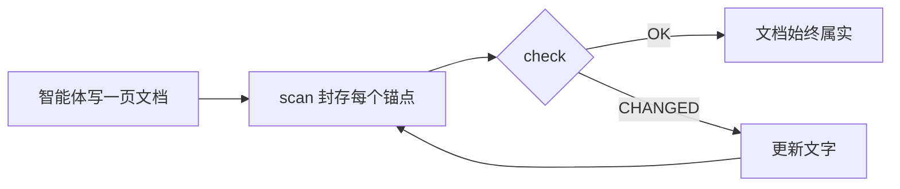

<div align="center">

# DocKeeper

**不会腐烂的文档。**

你的编程智能体负责写文档，图表也包括在内。DocKeeper 把每一条陈述、每一张图都绑定到背后的代码上，代码一变就立刻告诉你。

[](https://github.com/Nokky21/DocKeeper/actions/workflows/ci.yml)


[](../../LICENSE)

[官网](https://nokky21.github.io/DocKeeper/) · [在线演示](https://nokky21.github.io/DocKeeper/#demo) · [安装](#install) · [参考手册](../reference.md)

<details>
<summary>🌐 简体中文</summary>

<sub>[English](../../README.md) · [Español](README.es.md) · [Português](README.pt-BR.md) · [Français](README.fr.md) · [Deutsch](README.de.md) · [Italiano](README.it.md) · [Nederlands](README.nl.md) · [Polski](README.pl.md) · [Čeština](README.cs.md) · [Svenska](README.sv.md) · [Русский](README.ru.md) · [Українська](README.uk.md) · [Türkçe](README.tr.md) · [العربية](README.ar.md) · [עברית](README.he.md) · [हिन्दी](README.hi.md) · **简体中文** · [繁體中文](README.zh-TW.md) · [日本語](README.ja.md) · [한국어](README.ko.md) · [Tiếng Việt](README.vi.md) · [Bahasa Indonesia](README.id.md) · [ไทย](README.th.md)</sub>

</details>

<picture>
  <source media="(prefers-color-scheme: dark)" srcset="../../site/public/assets/readme-hero-dark.png">
  
</picture>

</div>

---

## 为什么

今天写的 README，几个月后就不对了，而且没人知道哪些页面在说谎。DocKeeper 解决的正是“没人知道”这一部分，免费，并且在你自己的机器上运行：

- **每条陈述都会被检查。** “付款在扣款前会先校验”这句话会绑定到实现它的函数上。这个函数一变，DocKeeper 就会告诉你。
- **检查过程不用 AI。** 智能体负责写，检查只比较指纹，所以每次给出的答案都一样。
- **本地且免费。** 无需账号、服务器或网络，零依赖。MIT 许可证。

## 它会写什么

只要说一次，智能体就会按照 skill 里的模板，一页一页地为整个仓库写好文档：

<table>
<tr><td><b>README</b></td><td>是什么、怎么工作、怎么运行。</td></tr>
<tr><td><b>架构</b></td><td>组件、流程、数据和边界，配有图表。</td></tr>
<tr><td><b>决策</b></td><td>决定了什么、为什么，只取自 git 历史。</td></tr>
<tr><td><b>操作手册</b></td><td>带有确切命令的运行手册。</td></tr>
<tr><td><b>API</b></td><td>每个操作的输入、错误和副作用。</td></tr>
<tr><td><b>入职指南</b></td><td>第一天的阅读路线。</td></tr>
</table>

在 monorepo 中，它还会为每个包写一份 README。每条陈述都指向对应的代码。看看用这个 skill 写成的[DocKeeper 自己的架构文档](../architecture.md)。

## 工作原理

<p align="center"></p>

1. **锚定。** 智能体在每条陈述旁边写上它在代码中的位置：`[[src/payments.py#validate_payment]]`；也可以写在 HTML 注释里，让页面保持干净。
2. **封存。** `dockeeper scan` 为每个锚点背后的代码（通常是整个函数）计算指纹。重新排版不受影响；改了逻辑才算。
   <!-- dockeeper: dockeeper/bloques.py#bloque_en dockeeper/huellas.py#huella -->
3. **检查。** `dockeeper check` 给每条陈述一个结论：`OK`；`MOVED`（代码挪了位置，`dockeeper fix` 会自动跟上，无需人工审阅）；或 `CHANGED`（代码变了，需要有人读一遍并更新文字）。只要有一个 `CHANGED`，退出码就是 1，CI 随之失败。
   <!-- dockeeper: dockeeper/motor.py#verificar_codigo dockeeper/motor.py#FALLOS -->

<p align="center"></p>

<a id="install"></a>

## 安装

需要 `python3`（3.10 或更高版本）和 `git`。把仓库克隆到一个名字恰好为 `dockeeper` 的文件夹：

```bash
# Claude Code
git clone https://github.com/Nokky21/DocKeeper.git ~/.claude/skills/dockeeper

# Codex, Gemini CLI, Cursor, GitHub Copilot
git clone https://github.com/Nokky21/DocKeeper.git ~/.agents/skills/dockeeper
```

其他目录、单个项目、Windows、claude.ai 和 API：请看[安装指南](../install.md)。

## 使用

用你自己的话告诉智能体：

- *“用 dockeeper 给这个仓库写文档。”* monorepo 也可以，一次一个包。
- *“检查我们的文档是否仍然属实，把不对的改掉。”*
- *“每次提交时都检查一下文档。”* 它会安装一个永远不会阻止提交的 git hook。
- *“根据 git 历史写决策页面，不要编造理由。”*
- *“用流程图画出架构。”*

或者在项目根目录自己运行：

```bash
DK="python3 $HOME/.claude/skills/dockeeper/bin/dockeeper"
$DK audit    # 缺什么：页面、包、没有文档的代码
$DK scan     # 封存新锚点，并显示每个锚点指向的代码
$DK check    # 还属实吗？退出码 0 = 是，1 = 有变化
$DK fix      # 跟上挪了位置的代码（只改动封存文件）
$DK review   # 最近一次提交对文档意味着什么
```

<!-- dockeeper: dockeeper/motor.py#arreglar -->

## 每次提交时

`review` 查看最近一次提交（或用 `--desde main` 查看整个分支），列出它涉及的陈述、还没有任何陈述覆盖的新代码或改动代码，以及这些提交中尚未写下来的决策。作为 `post-commit` hook，无论是你还是你的智能体提交，每次都会看到这份清单，文档就这样随代码一起成长：
<!-- dockeeper: dockeeper/revision.py#revisar -->

```sh
#!/bin/sh
python3 "$HOME/.claude/skills/dockeeper/bin/dockeeper" review || true
```

## 始终属实的图表

智能体用 Mermaid 画流程、时序、状态和数据，GitHub 和 Obsidian 的渲染效果一样。每张图都在内部带着自己的锚点，写在谁也看不到的 `%% dockeeper:` 行里，所以图中展示的代码一变，`check` 就会把它标出来。下面这张就是真的：



## Monorepo

`audit` 会找出每一个包（任何含有 `package.json`、`go.mod`、`Cargo.toml`、`pyproject.toml`、`pom.xml` 等文件的子目录），并指出哪些还没有文档。智能体先写根目录的页面和包的地图，再一次只给一个包写文档，所以再大的仓库也装得下。 <!-- dockeeper: dockeeper/paquetes.py#detectar -->

## 在 CI 中

```yaml
- uses: actions/checkout@v6
- uses: Nokky21/DocKeeper@v0.4.0
```

其他任何 CI 只需要 Python 和 git：[克隆后运行 `check`](../reference.md#continuous-integration)。

## 了解更多

- [安装指南](../install.md)：所有智能体、单个项目、Windows、claude.ai 和 API。
- [参考手册](../reference.md)：锚点、命令、结论、部分范围、对外发布的文档、“为什么”、配置、限制和常见问题。
- [架构](../architecture.md)：DocKeeper 的内部原理，用六张带锚点的图表说明。
- [SKILL.md](../../SKILL.md)（智能体遵循的指令）和[规格说明](../../SPEC.md)（二者均为西班牙语）。

## 许可证

[MIT](../../LICENSE).

---

<sub>本文译自[英文 README](../../README.md)，如有出入以英文版为准。安装指南、参考手册和架构文档为英文。</sub>
