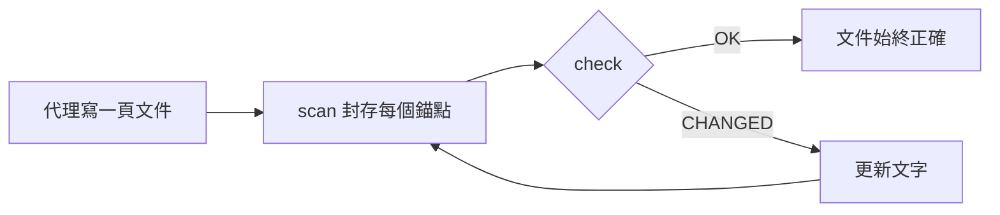

<div align="center">

# DocKeeper

**不會腐爛的文件。**

你的程式設計代理負責寫文件，圖表也包含在內。DocKeeper 把每一項陳述、每一張圖都綁定到背後的程式碼，程式碼一改就立刻通知你。

[](https://github.com/Nokky21/DocKeeper/actions/workflows/ci.yml)


[](../../LICENSE)

[官網](https://nokky21.github.io/DocKeeper/) · [線上展示](https://nokky21.github.io/DocKeeper/#demo) · [安裝](#install) · [參考手冊](../reference.md)

<sub>[English](../../README.md) · [Español](README.es.md) · [Português](README.pt-BR.md) · [Français](README.fr.md) · [Deutsch](README.de.md) · [Italiano](README.it.md) · [Nederlands](README.nl.md) · [Polski](README.pl.md) · [Čeština](README.cs.md) · [Svenska](README.sv.md) · [Русский](README.ru.md) · [Українська](README.uk.md) · [Türkçe](README.tr.md) · [العربية](README.ar.md) · [עברית](README.he.md) · [हिन्दी](README.hi.md) · [简体中文](README.zh-CN.md) · **繁體中文** · [日本語](README.ja.md) · [한국어](README.ko.md) · [Tiếng Việt](README.vi.md) · [Bahasa Indonesia](README.id.md) · [ไทย](README.th.md)</sub>

</div>

---

## 為什麼

今天寫的 README，幾個月後就不對了，而且沒人知道哪些頁面在說謊。DocKeeper 解決的正是「沒人知道」這部分，免費，並且在你自己的電腦上執行：

- **每項陳述都會被檢查。** 「付款在扣款前會先驗證」這句話會綁定到實作它的函式。這個函式一改，DocKeeper 就會告訴你。
- **檢查過程不用 AI。** 代理負責寫，檢查只比對指紋，所以每次給出的答案都一樣。
- **本機執行且免費。** 不需要帳號、伺服器或網路，零相依。MIT 授權。

## 它會寫什麼

只要說一次，代理就會依照 skill 裡的範本，一頁一頁為整個儲存庫寫好文件：

- **README**：是什麼、如何運作、怎麼執行。
- **架構**：元件、流程、資料和邊界，附上圖表。
- **決策**：決定了什麼、為什麼，只取自 git 歷史。
- **作業程序**：附有確切指令的操作手冊。
- **API**：每個操作的輸入、錯誤與影響。
- **新人導覽**：第一天的閱讀路線。

在 monorepo 中，它還會為每個套件寫一份 README。每項陳述都指向對應的程式碼。看看用這個 skill 寫成的[DocKeeper 自己的架構文件](../architecture.md)。

## 運作方式

<p align="center"></p>

1. **錨定。** 代理在每項陳述旁寫上它在程式碼中的位置：`[[src/payments.py#validate_payment]]`；也可以寫在 HTML 註解裡，讓頁面保持乾淨。
2. **封存。** `dockeeper scan` 為每個錨點背後的程式碼（通常是整個函式）計算指紋。重新排版不受影響；改了邏輯才算。
   <!-- dockeeper: dockeeper/bloques.py#bloque_en dockeeper/huellas.py#huella -->
3. **檢查。** `dockeeper check` 給每項陳述一個結論：`OK`；`MOVED`（程式碼換了位置，`dockeeper fix` 會自動跟上，不需要人工審閱）；或 `CHANGED`（程式碼改了，需要有人讀過並更新文字）。只要有一個 `CHANGED`，結束碼就是 1，CI 隨之失敗。
   <!-- dockeeper: dockeeper/motor.py#verificar_codigo dockeeper/motor.py#FALLOS -->

<p align="center"></p>

<a id="install"></a>

## 安裝

需要 `python3`（3.10 或更新版本）和 `git`。把儲存庫複製到名稱恰好為 `dockeeper` 的資料夾：

```bash
# Claude Code
git clone https://github.com/Nokky21/DocKeeper.git ~/.claude/skills/dockeeper

# Codex, Gemini CLI, Cursor, GitHub Copilot
git clone https://github.com/Nokky21/DocKeeper.git ~/.agents/skills/dockeeper
```

其他資料夾、單一專案、Windows、claude.ai 和 API：請看[安裝指南](../install.md)。

## 使用

用你自己的話告訴代理：

- *「用 dockeeper 為這個儲存庫寫文件。」* monorepo 也行，一次一個套件。
- *「檢查我們的文件是否仍然正確，把不對的地方改掉。」*
- *「每次 commit 都檢查一下文件。」* 它會安裝一個永遠不會擋下 commit 的 git hook。
- *「根據 git 歷史寫決策頁面，不要捏造理由。」*
- *「用流程圖畫出架構。」*

或者在專案根目錄自己執行：

```bash
DK="python3 $HOME/.claude/skills/dockeeper/bin/dockeeper"
$DK audit    # 缺什麼：頁面、套件、沒有文件的程式碼
$DK scan     # 封存新錨點，並顯示每個錨點指向的程式碼
$DK check    # 還正確嗎？結束碼 0 = 是，1 = 有變動
$DK fix      # 跟上換了位置的程式碼（只改動封存檔）
$DK review   # 最近一次 commit 對文件代表什麼
```

<!-- dockeeper: dockeeper/motor.py#arreglar -->

## 每次 commit 時

`review` 檢視最近一次 commit（或用 `--desde main` 檢視整個分支），列出它影響到的陳述、還沒有任何陳述涵蓋的新增或修改程式碼，以及這些 commit 中尚未寫下的決策。作為 `post-commit` hook，無論是你還是你的代理 commit，每次都會看到這份清單，文件就這樣隨程式碼一起成長：
<!-- dockeeper: dockeeper/revision.py#revisar -->

```sh
#!/bin/sh
python3 "$HOME/.claude/skills/dockeeper/bin/dockeeper" review || true
```

## 始終正確的圖表

代理用 Mermaid 畫出流程、時序、狀態和資料，GitHub 與 Obsidian 的呈現方式相同。每張圖都在內部帶著自己的錨點，寫在沒人看得到的 `%% dockeeper:` 行裡，所以圖中呈現的程式碼一改，`check` 就會把它標出來。下面這張是真的：



## Monorepo

`audit` 會找出每個套件（任何含有 `package.json`、`go.mod`、`Cargo.toml`、`pyproject.toml`、`pom.xml` 等檔案的子資料夾），並指出哪些還沒有文件。代理先寫根目錄的頁面和套件地圖，再一次只為一個套件寫文件，所以再大的儲存庫也容得下。 <!-- dockeeper: dockeeper/paquetes.py#detectar -->

## 在 CI 中

```yaml
- uses: actions/checkout@v6
- uses: Nokky21/DocKeeper@v0.2.0
```

其他任何 CI 只需要 Python 和 git：[複製後執行 `check`](../reference.md#continuous-integration)。

## 延伸閱讀

- [安裝指南](../install.md)：所有代理、單一專案、Windows、claude.ai 和 API。
- [參考手冊](../reference.md)：錨點、指令、結論、部分範圍、對外發布的文件、「為什麼」、設定、限制和常見問題。
- [架構](../architecture.md)：DocKeeper 的內部運作，用六張帶錨點的圖表說明。
- [SKILL.md](../../SKILL.md)（代理遵循的指示）和[規格說明](../../SPEC.md)（兩者皆為西班牙文）。

## 授權

[MIT](../../LICENSE).

---

<sub>本文譯自[英文 README](../../README.md)，如有出入以英文版為準。安裝指南、參考手冊和架構文件為英文。</sub>
