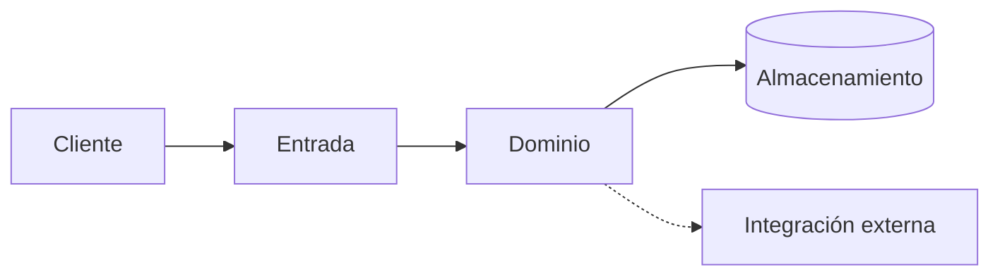
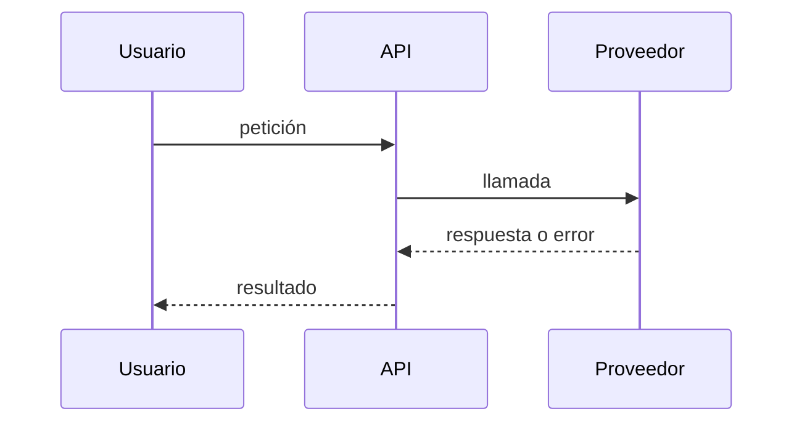
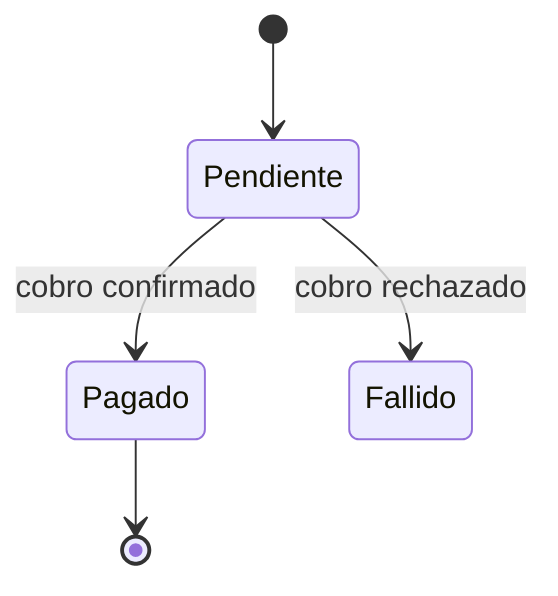

<!--
Plantilla DocKeeper · ARQUITECTURA
Para quién: quien va a cambiar el código y necesita el mapa antes de tocarlo.
Reglas: cada componente, frontera y flujo con su ancla. Si una afirmación no puede anclarse
(p. ej., «esto escala bien»), o se demuestra con un ancla o se quita.
Borra este comentario al rellenar.
-->

# Arquitectura

## Vista general

Qué piezas hay y cómo se hablan, en un párrafo, y su diagrama. Cada nodo existe en el código; las
líneas `%% dockeeper:` lo anclan (no se ven en Obsidian ni en GitHub).

## Componentes

### Nombre del componente

- **Responsabilidad:** una frase. [[ruta/al/modulo.ext#Simbolo]]
- **Entradas y salidas:** qué recibe y qué devuelve. [[ruta/al/modulo.ext#Simbolo]]
- **Depende de:** otros componentes o servicios. [[ruta/al/modulo.ext:N]]
- **Invariantes:** lo que nunca debe romperse y dónde se garantiza. [[ruta/al/modulo.ext#Simbolo]]

(Repite por componente.)

## Flujos principales

### Nombre del flujo

Paso a paso, un ancla por paso. Incluye qué pasa cuando falla (reintentos, compensaciones, errores
que ve el usuario). Si intervienen varias piezas, su secuencia:

> [!WARNING]
> Lo que puede salir mal en este flujo y cómo se nota.

## Datos

Modelos o tablas principales, quién los escribe y quién los lee, con ancla a su definición. Si una
entidad pasa por estados, dibújalos:

## Fronteras y seguridad

Dónde se autentica, dónde se autoriza, qué se valida en la entrada y qué datos sensibles existen,
con ancla a cada control.

## Lo que no está claro

Zonas sin dueño, deuda conocida, comportamientos sin explicación. «No consta» es una respuesta válida.
